# Patrones estructurales

## ¿Qué son los patrones estructurales?

Los patrones estructurales resuelven un problema de fondo distinto al de los creacionales: **cómo combinar clases y objetos en estructuras más grandes sin que el conjunto se vuelva rígido, frágil o difícil de cambiar**. No se ocupan de crear objetos, sino de **organizar las relaciones** entre ellos (envolver, agrupar, compartir, delegar) para que cada parte siga siendo simple aunque el sistema crezca.

En este bloque vemos los siete patrones estructurales clásicos del catálogo GoF (Gang of Four):

1. **Adapter**: hace que dos interfaces incompatibles puedan trabajar juntas.
2. **Bridge**: separa una abstracción de su implementación para que ambas evolucionen por separado.
3. **Composite**: trata objetos individuales y grupos de objetos de la misma manera, formando árboles.
4. **Decorator**: agrega comportamiento a un objeto envolviéndolo, sin modificar su clase.
5. **Facade**: ofrece una interfaz simple a un subsistema complejo.
6. **Flyweight**: ahorra memoria compartiendo el estado común entre muchos objetos.
7. **Proxy**: coloca un sustituto delante de un objeto para controlar el acceso a él.

Una pista para no confundirlos: casi todos **envuelven** a otro objeto (Adapter, Decorator, Facade, Proxy), pero lo hacen con **intenciones distintas**. Lo que cambia entre ellos no es la mecánica, sino el problema que cada uno resuelve.

---

## 1. Adapter

### Descripción

Permite que objetos con **interfaces incompatibles** colaboren. El adaptador actúa como traductor: recibe las llamadas en el formato que el cliente espera y las convierte al formato que entiende la otra clase.

### Estructura general

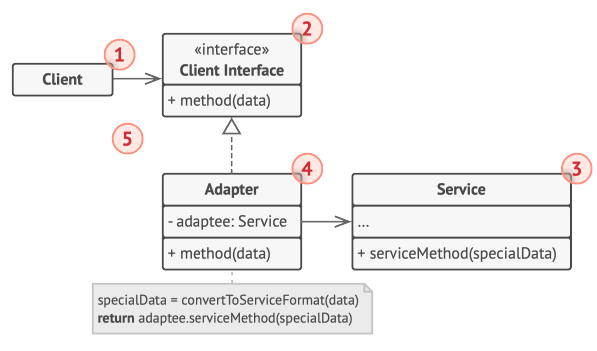

**Qué representa cada número de la figura (variante de adaptador de objetos, la que se usa en Java):**

1. **Cliente**: la clase con la lógica de negocio que ya existe en el programa.
2. **Interfaz con el cliente**: el contrato que las demás clases deben cumplir para poder colaborar con el cliente.
3. **Servicio**: una clase útil (normalmente de un tercero o heredada) que el cliente no puede usar directamente porque su interfaz es incompatible.
4. **Adaptador**: implementa la interfaz con el cliente y, por dentro, envuelve al servicio. Recibe las llamadas del cliente y las traduce a llamadas al servicio en un formato que éste comprenda.
5. El cliente nunca se acopla al adaptador concreto, solo a la interfaz. Por eso se pueden introducir nuevos adaptadores (por ejemplo, si el servicio cambia o se reemplaza) sin tocar el código cliente.

*(El libro describe también una variante "adaptador de clases" que usa herencia múltiple; no es posible en Java, por eso aquí usamos solo la de objetos.)*

---

### El problema

Tu tienda en línea ya funciona con una interfaz `ProcesadorPagos` (`pagar(double montoPesos)`). Ahora la empresa contrata una pasarela de pago antigua, `PasarelaLegada`, que trabaja en **centavos**, exige el **código de moneda** y devuelve un **texto** (`"OK-..."`) en lugar de un `boolean`. No puedes modificar esa clase (es de un tercero), y tampoco quieres reescribir la `Tienda` para que conozca los detalles de cada proveedor.

### La solución

Se crea una clase `AdaptadorPasarelaLegada` que implementa `ProcesadorPagos` (lo que la `Tienda` espera) y guarda una referencia a la `PasarelaLegada`. Cuando la tienda llama a `pagar(pesos)`, el adaptador convierte pesos a centavos, agrega la moneda, llama a la clase legada e interpreta la respuesta como `boolean`.

### Estructura de la solución

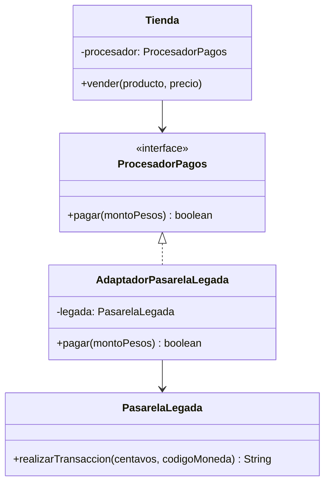

### Código para probar

```java
// ProcesadorPagos.java
// Interfaz que el codigo cliente (Tienda) ya conoce y usa.
public interface ProcesadorPagos {
    boolean pagar(double montoPesos);
}
```

```java
// PasarelaLegada.java
// Clase de un tercero (o heredada). No podemos modificarla.
// Su interfaz es incompatible: trabaja en centavos y exige el codigo de moneda.
public class PasarelaLegada {

    public String realizarTransaccion(long centavos, String codigoMoneda) {
        System.out.println("[Legada] Cobrando " + centavos + " centavos en " + codigoMoneda);
        return "OK-" + centavos;
    }
}
```

```java
// AdaptadorPasarelaLegada.java
// Adaptador: implementa la interfaz que espera el cliente
// y por dentro traduce cada llamada al formato de la clase legada.
public class AdaptadorPasarelaLegada implements ProcesadorPagos {

    private final PasarelaLegada legada;

    public AdaptadorPasarelaLegada(PasarelaLegada legada) {
        this.legada = legada;
    }

    @Override
    public boolean pagar(double montoPesos) {
        long centavos = Math.round(montoPesos * 100);              // pesos -> centavos
        String respuesta = legada.realizarTransaccion(centavos, "COP");
        return respuesta.startsWith("OK");                          // texto -> boolean
    }
}
```

```java
// Tienda.java
// Cliente: contiene la logica de negocio y solo conoce ProcesadorPagos.
public class Tienda {

    private final ProcesadorPagos procesador;

    public Tienda(ProcesadorPagos procesador) {
        this.procesador = procesador;
    }

    public void vender(String producto, double precio) {
        boolean ok = procesador.pagar(precio);
        System.out.println("Venta de " + producto + ": " + (ok ? "exitosa" : "fallida"));
    }
}
```

```java
// App.java
public class App {
    public static void main(String[] args) {
        PasarelaLegada legada = new PasarelaLegada();
        ProcesadorPagos adaptador = new AdaptadorPasarelaLegada(legada);

        Tienda tienda = new Tienda(adaptador);   // la Tienda no sabe que hay una clase legada detras
        tienda.vender("Teclado", 85000.50);
    }
}
```

Salida esperada:

```
[Legada] Cobrando 8500050 centavos en COP
Venta de Teclado: exitosa
```

Observa que 85000.50 pesos llegan a la clase legada como 8500050 centavos: la conversión ocurre dentro del adaptador y la `Tienda` nunca se entera.

### Cuándo usarlo y cuándo no

**Úsalo cuando** quieras reutilizar una clase existente (de un tercero, legada, o que no puedes modificar) cuya interfaz no coincide con la que necesita tu código, o cuando quieras aislar al sistema de los detalles de una biblioteca externa.

**Evítalo cuando** tengas control sobre ambas clases y puedas simplemente cambiar una de ellas para que coincida con la otra: un adaptador de más es una capa extra sin necesidad.

---

## 2. Bridge

### Descripción

Divide una clase grande (o un conjunto de clases muy relacionadas) en **dos jerarquías independientes**: la **abstracción** y la **implementación**, que pueden desarrollarse por separado. La abstracción contiene una referencia a la implementación: ese vínculo es el "puente".

### Estructura general

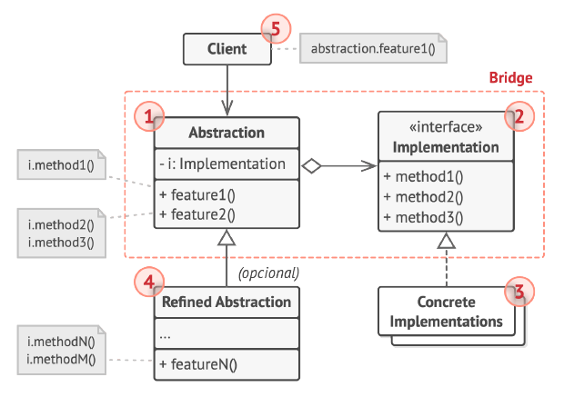

**Qué representa cada número de la figura:**

1. **Abstracción**: ofrece la lógica de control de alto nivel. Depende de un objeto de implementación para hacer el trabajo de bajo nivel.
2. **Implementación**: declara la interfaz común a todas las implementaciones concretas. La abstracción solo puede comunicarse con la implementación a través de los métodos declarados aquí (suelen ser operaciones simples, mientras la abstracción declara otras más complejas que las combinan).
3. **Implementaciones concretas**: contienen el código específico de cada plataforma o variante.
4. **Abstracciones refinadas**: variantes de la lógica de control. Como su clase padre, trabajan con cualquier implementación a través de la interfaz general.
5. **Cliente**: normalmente solo le interesa la abstracción, pero es quien debe vincular un objeto de abstracción con uno de implementación.

---

### El problema

Tu sistema envía notificaciones. Tienes dos *tipos* (normal y urgente) y tres *canales* (correo, SMS y push). Si lo resuelves con herencia, necesitas una clase por cada combinación: `NotificacionNormalEmail`, `NotificacionNormalSms`, `NotificacionUrgentePush`... Con 2 tipos y 3 canales son 6 clases; si mañana agregas un canal (WhatsApp) debes escribir 2 clases nuevas, y si agregas un tipo (Informativa), 3 más. La jerarquía crece **multiplicándose** en dos dimensiones.

### La solución

Se separan las dos dimensiones: una jerarquía para **qué** se notifica (`Notificacion`, `NotificacionNormal`, `NotificacionUrgente`) y otra para **cómo** se entrega (`Canal`, `CanalEmail`, `CanalSms`, `CanalPush`). La notificación guarda una referencia a un `Canal` y le delega el envío. Ahora los tipos y los canales **se suman, no se multiplican**: 2 + 3 = 5 clases, y se combinan libremente al construir el objeto.

### Estructura de la solución

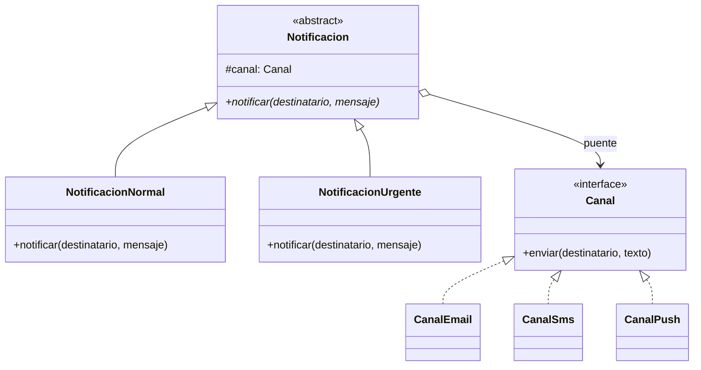

### Código para probar

```java
// Canal.java
// IMPLEMENTACION: define las operaciones de bajo nivel (como se entrega un mensaje).
public interface Canal {
    void enviar(String destinatario, String texto);
}
```

```java
// CanalEmail.java
public class CanalEmail implements Canal {
    @Override
    public void enviar(String destinatario, String texto) {
        System.out.println("[Email a " + destinatario + "] " + texto);
    }
}
```

```java
// CanalSms.java
public class CanalSms implements Canal {
    @Override
    public void enviar(String destinatario, String texto) {
        System.out.println("[SMS a " + destinatario + "] " + texto);
    }
}
```

```java
// CanalPush.java
public class CanalPush implements Canal {
    @Override
    public void enviar(String destinatario, String texto) {
        System.out.println("[Push a " + destinatario + "] " + texto);
    }
}
```

```java
// Notificacion.java
// ABSTRACCION: logica de alto nivel. Delega el trabajo real en el Canal (el "puente").
public abstract class Notificacion {

    protected final Canal canal;

    protected Notificacion(Canal canal) {
        this.canal = canal;
    }

    public abstract void notificar(String destinatario, String mensaje);
}
```

```java
// NotificacionNormal.java
public class NotificacionNormal extends Notificacion {

    public NotificacionNormal(Canal canal) {
        super(canal);
    }

    @Override
    public void notificar(String destinatario, String mensaje) {
        canal.enviar(destinatario, mensaje);
    }
}
```

```java
// NotificacionUrgente.java
// ABSTRACCION REFINADA: cambia la logica de alto nivel, sin importar el canal.
public class NotificacionUrgente extends Notificacion {

    public NotificacionUrgente(Canal canal) {
        super(canal);
    }

    @Override
    public void notificar(String destinatario, String mensaje) {
        canal.enviar(destinatario, "[URGENTE] " + mensaje.toUpperCase());
    }
}
```

```java
// App.java
public class App {
    public static void main(String[] args) {
        // El cliente vincula una abstraccion con una implementacion al construirla.
        Notificacion a = new NotificacionNormal(new CanalEmail());
        Notificacion b = new NotificacionUrgente(new CanalSms());
        Notificacion c = new NotificacionUrgente(new CanalPush());

        a.notificar("ana@correo.com", "Tu pedido fue enviado");
        b.notificar("3001234567", "Pago rechazado");
        c.notificar("usuario-42", "Cuenta bloqueada");
    }
}
```

Salida esperada:

```
[Email a ana@correo.com] Tu pedido fue enviado
[SMS a 3001234567] [URGENTE] PAGO RECHAZADO
[Push a usuario-42] [URGENTE] CUENTA BLOQUEADA
```

Para probar la extensibilidad: crea `CanalWhatsApp implements Canal` y úsalo con cualquiera de las dos notificaciones **sin modificar ninguna clase existente**.

### Cuándo usarlo y cuándo no

**Úsalo cuando** una clase crece en dos dimensiones independientes (tipo y plataforma, forma y color, dispositivo y control remoto) y quieras evitar la explosión de subclases, o cuando quieras cambiar la implementación en tiempo de ejecución.

**Evítalo cuando** solo haya una dimensión de variación o la clase sea cohesiva y pequeña: dividirla en dos jerarquías añadiría complejidad sin ganancia. Es un patrón que se aplica **de entrada, al diseñar**, no para arreglar un código que ya funciona.

---

## 3. Composite

### Descripción

Permite componer objetos en **estructuras de árbol** y trabajar con ellas como si fueran objetos individuales. Un grupo y un elemento simple se tratan **de la misma manera**.

### Estructura general

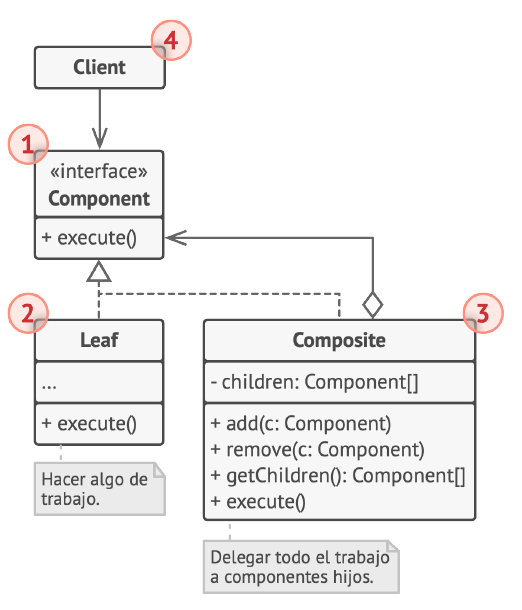

**Qué representa cada número de la figura:**

1. **Componente**: la interfaz que describe las operaciones comunes a los elementos simples y complejos del árbol.
2. **Hoja**: elemento básico del árbol que no tiene subelementos. Normalmente realiza la mayor parte del trabajo real porque no tiene a quién delegárselo.
3. **Contenedor (compuesto)**: elemento que tiene subelementos (hojas u otros contenedores). No conoce las clases concretas de sus hijos: trabaja con todos a través de la interfaz del componente. Al recibir una solicitud, la delega en sus hijos, procesa los resultados intermedios y devuelve el final.
4. **Cliente**: trabaja con todos los elementos a través de la interfaz del componente, por lo que puede tratar igual a elementos simples y complejos.

---

### El problema

Un explorador de archivos maneja **archivos** y **carpetas**. Una carpeta puede contener archivos y otras carpetas, con cualquier profundidad. Si quieres calcular el tamaño total o mostrar el contenido, tendrías que preguntar a cada elemento "¿eres archivo o carpeta?" (`instanceof`), recorrer a mano cada nivel y duplicar esa lógica en cada operación. El código cliente se llena de condicionales y no sabe cuántos niveles habrá.

### La solución

Se define una interfaz común, `ElementoArchivo`, que implementan tanto `Archivo` (la hoja) como `Carpeta` (el contenedor). La carpeta guarda una lista de `ElementoArchivo` y, cuando le piden su tamaño o que se muestre, **delega la petición en sus hijos** y combina el resultado. Como una carpeta puede contener otras carpetas, la recursión ocurre sola. El cliente llama el mismo método sin importar con qué tipo de elemento esté hablando.

### Estructura de la solución

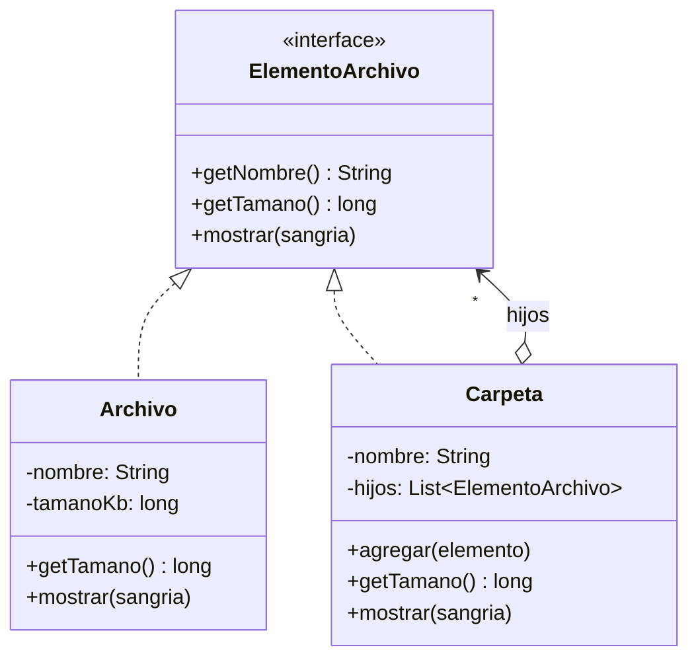

### Código para probar

```java
// ElementoArchivo.java
// COMPONENTE: operaciones comunes a elementos simples (archivos) y complejos (carpetas).
public interface ElementoArchivo {
    String getNombre();

    long getTamano();                       // en KB

    void mostrar(String sangria);
}
```

```java
// Archivo.java
// HOJA: no tiene hijos, hace el trabajo real.
public class Archivo implements ElementoArchivo {

    private final String nombre;
    private final long tamanoKb;

    public Archivo(String nombre, long tamanoKb) {
        this.nombre = nombre;
        this.tamanoKb = tamanoKb;
    }

    @Override
    public String getNombre() {
        return nombre;
    }

    @Override
    public long getTamano() {
        return tamanoKb;
    }

    @Override
    public void mostrar(String sangria) {
        System.out.println(sangria + nombre + " (" + tamanoKb + " KB)");
    }
}
```

```java
// Carpeta.java
import java.util.ArrayList;
import java.util.List;

// CONTENEDOR (compuesto): guarda hijos que pueden ser archivos u otras carpetas.
// Solo los conoce a traves de la interfaz ElementoArchivo.
public class Carpeta implements ElementoArchivo {

    private final String nombre;
    private final List<ElementoArchivo> hijos = new ArrayList<>();

    public Carpeta(String nombre) {
        this.nombre = nombre;
    }

    public void agregar(ElementoArchivo elemento) {
        hijos.add(elemento);
    }

    @Override
    public String getNombre() {
        return nombre;
    }

    // Delega en los hijos y suma los resultados (recursion implicita).
    @Override
    public long getTamano() {
        long total = 0;
        for (ElementoArchivo hijo : hijos) {
            total += hijo.getTamano();
        }
        return total;
    }

    @Override
    public void mostrar(String sangria) {
        System.out.println(sangria + nombre + "/ (" + getTamano() + " KB)");
        for (ElementoArchivo hijo : hijos) {
            hijo.mostrar(sangria + "  ");
        }
    }
}
```

```java
// App.java
public class App {
    public static void main(String[] args) {
        Carpeta raiz = new Carpeta("proyecto");
        Carpeta src = new Carpeta("src");
        Carpeta docs = new Carpeta("docs");

        src.agregar(new Archivo("App.java", 4));
        src.agregar(new Archivo("Pedido.java", 7));
        docs.agregar(new Archivo("manual.pdf", 1200));
        docs.agregar(new Archivo("logo.png", 300));

        raiz.agregar(src);
        raiz.agregar(docs);
        raiz.agregar(new Archivo("README.md", 2));

        // El cliente trata igual a una carpeta y a un archivo.
        raiz.mostrar("");
        System.out.println("Tamano de docs: " + docs.getTamano() + " KB");
        System.out.println("Tamano de README.md: " + new Archivo("README.md", 2).getTamano() + " KB");
    }
}
```

Salida esperada:

```
proyecto/ (1513 KB)
  src/ (11 KB)
    App.java (4 KB)
    Pedido.java (7 KB)
  docs/ (1500 KB)
    manual.pdf (1200 KB)
    logo.png (300 KB)
  README.md (2 KB)
Tamano de docs: 1500 KB
Tamano de README.md: 2 KB
```

El tamaño de `proyecto` (1513 KB) se calcula solo, sumando recursivamente `src` (11), `docs` (1500) y `README.md` (2), sin ningún `instanceof` en el cliente.

### Cuándo usarlo y cuándo no

**Úsalo cuando** tu modelo sea naturalmente un árbol (carpetas, menús anidados, organigramas, formas gráficas agrupadas, categorías con subcategorías) y quieras que el cliente trate igual a lo simple y a lo compuesto.

**Evítalo cuando** los elementos sean tan distintos entre sí que una interfaz común quede forzada (la hoja terminaría con métodos que no le sirven, como `agregar()`), o cuando no exista una verdadera estructura jerárquica.

---

## 4. Decorator

### Descripción

Permite **agregar comportamientos nuevos a un objeto** colocándolo dentro de objetos envoltorio (decoradores) que contienen esos comportamientos. Es una alternativa flexible a la herencia para extender funcionalidad.

### Estructura general

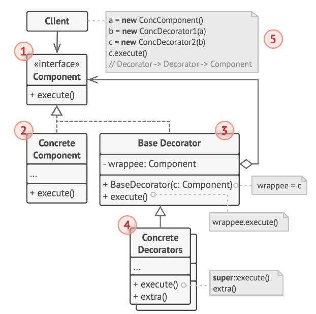

**Qué representa cada número de la figura:**

1. **Componente**: declara la interfaz común tanto para los objetos envueltos como para los envoltorios.
2. **Componente concreto**: la clase de los objetos que se envuelven. Define el comportamiento básico que los decoradores pueden alterar.
3. **Decorador base**: tiene un campo que referencia al objeto envuelto. El tipo del campo es la interfaz del componente, para poder contener tanto componentes concretos como otros decoradores. Delega todas las operaciones en el objeto envuelto.
4. **Decoradores concretos**: definen las funcionalidades adicionales que se pueden agregar dinámicamente. Sobrescriben los métodos del decorador base y ejecutan su comportamiento antes o después de invocar al método del padre.
5. **Cliente**: puede envolver componentes en varias capas de decoradores, siempre que trabaje con todos los objetos a través de la interfaz del componente.

---

### El problema

Una cafetería vende café con adiciones opcionales: leche, azúcar, crema, y se pueden repetir (doble leche). Con herencia tendrías que crear una subclase por cada combinación posible: `CafeConLeche`, `CafeConLecheYAzucar`, `CafeConDobleLecheYCrema`... el número de clases explota y cada combinación nueva exige tocar el código. Además la herencia es **estática**: se decide al compilar, no cuando el cliente hace su pedido.

### La solución

Cada adición es un **decorador**: una clase que implementa `Bebida`, recibe otra `Bebida` en su constructor y la envuelve. Al pedir la descripción o el costo, primero delega en la bebida envuelta y luego **suma lo suyo**. Como el decorador es también una `Bebida`, se pueden apilar tantas capas como se quiera y en cualquier orden, en tiempo de ejecución.

### Estructura de la solución

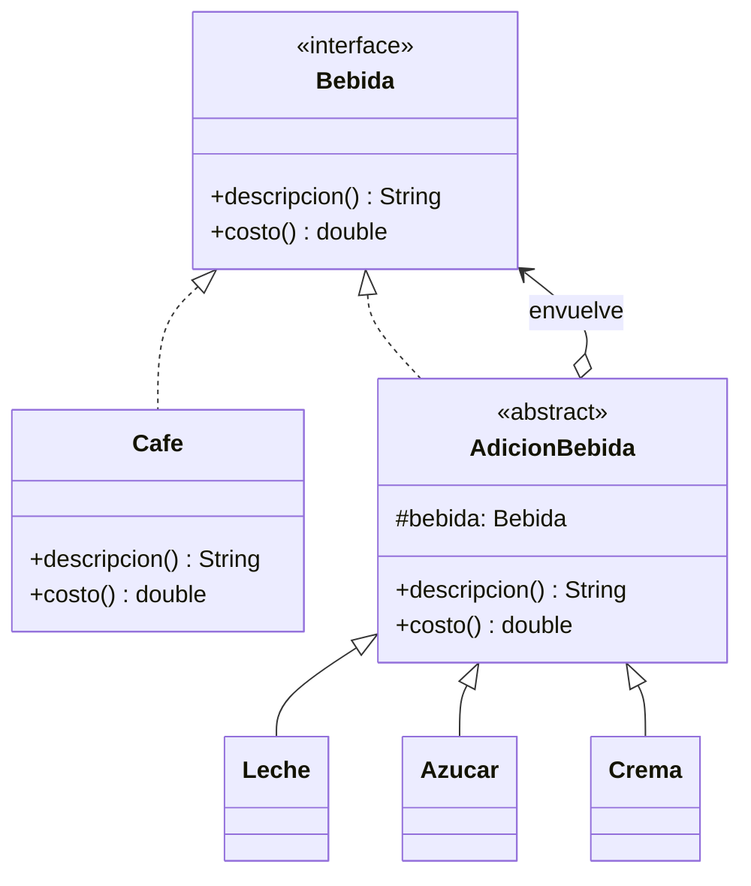

### Código para probar

```java
// Bebida.java
// COMPONENTE: interfaz comun a la bebida base y a todos los decoradores.
public interface Bebida {
    String descripcion();

    double costo();
}
```

```java
// Cafe.java
// COMPONENTE CONCRETO: comportamiento basico que los decoradores pueden alterar.
public class Cafe implements Bebida {
    @Override
    public String descripcion() {
        return "Cafe";
    }

    @Override
    public double costo() {
        return 3000;
    }
}
```

```java
// AdicionBebida.java
// DECORADOR BASE: envuelve otra Bebida y por defecto le delega todo.
public abstract class AdicionBebida implements Bebida {

    protected final Bebida bebida;

    protected AdicionBebida(Bebida bebida) {
        this.bebida = bebida;
    }

    @Override
    public String descripcion() {
        return bebida.descripcion();
    }

    @Override
    public double costo() {
        return bebida.costo();
    }
}
```

```java
// Leche.java
// DECORADOR CONCRETO: agrega comportamiento antes o despues de delegar.
public class Leche extends AdicionBebida {

    public Leche(Bebida bebida) {
        super(bebida);
    }

    @Override
    public String descripcion() {
        return super.descripcion() + " + Leche";
    }

    @Override
    public double costo() {
        return super.costo() + 1000;
    }
}
```

```java
// Azucar.java
public class Azucar extends AdicionBebida {

    public Azucar(Bebida bebida) {
        super(bebida);
    }

    @Override
    public String descripcion() {
        return super.descripcion() + " + Azucar";
    }

    @Override
    public double costo() {
        return super.costo() + 500;
    }
}
```

```java
// Crema.java
public class Crema extends AdicionBebida {

    public Crema(Bebida bebida) {
        super(bebida);
    }

    @Override
    public String descripcion() {
        return super.descripcion() + " + Crema";
    }

    @Override
    public double costo() {
        return super.costo() + 1500;
    }
}
```

```java
// App.java
public class App {
    public static void main(String[] args) {
        Bebida simple = new Cafe();
        mostrar(simple);

        // Las capas se apilan en tiempo de ejecucion, en cualquier combinacion y cantidad.
        Bebida especial = new Crema(new Leche(new Leche(new Cafe())));
        mostrar(especial);

        Bebida dulce = new Azucar(new Azucar(new Cafe()));
        mostrar(dulce);
    }

    private static void mostrar(Bebida b) {
        System.out.println(b.descripcion() + " = $" + (long) b.costo());
    }
}
```

Salida esperada:

```
Cafe = $3000
Cafe + Leche + Leche + Crema = $6500
Cafe + Azucar + Azucar = $4000
```

Verifica el cálculo de la segunda línea: 3000 (café) + 1000 + 1000 (dos leches) + 1500 (crema) = 6500.

### Cuándo usarlo y cuándo no

**Úsalo cuando** necesites agregar responsabilidades a objetos de forma dinámica y transparente, sin afectar a otros objetos, o cuando extender mediante herencia sea impráctico por la cantidad de combinaciones. En Java, las clases de entrada y salida (`BufferedReader` envolviendo a `FileReader`) son un ejemplo clásico.

**Evítalo cuando** el comportamiento dependa del **orden** de las capas de una forma difícil de controlar, o cuando una sola adición fija baste (una simple subclase o un parámetro es más claro). También ten presente que quitar un decorador del medio de la pila es incómodo, y que muchas capas pequeñas pueden hacer difícil depurar.

---

## 5. Facade

### Descripción

Proporciona una **interfaz simplificada** a una biblioteca, un framework o un conjunto complejo de clases (un subsistema). El cliente habla con la fachada en lugar de con decenas de objetos internos.

### Estructura general

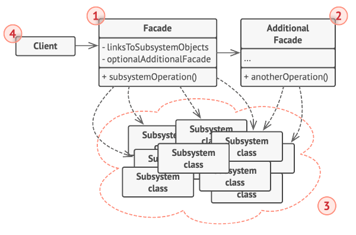

**Qué representa cada número de la figura:**

1. **Fachada**: da acceso cómodo a una parte concreta de la funcionalidad del subsistema. Sabe a dónde dirigir cada petición del cliente y cómo operar todas las piezas móviles.
2. **Fachada adicional**: se puede crear para evitar que una sola fachada acumule funciones no relacionadas y se convierta en otra estructura compleja. Pueden usarla tanto los clientes como otras fachadas.
3. **Subsistema complejo**: formado por decenas de objetos diversos. Para que hagan algo útil hay que conocer sus detalles internos (inicializar objetos en el orden correcto, entregar los datos en el formato adecuado). Estas clases **no conocen la existencia de la fachada**: operan entre sí directamente.
4. **Cliente**: usa la fachada en lugar de invocar directamente los objetos del subsistema.

---

### El problema

Para completar una compra en línea hay que coordinar cuatro servicios: verificar el **inventario**, **cobrar** el pago, **reservar** el producto, **programar el envío** y **notificar** al cliente por correo, y en un orden preciso. Si cada pantalla o controlador de la aplicación repite esa secuencia, el código queda duplicado y acoplado a todos los detalles del subsistema; cualquier cambio interno obliga a modificar muchos lugares.

### La solución

Se crea la clase `TiendaFachada` con un único método `comprar(...)`. Esa clase conoce el orden y las reglas para usar los cuatro servicios (qué hacer si no hay stock, si el pago falla, etc.). El cliente solo hace **una llamada**. Los servicios internos siguen existiendo, y quien necesite algo más específico aún puede usarlos directamente: la fachada **simplifica, no prohíbe**.

### Estructura de la solución

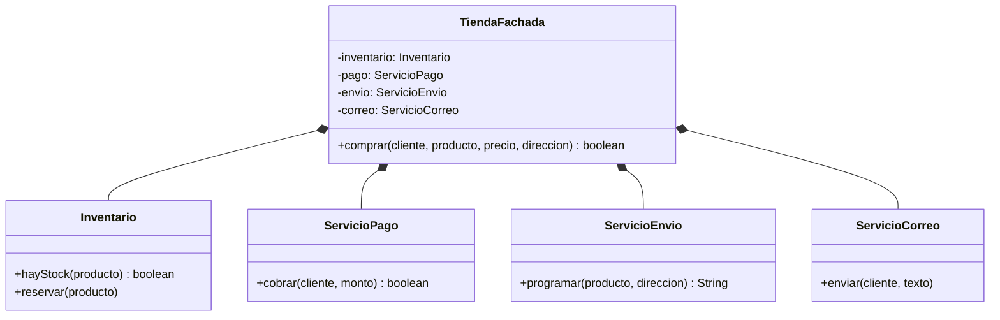

*(El rombo relleno indica **composición**: la fachada crea sus servicios y es la única que los usa. Ver la nota "Asociación, agregación o composición" más abajo.)*

### Código para probar

```java
// Inventario.java
// --- Subsistema complejo: estas clases no conocen la fachada ---
public class Inventario {
    public boolean hayStock(String producto) {
        System.out.println("[Inventario] Verificando stock de " + producto);
        return true;
    }

    public void reservar(String producto) {
        System.out.println("[Inventario] Reservando " + producto);
    }
}
```

```java
// ServicioPago.java
public class ServicioPago {
    public boolean cobrar(String cliente, double monto) {
        System.out.println("[Pago] Cobrando $" + (long) monto + " a " + cliente);
        return monto <= 1000000;
    }
}
```

```java
// ServicioEnvio.java
public class ServicioEnvio {
    public String programar(String producto, String direccion) {
        System.out.println("[Envio] Programando " + producto + " hacia " + direccion);
        return "GUIA-1001";
    }
}
```

```java
// ServicioCorreo.java
public class ServicioCorreo {
    public void enviar(String cliente, String texto) {
        System.out.println("[Correo] Para " + cliente + ": " + texto);
    }
}
```

```java
// TiendaFachada.java
// FACHADA: ofrece una operacion simple que sabe en que orden usar cada pieza del subsistema.
public class TiendaFachada {

    private final Inventario inventario = new Inventario();
    private final ServicioPago pago = new ServicioPago();
    private final ServicioEnvio envio = new ServicioEnvio();
    private final ServicioCorreo correo = new ServicioCorreo();

    public boolean comprar(String cliente, String producto, double precio, String direccion) {
        if (!inventario.hayStock(producto)) {
            correo.enviar(cliente, "Producto agotado");
            return false;
        }
        if (!pago.cobrar(cliente, precio)) {
            correo.enviar(cliente, "Pago rechazado");
            return false;
        }
        inventario.reservar(producto);
        String guia = envio.programar(producto, direccion);
        correo.enviar(cliente, "Compra exitosa. Guia " + guia);
        return true;
    }
}
```

```java
// App.java
public class App {
    public static void main(String[] args) {
        // El cliente usa UNA llamada en lugar de coordinar cuatro servicios.
        TiendaFachada tienda = new TiendaFachada();

        System.out.println("-- Compra normal --");
        tienda.comprar("Ana", "Monitor", 750000, "Cra 7 # 45-10");

        System.out.println("-- Compra rechazada --");
        tienda.comprar("Luis", "Portatil", 3500000, "Calle 80 # 20-5");
    }
}
```

Salida esperada:

```
-- Compra normal --
[Inventario] Verificando stock de Monitor
[Pago] Cobrando $750000 a Ana
[Inventario] Reservando Monitor
[Envio] Programando Monitor hacia Cra 7 # 45-10
[Correo] Para Ana: Compra exitosa. Guia GUIA-1001
-- Compra rechazada --
[Inventario] Verificando stock de Portatil
[Pago] Cobrando $3500000 a Luis
[Correo] Para Luis: Pago rechazado
```

Compara con lo que tendría que hacer el cliente sin la fachada: crear los cuatro servicios y escribir las condiciones de cada paso en cada lugar donde se compra.

#### Nota: ¿asociación, agregación o composición?

Fíjate en cómo `TiendaFachada` obtiene sus servicios:

```java
private final Inventario inventario = new Inventario();
```

La fachada **crea** cada servicio, lo guarda en un atributo privado y nadie más tiene acceso a él. Los servicios nacen con la fachada y viven mientras ella viva. Eso es **composición** (el "todo" es dueño del ciclo de vida de sus "partes"), por eso el diagrama usa el rombo relleno. Una simple **asociación** (flecha sencilla) solo diría "usa a", sin decir quién crea a quién.

La regla para decidir la relación UML mirando el código es preguntarse **de dónde sale el objeto y quién controla su vida**:

| Relación | Cómo se ve en el código | Ciclo de vida |
|---|---|---|
| **Asociación** | Un parámetro de método o una referencia que solo se usa de paso | Independiente |
| **Agregación** | El objeto llega **desde fuera** (constructor o setter) y se guarda | Independiente: la parte puede existir sin el todo y compartirse |
| **Composición** | El todo hace `new` de la parte y no la expone | Dependiente: si el todo desaparece, la parte también |

Que la fachada use composición es **una decisión de implementación, no una exigencia del patrón**. El patrón solo pide que el cliente hable con la fachada y no con el subsistema. Hay dos formas de armarla:

| | Fachada que crea sus servicios (versión de esta guía) | Fachada que recibe sus servicios |
|---|---|---|
| Relación UML | Composición | Agregación |
| Uso para el cliente | `new TiendaFachada()` | `new TiendaFachada(inventario, pago, ...)` |
| Pruebas unitarias | Difícil: siempre usa los servicios reales | Fácil: se le pasan servicios falsos |
| Acoplamiento | Depende de las clases concretas | Puede depender de interfaces (DIP) |

Una solución intermedia, muy usada, es ofrecer **los dos constructores**: uno sin parámetros que arma el subsistema por defecto (el cliente sigue escribiendo una sola línea) y otro que recibe las piezas:

```java
// TiendaFachada.java (variante con inyeccion)
public class TiendaFachada {

    private final Inventario inventario;
    private final ServicioPago pago;
    private final ServicioEnvio envio;
    private final ServicioCorreo correo;

    // Constructor "comodo": arma el subsistema por defecto (el cliente sigue usando una sola linea).
    public TiendaFachada() {
        this(new Inventario(), new ServicioPago(), new ServicioEnvio(), new ServicioCorreo());
    }

    // Constructor que recibe las piezas: permite reemplazarlas (por ejemplo, por versiones falsas en pruebas).
    public TiendaFachada(Inventario inventario, ServicioPago pago,
                         ServicioEnvio envio, ServicioCorreo correo) {
        this.inventario = inventario;
        this.pago = pago;
        this.envio = envio;
        this.correo = correo;
    }

    public boolean comprar(String cliente, String producto, double precio, String direccion) {
        if (!inventario.hayStock(producto)) {
            correo.enviar(cliente, "Producto agotado");
            return false;
        }
        if (!pago.cobrar(cliente, precio)) {
            correo.enviar(cliente, "Pago rechazado");
            return false;
        }
        inventario.reservar(producto);
        String guia = envio.programar(producto, direccion);
        correo.enviar(cliente, "Compra exitosa. Guia " + guia);
        return true;
    }
}
```

```java
// App.java (variante con inyeccion)
public class App {
    public static void main(String[] args) {
        // Uso normal: una sola linea, igual que antes.
        TiendaFachada tienda = new TiendaFachada();
        tienda.comprar("Ana", "Monitor", 750000, "Cra 7 # 45-10");

        // Uso en pruebas: se entrega un servicio de pago distinto (siempre rechaza).
        ServicioPago pagoFalso = new ServicioPago() {
            @Override
            public boolean cobrar(String cliente, double monto) {
                System.out.println("[PagoFalso] Rechazando siempre");
                return false;
            }
        };
        TiendaFachada tiendaDePrueba =
            new TiendaFachada(new Inventario(), pagoFalso, new ServicioEnvio(), new ServicioCorreo());
        tiendaDePrueba.comprar("Luis", "Teclado", 50000, "Calle 80 # 20-5");
    }
}
```

Salida esperada:

```
[Inventario] Verificando stock de Monitor
[Pago] Cobrando $750000 a Ana
[Inventario] Reservando Monitor
[Envio] Programando Monitor hacia Cra 7 # 45-10
[Correo] Para Ana: Compra exitosa. Guia GUIA-1001
[Inventario] Verificando stock de Teclado
[PagoFalso] Rechazando siempre
[Correo] Para Luis: Pago rechazado
```

En esta variante el diagrama pasa a **agregación** (`TiendaFachada o-- Inventario`, etc.), porque los servicios ya no nacen dentro de la fachada. Para el taller basta con que el estudiante **justifique** su elección y que el diagrama sea coherente con el código que escribió.

### Cuándo usarlo y cuándo no

**Úsalo cuando** necesites una interfaz simple y limitada para un subsistema complejo, cuando quieras estructurar un sistema en capas (cada capa expone una fachada), o cuando quieras aislar tu código de una biblioteca de terceros para poder reemplazarla después.

**Evítalo cuando** la fachada empiece a acumular **todas** las responsabilidades del sistema y se vuelva un "objeto dios" acoplado a todo. En ese caso conviene dividirla en fachadas más pequeñas (la "fachada adicional" de la figura).

---

## 6. Flyweight

### Descripción

Permite mantener **más objetos en la memoria disponible** compartiendo las partes del estado que son iguales entre muchos objetos, en lugar de guardar toda la información en cada uno.

### Estructura general


**Qué representa cada número de la figura:**

1. Flyweight es **solo una optimización**. Antes de aplicarlo hay que comprobar que el programa realmente tiene un problema de consumo de memoria causado por una enorme cantidad de objetos similares existiendo al mismo tiempo, y que no se puede resolver de otra forma razonable.
2. **Clase Flyweight**: contiene la parte del estado del objeto original que se puede compartir entre varios objetos. Ese estado compartido se llama **intrínseco**; el que se pasa por parámetro a sus métodos se llama **extrínseco**. El mismo flyweight puede usarse en muchos contextos.
3. **Clase Contexto**: contiene el estado **extrínseco**, único de cada objeto original. Al emparejarse con un flyweight, representa el estado completo del objeto original.
4. El comportamiento del objeto original normalmente permanece en el flyweight; quien lo invoque debe pasarle el estado extrínseco necesario como parámetros. Alternativamente, el comportamiento puede moverse al contexto, que usaría al flyweight como simple objeto de datos.
5. **Cliente**: calcula o almacena el estado extrínseco de los objetos. Desde su punto de vista, un flyweight es una plantilla que se configura en tiempo de ejecución pasando información contextual por parámetros.
6. **Fábrica de flyweights**: administra el conjunto de flyweights existentes. Los clientes no los crean directamente: le piden uno entregándole el estado intrínseco deseado, y la fábrica devuelve uno ya creado si coincide, o crea uno nuevo si no existe.

---

### El problema

Un videojuego dibuja un bosque con **miles de árboles**. Cada árbol guarda su posición (x, y), su nombre, su color y una textura que ocupa mucha memoria. Pero la mayoría de los árboles son de apenas tres especies: miles de objetos repiten exactamente el mismo nombre, color y textura. Con 10.000 árboles, estás guardando 10.000 copias de la misma textura, y el juego se queda sin memoria.

### La solución

Se separa el estado de cada árbol en dos partes:

- **Intrínseco** (compartido, inmutable): nombre, color y textura. Va en `TipoArbol`, el flyweight. Solo existe **un objeto por cada especie**.
- **Extrínseco** (propio de cada árbol): la posición x, y. Va en `Arbol`, el contexto, junto con una referencia al `TipoArbol` que le corresponde.

`FabricaTipoArbol` garantiza que nunca se cree dos veces el mismo tipo: si ya existe uno con esas características, lo entrega. Resultado: 10.000 objetos `Arbol` livianos apuntando a solo 3 objetos `TipoArbol` pesados.

### Estructura de la solución

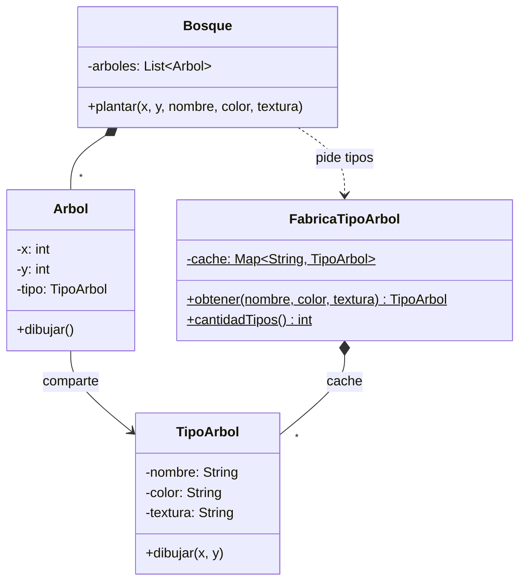

### Código para probar

```java
// TipoArbol.java
// FLYWEIGHT: guarda el estado INTRINSECO (compartido e inmutable).
public class TipoArbol {

    private final String nombre;
    private final String color;
    private final String textura;   // en la vida real seria una imagen pesada

    public TipoArbol(String nombre, String color, String textura) {
        this.nombre = nombre;
        this.color = color;
        this.textura = textura;
    }

    // El estado EXTRINSECO (x, y) llega por parametro, no se guarda aqui.
    public void dibujar(int x, int y) {
        System.out.println("Dibujando " + nombre + " (" + color + ", " + textura + ") en (" + x + "," + y + ")");
    }
}
```

```java
// FabricaTipoArbol.java
import java.util.HashMap;
import java.util.Map;

// FABRICA FLYWEIGHT: entrega un objeto existente si ya hay uno con esas caracteristicas.
public class FabricaTipoArbol {

    private static final Map<String, TipoArbol> cache = new HashMap<>();

    public static TipoArbol obtener(String nombre, String color, String textura) {
        String clave = nombre + "|" + color + "|" + textura;
        TipoArbol tipo = cache.get(clave);
        if (tipo == null) {
            tipo = new TipoArbol(nombre, color, textura);
            cache.put(clave, tipo);
        }
        return tipo;
    }

    public static int cantidadTipos() {
        return cache.size();
    }
}
```

```java
// Arbol.java
// CONTEXTO: guarda el estado EXTRINSECO (unico de cada arbol) y una referencia al flyweight.
public class Arbol {

    private final int x;
    private final int y;
    private final TipoArbol tipo;

    public Arbol(int x, int y, TipoArbol tipo) {
        this.x = x;
        this.y = y;
        this.tipo = tipo;
    }

    public TipoArbol getTipo() {
        return tipo;
    }

    public void dibujar() {
        tipo.dibujar(x, y);
    }
}
```

```java
// Bosque.java
import java.util.ArrayList;
import java.util.List;

// CLIENTE: crea muchos arboles pero pide los tipos a la fabrica.
public class Bosque {

    private final List<Arbol> arboles = new ArrayList<>();

    public void plantar(int x, int y, String nombre, String color, String textura) {
        TipoArbol tipo = FabricaTipoArbol.obtener(nombre, color, textura);
        arboles.add(new Arbol(x, y, tipo));
    }

    public List<Arbol> getArboles() {
        return arboles;
    }
}
```

```java
// App.java
public class App {
    public static void main(String[] args) {
        Bosque bosque = new Bosque();

        for (int i = 0; i < 10000; i++) {
            switch (i % 3) {
                case 0 -> bosque.plantar(i, i * 2, "Roble", "verde", "textura-roble.png");
                case 1 -> bosque.plantar(i, i * 2, "Pino", "verde oscuro", "textura-pino.png");
                default -> bosque.plantar(i, i * 2, "Abedul", "blanco", "textura-abedul.png");
            }
        }

        System.out.println("Arboles en el bosque: " + bosque.getArboles().size());
        System.out.println("Objetos TipoArbol (flyweights): " + FabricaTipoArbol.cantidadTipos());

        Arbol a0 = bosque.getArboles().get(0);
        Arbol a3 = bosque.getArboles().get(3);
        System.out.println("Arbol 0 y arbol 3 comparten el mismo tipo: " + (a0.getTipo() == a3.getTipo()));

        a0.dibujar();
        a3.dibujar();
    }
}
```

Salida esperada:

```
Arboles en el bosque: 10000
Objetos TipoArbol (flyweights): 3
Arbol 0 y arbol 3 comparten el mismo tipo: true
Dibujando Roble (verde, textura-roble.png) en (0,0)
Dibujando Roble (verde, textura-roble.png) en (3,6)
```

Las dos últimas líneas muestran que el árbol 0 y el árbol 3 se dibujan con el mismo `TipoArbol`, cada uno en su propia posición. Para comprobar el ahorro, comenta el uso de la fábrica y haz `new TipoArbol(...)` por cada árbol: el programa seguirá funcionando, pero con 10.000 objetos pesados en lugar de 3.

### Cuándo usarlo y cuándo no

**Úsalo cuando** tu programa deba manejar una cantidad enorme de objetos similares que agotan la memoria disponible (partículas, caracteres de un editor de texto, árboles o enemigos de un videojuego) y gran parte de su estado se pueda compartir.

**Evítalo cuando** no tengas un problema real de memoria: el patrón complica el código (separar estado intrínseco y extrínseco, mantener inmutables los flyweights) y no aporta nada si los objetos son pocos o ya son livianos. Es una optimización: se aplica **después de medir**, no por adelantado.

---

## 7. Proxy

### Descripción

Proporciona un **sustituto** o marcador de posición de otro objeto. El proxy controla el acceso al objeto original, lo que permite realizar algo antes o después de que la solicitud llegue a él.

### Estructura general

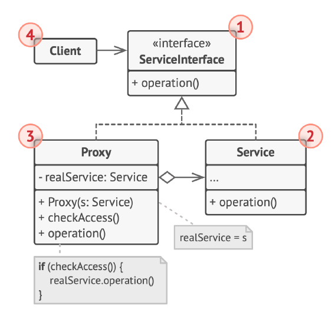

**Qué representa cada número de la figura:**

1. **Interfaz de servicio**: declara la interfaz del servicio. El proxy debe seguirla para poder hacerse pasar por el objeto de servicio.
2. **Servicio**: la clase que ofrece la lógica de negocio útil.
3. **Proxy**: tiene un campo que referencia a un objeto de servicio. Cuando termina su propio procesamiento (inicialización diferida, registro, control de acceso, caché, etc.) pasa la solicitud al servicio. Normalmente el proxy administra el ciclo de vida completo del servicio.
4. **Cliente**: debe trabajar con servicios y con proxies a través de la misma interfaz, de modo que se pueda pasar un proxy a cualquier código que espere un servicio.

---

### El problema

Una galería de fotos tiene imágenes muy pesadas. Cargar una imagen desde el disco es una operación lenta y gasta mucha memoria. Si la galería crea los objetos `ImagenReal` al abrir la aplicación, carga todas las fotos aunque el usuario solo mire una o dos: la aplicación arranca lenta y desperdicia memoria.

### La solución

Se crea `ImagenProxy`, que implementa la misma interfaz `Imagen` y guarda solo el **nombre del archivo** (crearlo es barato). La imagen real se crea **la primera vez que alguien llama a `mostrar()`**, y desde entonces se reutiliza. Este tipo de proxy se llama **proxy virtual** (carga diferida). El cliente no nota la diferencia: sigue usando la interfaz `Imagen`.

### Estructura de la solución

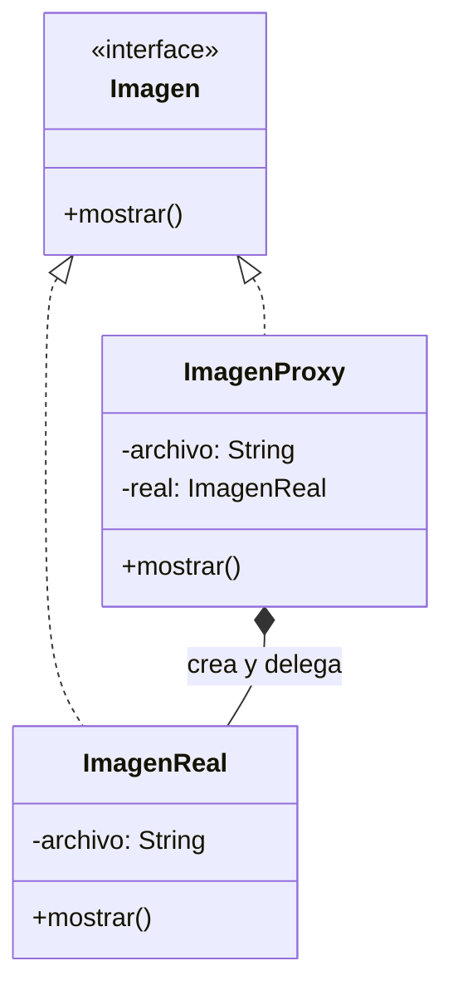

### Código para probar

```java
// Imagen.java
// INTERFAZ DE SERVICIO: el proxy la implementa para poder hacerse pasar por el servicio real.
public interface Imagen {
    void mostrar();
}
```

```java
// ImagenReal.java
// SERVICIO: crearlo es costoso porque carga el archivo completo en memoria.
public class ImagenReal implements Imagen {

    private final String archivo;

    public ImagenReal(String archivo) {
        this.archivo = archivo;
        System.out.println("  [Disco] Cargando " + archivo + " (operacion costosa)...");
    }

    @Override
    public void mostrar() {
        System.out.println("  Mostrando " + archivo);
    }
}
```

```java
// ImagenProxy.java
// PROXY (carga diferida): controla el acceso y crea el servicio real solo cuando hace falta.
public class ImagenProxy implements Imagen {

    private final String archivo;
    private ImagenReal real;          // null hasta que alguien pida mostrar()

    public ImagenProxy(String archivo) {
        this.archivo = archivo;       // crear el proxy es barato: no toca el disco
    }

    @Override
    public void mostrar() {
        if (real == null) {
            real = new ImagenReal(archivo);   // primera vez: se crea el servicio
        }
        real.mostrar();                       // despues delega la solicitud
    }
}
```

```java
// App.java
public class App {
    public static void main(String[] args) {
        System.out.println("Creando galeria de 3 imagenes...");
        Imagen[] galeria = {
            new ImagenProxy("foto1.png"),
            new ImagenProxy("foto2.png"),
            new ImagenProxy("foto3.png")
        };
        System.out.println("Galeria lista (nada se ha cargado todavia).");

        System.out.println("Usuario abre la foto 2:");
        galeria[1].mostrar();

        System.out.println("Usuario vuelve a abrir la foto 2:");
        galeria[1].mostrar();
    }
}
```

Salida esperada:

```
Creando galeria de 3 imagenes...
Galeria lista (nada se ha cargado todavia).
Usuario abre la foto 2:
  [Disco] Cargando foto2.png (operacion costosa)...
  Mostrando foto2.png
Usuario vuelve a abrir la foto 2:
  Mostrando foto2.png
```

Fíjate en dos cosas: al crear la galería no aparece ningún "Cargando", y la segunda vez que se abre la foto 2 tampoco: el costoso `new ImagenReal(...)` ocurre una sola vez, justo cuando se necesita.

### Otros tipos de proxy

La misma estructura sirve para propósitos distintos, y lo que cambia es **qué hace el proxy antes de delegar**:

| Tipo | Qué hace antes de delegar | Ejemplo |
|---|---|---|
| **Virtual** | Crea el servicio solo cuando hace falta | La galería de este ejemplo |
| **De protección** | Verifica permisos del cliente | Solo un administrador puede borrar un registro |
| **De caché** | Guarda resultados de solicitudes repetidas | No descargar dos veces el mismo video |
| **De registro (log)** | Anota cada llamada | Auditoría de accesos a un servicio |
| **Remoto** | Oculta que el servicio está en otra máquina | Llamar a un servicio web como si fuera un objeto local |

### Cuándo usarlo y cuándo no

**Úsalo cuando** necesites controlar el acceso a un objeto (cargarlo bajo demanda, validar permisos, guardar resultados en caché, registrar uso) sin que el cliente tenga que saberlo ni modificar la clase original.

**Evítalo cuando** el control adicional no sea necesario o el objeto sea liviano de crear y usar: el proxy agrega una capa y puede introducir latencia. Y si lo que buscas es **agregar funcionalidad** apilable al objeto (no controlar su acceso), el patrón adecuado es Decorator.

---

## Cómo distinguir los patrones que "envuelven" a otro objeto

Cuatro de los siete patrones se parecen por fuera (una clase que guarda a otra y le delega), pero se distinguen por la **intención**:

| Patrón | Interfaz del envoltorio respecto a la del objeto envuelto | Intención |
|---|---|---|
| **Adapter** | **Distinta**: la cambia | Hacer compatible algo que no encaja |
| **Decorator** | **Igual** | Añadir comportamiento, apilando capas |
| **Proxy** | **Igual** | Controlar el acceso al objeto |
| **Facade** | **Nueva y más simple** | Simplificar un subsistema entero |

## Resumen comparativo

| Patrón | Resuelve... | Mecanismo típico en Java |
|---|---|---|
| **Adapter** | Interfaces incompatibles | Clase que implementa la interfaz esperada y envuelve al servicio |
| **Bridge** | Explosión de subclases en dos dimensiones | Una jerarquía guarda una referencia a la interfaz de la otra |
| **Composite** | Tratar igual lo simple y lo compuesto en un árbol | Interfaz común; el contenedor guarda una lista de componentes |
| **Decorator** | Agregar responsabilidades dinámicamente | Envoltorio que implementa la misma interfaz y delega |
| **Facade** | Subsistema difícil de usar | Clase con métodos de alto nivel que coordina el subsistema |
| **Flyweight** | Demasiados objetos similares en memoria | Fábrica con caché + separación de estado intrínseco/extrínseco |
| **Proxy** | Controlar el acceso a un objeto | Sustituto con la misma interfaz que decide cuándo delegar |
