# Patrones de comportamiento

## ¿Qué son los patrones de comportamiento?

Los patrones creacionales se ocupan de **cómo se crean** los objetos y los estructurales de **cómo se organizan**. Los patrones de comportamiento se ocupan de lo que sucede **mientras el programa corre**: cómo se **reparten responsabilidades** entre los objetos, cómo **se comunican** y cómo se **ejecutan los algoritmos**. Su objetivo común es que los objetos colaboren sin conocerse demasiado, de modo que el comportamiento se pueda cambiar, ampliar o reutilizar sin romper el resto del sistema.

En este bloque vemos los once patrones de comportamiento del catálogo GoF (Gang of Four):

1. **Chain of Responsibility** (Cadena de responsabilidad): pasa una solicitud por una cadena de manejadores hasta que alguno la procese.
2. **Command** (Comando): convierte una solicitud en un objeto, lo que permite guardarla, ponerla en cola o deshacerla.
3. **Iterator** (Iterador): recorre los elementos de una colección sin exponer cómo está construida.
4. **Mediator** (Mediador): centraliza la comunicación entre objetos para que no se conozcan entre sí.
5. **Memento**: guarda y restaura el estado de un objeto sin violar su encapsulación.
6. **Observer** (Observador): avisa a varios objetos cuando algo cambia en otro.
7. **State** (Estado): cambia el comportamiento de un objeto cuando cambia su estado interno.
8. **Strategy** (Estrategia): intercambia algoritmos completos en tiempo de ejecución.
9. **Template Method** (Método plantilla): fija el esqueleto de un algoritmo y deja pasos a las subclases.
10. **Visitor** (Visitante): agrega operaciones a una familia de clases sin modificarlas.
11. **Interpreter** (Intérprete): define una gramática sencilla y la interpreta con un árbol de objetos.

*Nota sobre el libro de Shvets:* su libro cubre los diez primeros con figura numerada. **Interpreter no aparece en él**, por eso en ese patrón no hay figura del libro para ubicar: uso el diagrama de la solución y una leyenda propia.

Una pista para no confundirlos: **Strategy, State y Template Method** se parecen porque los tres cambian "cómo se hace algo" apoyándose en polimorfismo. Lo que los distingue es **quién decide** el cambio y **cuándo** (se compara en la sección final).

---

## 1. Chain of Responsibility

### Descripción

Permite pasar una solicitud a lo largo de una **cadena de manejadores**. Cada manejador decide si la procesa y si la deja continuar hacia el siguiente.

### Estructura general

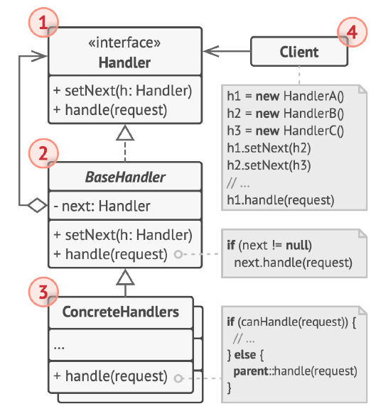

**Qué representa cada número de la figura:**

1. **Manejador**: la interfaz común a todos los manejadores. Normalmente declara un único método para manejar solicitudes, y a veces otro para establecer el siguiente manejador de la cadena.
2. **Manejador base** (opcional): el lugar para el código repetitivo común a todos los manejadores. Suele guardar la referencia al siguiente manejador y puede implementar el comportamiento por defecto de pasar la solicitud al siguiente, si existe.
3. **Manejadores concretos**: contienen el código que procesa las solicitudes. Al recibir una, cada uno decide si la procesa y si la pasa a lo largo de la cadena. Suelen ser autónomos e inmutables y reciben sus datos por el constructor.
4. **Cliente**: puede armar la cadena una sola vez o componerla dinámicamente según la lógica de la aplicación. Una solicitud puede enviarse a cualquier manejador de la cadena, no necesariamente al primero.

---

### El problema

Una API web debe revisar cada petición antes de atenderla: ¿trae un token válido?, ¿el usuario tiene permiso para esa ruta?, ¿ya excedió su límite de peticiones? Si todo está en un solo método, queda una cascada de `if` anidados difícil de leer, que crece con cada regla nueva y que no se puede reordenar ni reutilizar en otra parte (por ejemplo, otra API que solo necesita autenticación).

### La solución

Cada verificación es un **manejador** independiente con una sola responsabilidad. Los manejadores se enlazan en cadena (autenticación, autorización, límite). Cada uno revisa la petición: si la rechaza, la cadena se corta; si está de acuerdo, se la pasa al siguiente. Agregar, quitar o reordenar reglas es cuestión de **armar la cadena de otra forma**, sin tocar los manejadores.

### Estructura de la solución

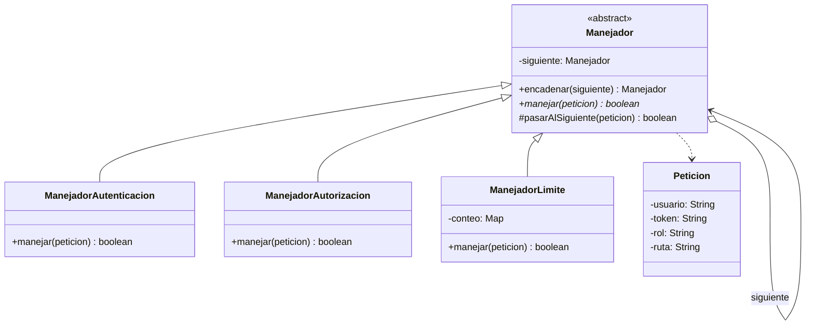

### Código para probar

```java
// Peticion.java
// Solicitud que viaja por la cadena de manejadores (simula una peticion web).
public class Peticion {

    private final String usuario;
    private final String token;
    private final String rol;
    private final String ruta;

    public Peticion(String usuario, String token, String rol, String ruta) {
        this.usuario = usuario;
        this.token = token;
        this.rol = rol;
        this.ruta = ruta;
    }

    public String getUsuario() {
        return usuario;
    }

    public String getToken() {
        return token;
    }

    public String getRol() {
        return rol;
    }

    public String getRuta() {
        return ruta;
    }
}
```

```java
// Manejador.java
// MANEJADOR BASE: guarda la referencia al siguiente eslabon y ofrece el codigo comun para pasar la solicitud.
public abstract class Manejador {

    private Manejador siguiente;

    // Devuelve el manejador recibido para poder encadenar: a.encadenar(b).encadenar(c)
    public Manejador encadenar(Manejador siguiente) {
        this.siguiente = siguiente;
        return siguiente;
    }

    // true = la peticion fue aceptada por toda la cadena; false = alguien la rechazo.
    public abstract boolean manejar(Peticion peticion);

    // Comportamiento por defecto: si hay otro eslabon, le pasa la solicitud.
    protected boolean pasarAlSiguiente(Peticion peticion) {
        if (siguiente == null) {
            return true;
        }
        return siguiente.manejar(peticion);
    }
}
```

```java
// ManejadorAutenticacion.java
// MANEJADOR CONCRETO: decide si procesa la solicitud y si la deja continuar.
public class ManejadorAutenticacion extends Manejador {
    @Override
    public boolean manejar(Peticion peticion) {
        if (!peticion.getToken().startsWith("tk-")) {
            System.out.println("  [Autenticacion] Rechazada: token invalido (401)");
            return false;
        }
        System.out.println("  [Autenticacion] OK");
        return pasarAlSiguiente(peticion);
    }
}
```

```java
// ManejadorAutorizacion.java
public class ManejadorAutorizacion extends Manejador {
    @Override
    public boolean manejar(Peticion peticion) {
        boolean esAdmin = peticion.getRol().equals("ADMIN");
        if (peticion.getRuta().startsWith("/admin") && !esAdmin) {
            System.out.println("  [Autorizacion] Rechazada: se requiere rol ADMIN (403)");
            return false;
        }
        System.out.println("  [Autorizacion] OK");
        return pasarAlSiguiente(peticion);
    }
}
```

```java
// ManejadorLimite.java
import java.util.HashMap;
import java.util.Map;

// Este manejador tiene estado propio: cuenta cuantas peticiones ha dejado pasar por usuario.
public class ManejadorLimite extends Manejador {

    private static final int MAXIMO = 3;
    private final Map<String, Integer> conteo = new HashMap<>();

    @Override
    public boolean manejar(Peticion peticion) {
        int usadas = conteo.getOrDefault(peticion.getUsuario(), 0) + 1;
        if (usadas > MAXIMO) {
            System.out.println("  [Limite] Rechazada: demasiadas peticiones (429)");
            return false;
        }
        conteo.put(peticion.getUsuario(), usadas);
        System.out.println("  [Limite] OK (" + usadas + " de " + MAXIMO + ")");
        return pasarAlSiguiente(peticion);
    }
}
```

```java
// App.java
public class App {
    public static void main(String[] args) {

        // El cliente arma la cadena: autenticacion -> autorizacion -> limite
        Manejador cadena = new ManejadorAutenticacion();
        cadena.encadenar(new ManejadorAutorizacion())
              .encadenar(new ManejadorLimite());

        enviar(cadena, new Peticion("ana", "tk-1", "USUARIO", "/productos"));
        enviar(cadena, new Peticion("luis", "", "USUARIO", "/productos"));
        enviar(cadena, new Peticion("ana", "tk-1", "USUARIO", "/admin/usuarios"));
        enviar(cadena, new Peticion("root", "tk-9", "ADMIN", "/admin/usuarios"));
        enviar(cadena, new Peticion("ana", "tk-1", "USUARIO", "/productos"));
        enviar(cadena, new Peticion("ana", "tk-1", "USUARIO", "/productos"));
        enviar(cadena, new Peticion("ana", "tk-1", "USUARIO", "/productos"));
    }

    private static void enviar(Manejador cadena, Peticion p) {
        System.out.println("Peticion de " + p.getUsuario() + " a " + p.getRuta());
        boolean aceptada = cadena.manejar(p);
        System.out.println("  => " + (aceptada ? "ACEPTADA" : "RECHAZADA"));
    }
}
```

Salida esperada:

```
Peticion de ana a /productos
  [Autenticacion] OK
  [Autorizacion] OK
  [Limite] OK (1 de 3)
  => ACEPTADA
Peticion de luis a /productos
  [Autenticacion] Rechazada: token invalido (401)
  => RECHAZADA
Peticion de ana a /admin/usuarios
  [Autenticacion] OK
  [Autorizacion] Rechazada: se requiere rol ADMIN (403)
  => RECHAZADA
Peticion de root a /admin/usuarios
  [Autenticacion] OK
  [Autorizacion] OK
  [Limite] OK (1 de 3)
  => ACEPTADA
Peticion de ana a /productos
  [Autenticacion] OK
  [Autorizacion] OK
  [Limite] OK (2 de 3)
  => ACEPTADA
Peticion de ana a /productos
  [Autenticacion] OK
  [Autorizacion] OK
  [Limite] OK (3 de 3)
  => ACEPTADA
Peticion de ana a /productos
  [Autenticacion] OK
  [Autorizacion] OK
  [Limite] Rechazada: demasiadas peticiones (429)
  => RECHAZADA
```

Observa dos cosas: a la petición rechazada por autenticación **no se le aplican** las reglas siguientes, y el contador de límite solo cuenta las peticiones que **llegaron** hasta ese eslabón (la de `/admin` rechazada por autorización no suma).

### Cuándo usarlo y cuándo no

**Úsalo cuando** varios objetos puedan atender una solicitud y no se sepa de antemano cuál, cuando necesites ejecutar varios pasos de verificación o procesamiento en un orden configurable, o cuando el conjunto de pasos deba poder cambiar en tiempo de ejecución.

**Evítalo cuando** la solicitud siempre la procesa el mismo objeto, o cuando **todas** las reglas deban ejecutarse siempre sin posibilidad de corte (ahí basta un recorrido de lista). Cuidado además con las solicitudes que **nadie** maneja: decide qué pasa si la cadena termina sin respuesta. Los filtros de servlets y los *middlewares* web se parecen mucho a este patrón.

---

## 2. Command

### Descripción

Convierte una solicitud (una acción) en un **objeto independiente** que contiene toda la información sobre ella. Eso permite pasarla como argumento, guardarla, ponerla en cola, registrarla o **deshacerla**.

### Estructura general

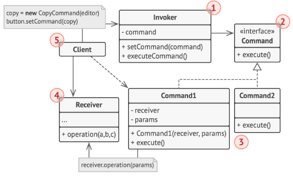

**Qué representa cada número de la figura:**

1. **Emisora (invocadora)**: se encarga de iniciar las solicitudes. Guarda una referencia a un comando y lo activa en lugar de enviar la solicitud directamente al receptor. No crea el comando: normalmente lo recibe ya creado del cliente.
2. **Interfaz Comando**: normalmente declara un único método para ejecutar el comando.
3. **Comandos concretos**: implementan los distintos tipos de solicitud. Un comando no suele hacer el trabajo por su cuenta: pasa la llamada a un objeto de la lógica de negocio. Los parámetros que necesita se guardan como campos del comando, que idealmente es inmutable.
4. **Receptora**: contiene la lógica de negocio. Casi cualquier objeto puede actuar como receptor; el comando solo gestiona cómo se le pasa la solicitud y el receptor hace el trabajo real.
5. **Cliente**: crea y configura los comandos concretos, pasando todos los parámetros de la solicitud (incluida la instancia del receptor) al constructor del comando. Después el comando se asocia con uno o varios emisores.

---

### El problema

Un editor de texto tiene botones, atajos de teclado y un menú que hacen las mismas cosas (escribir, borrar). Si cada botón contiene el código de la acción, se duplica la lógica en cada lugar, y es muy difícil implementar **deshacer**: ¿cómo saber qué hizo cada acción y cómo revertirla? Además la interfaz queda acoplada a la lógica del negocio.

### La solución

Cada acción pasa a ser un **objeto comando** con dos operaciones: `ejecutar()` y `deshacer()`. El comando conoce al receptor (`Editor`) y los parámetros de la acción, y guarda lo necesario para revertirla (por ejemplo, el texto que borró). Un `Historial` (la invocadora) ejecuta los comandos y los apila; deshacer es simplemente sacar el último y pedirle que se revierta. Los botones y atajos solo necesitan un comando, no conocen al editor.

### Estructura de la solución

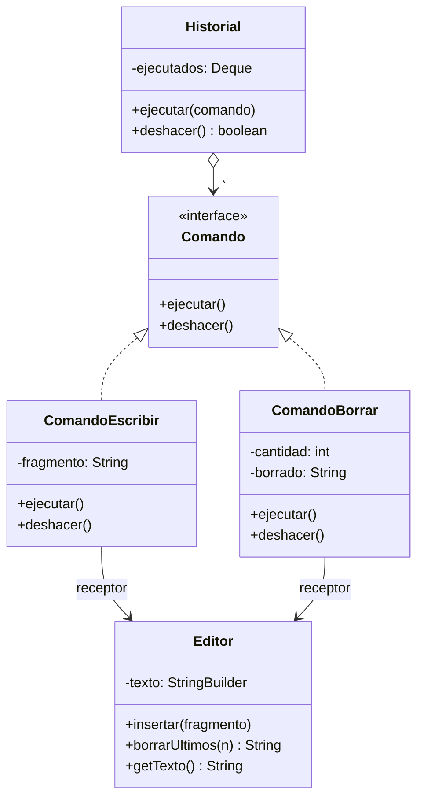

### Código para probar

```java
// Editor.java
// RECEPTOR: contiene la logica de negocio real. No sabe nada de comandos.
public class Editor {

    private final StringBuilder texto = new StringBuilder();

    public void insertar(String fragmento) {
        texto.append(fragmento);
    }

    // Borra los ultimos n caracteres y devuelve lo que borro (para poder deshacer).
    public String borrarUltimos(int n) {
        int inicio = Math.max(0, texto.length() - n);
        String borrado = texto.substring(inicio);
        texto.delete(inicio, texto.length());
        return borrado;
    }

    public String getTexto() {
        return texto.toString();
    }
}
```

```java
// Comando.java
// INTERFAZ COMANDO: toda solicitud se convierte en un objeto con estas dos operaciones.
public interface Comando {
    void ejecutar();

    void deshacer();
}
```

```java
// ComandoEscribir.java
// COMANDO CONCRETO: guarda los parametros de la solicitud y delega el trabajo en el receptor.
public class ComandoEscribir implements Comando {

    private final Editor editor;
    private final String fragmento;

    public ComandoEscribir(Editor editor, String fragmento) {
        this.editor = editor;
        this.fragmento = fragmento;
    }

    @Override
    public void ejecutar() {
        editor.insertar(fragmento);
    }

    @Override
    public void deshacer() {
        editor.borrarUltimos(fragmento.length());
    }
}
```

```java
// ComandoBorrar.java
public class ComandoBorrar implements Comando {

    private final Editor editor;
    private final int cantidad;
    private String borrado = "";      // copia de seguridad, necesaria para deshacer

    public ComandoBorrar(Editor editor, int cantidad) {
        this.editor = editor;
        this.cantidad = cantidad;
    }

    @Override
    public void ejecutar() {
        borrado = editor.borrarUltimos(cantidad);
    }

    @Override
    public void deshacer() {
        editor.insertar(borrado);
    }
}
```

```java
// Historial.java
import java.util.ArrayDeque;
import java.util.Deque;

// EMISORA (invocadora): ejecuta comandos que le entregan ya creados y los recuerda para deshacerlos.
public class Historial {

    private final Deque<Comando> ejecutados = new ArrayDeque<>();

    public void ejecutar(Comando comando) {
        comando.ejecutar();
        ejecutados.push(comando);
    }

    public boolean deshacer() {
        if (ejecutados.isEmpty()) {
            return false;
        }
        ejecutados.pop().deshacer();
        return true;
    }
}
```

```java
// App.java
public class App {
    public static void main(String[] args) {
        Editor editor = new Editor();
        Historial historial = new Historial();

        historial.ejecutar(new ComandoEscribir(editor, "Hola"));
        historial.ejecutar(new ComandoEscribir(editor, " mundo"));
        historial.ejecutar(new ComandoBorrar(editor, 3));
        mostrar("Despues de 3 comandos", editor);

        historial.deshacer();
        mostrar("Deshacer 1 (restaura lo borrado)", editor);

        historial.deshacer();
        mostrar("Deshacer 2", editor);

        historial.deshacer();
        mostrar("Deshacer 3", editor);

        System.out.println("Hay algo mas por deshacer? " + historial.deshacer());
    }

    private static void mostrar(String etiqueta, Editor editor) {
        System.out.println(etiqueta + ": \"" + editor.getTexto() + "\"");
    }
}
```

Salida esperada:

```
Despues de 3 comandos: "Hola mu"
Deshacer 1 (restaura lo borrado): "Hola mundo"
Deshacer 2: "Hola"
Deshacer 3: ""
Hay algo mas por deshacer? false
```

Fíjate en `ComandoBorrar`: guarda el texto que borró precisamente para poder devolverlo en `deshacer()`. Esa "copia de seguridad" es lo que hace posible revertir.

### Cuándo usarlo y cuándo no

**Úsalo cuando** necesites deshacer y rehacer, poner operaciones en cola o programarlas, registrar un historial de acciones, o desacoplar quien pide una acción de quien la ejecuta (botones, menús, tareas programadas).

**Evítalo cuando** la acción sea simple y nunca vaya a guardarse, deshacerse ni encolarse: crear una clase por cada operación añade código sin beneficio. En Java, si solo necesitas pasar un bloque de código, a veces una lambda (`Runnable`) es suficiente.

---

## 3. Iterator

### Descripción

Permite **recorrer los elementos de una colección** sin exponer su representación interna (lista, árbol, grafo, etc.).

### Estructura general

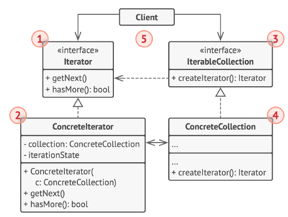

**Qué representa cada número de la figura:**

1. **Interfaz iteradora**: declara las operaciones necesarias para recorrer una colección: extraer el siguiente elemento, consultar la posición actual, reiniciar la iteración, etc.
2. **Iteradores concretos**: implementan algoritmos específicos de recorrido. Cada iterador controla su propio progreso, lo que permite que varios recorran la misma colección de forma independiente.
3. **Interfaz colección**: declara uno o varios métodos para obtener iteradores compatibles con la colección. El tipo de retorno debe ser la interfaz iteradora, para que las colecciones concretas puedan devolver diferentes tipos de iteradores.
4. **Colecciones concretas**: devuelven una instancia nueva de un iterador concreto cada vez que el cliente la pide. El resto del código de la colección (agregar, quitar, etc.) vive en la misma clase.
5. **Cliente**: trabaja con colecciones e iteradores a través de sus interfaces, de modo que no se acopla a clases concretas y el mismo código sirve con distintas colecciones e iteradores. Normalmente no crea iteradores: se los pide a la colección.

---

### El problema

Una lista de reproducción guarda canciones y se quiere recorrer de varias formas: en orden, al revés, o solo las de un artista. Si el código cliente recorre la lista con índices, queda **acoplado a cómo está guardada** (¿arreglo?, ¿lista enlazada?, ¿árbol por artista?). Si cambia la estructura interna, hay que reescribir todos los recorridos; y cada nueva forma de recorrer obliga a escribir otro `for` con sus propias condiciones.

### La solución

El recorrido se saca de la colección y se coloca en objetos **iteradores**. Cada iterador conoce una forma de recorrer (directa, inversa, por artista) y lleva su propia posición. La colección entrega un iterador nuevo cada vez que se le pide. El cliente solo usa `hayMas()` y `siguiente()` y no le importa cómo está guardada la lista; además, puede haber varios recorridos simultáneos sin interferir.

### Estructura de la solución

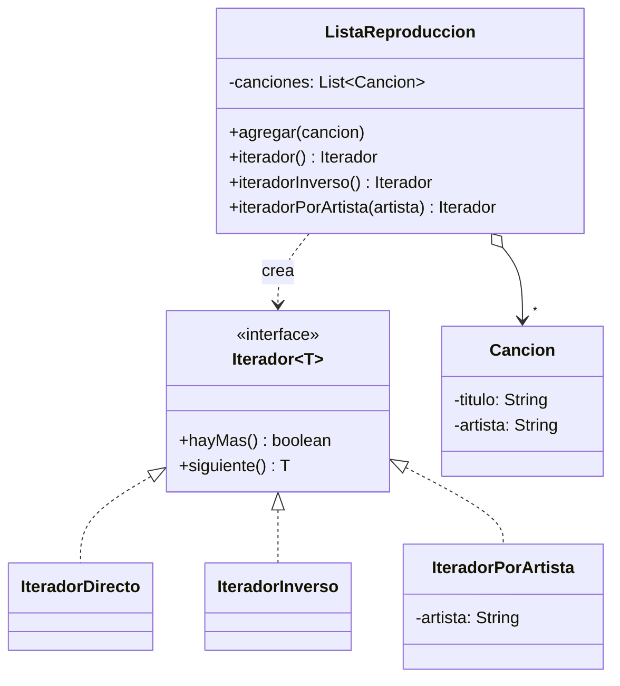

### Código para probar

```java
// Cancion.java
public class Cancion {

    private final String titulo;
    private final String artista;

    public Cancion(String titulo, String artista) {
        this.titulo = titulo;
        this.artista = artista;
    }

    public String getTitulo() {
        return titulo;
    }

    public String getArtista() {
        return artista;
    }

    @Override
    public String toString() {
        return titulo + " (" + artista + ")";
    }
}
```

```java
// Iterador.java
// INTERFAZ ITERADORA: las operaciones para recorrer, sin revelar como esta guardada la coleccion.
// (Java ya trae java.util.Iterator; la repetimos aqui para ver el patron completo.)
public interface Iterador<T> {
    boolean hayMas();

    T siguiente();
}
```

```java
// IteradorDirecto.java
import java.util.List;

// ITERADOR CONCRETO: lleva su propio progreso (posicion), por eso pueden existir varios a la vez.
public class IteradorDirecto implements Iterador<Cancion> {

    private final List<Cancion> canciones;
    private int posicion = 0;

    public IteradorDirecto(List<Cancion> canciones) {
        this.canciones = canciones;
    }

    @Override
    public boolean hayMas() {
        return posicion < canciones.size();
    }

    @Override
    public Cancion siguiente() {
        return canciones.get(posicion++);
    }
}
```

```java
// IteradorInverso.java
import java.util.List;

public class IteradorInverso implements Iterador<Cancion> {

    private final List<Cancion> canciones;
    private int posicion;

    public IteradorInverso(List<Cancion> canciones) {
        this.canciones = canciones;
        this.posicion = canciones.size() - 1;
    }

    @Override
    public boolean hayMas() {
        return posicion >= 0;
    }

    @Override
    public Cancion siguiente() {
        return canciones.get(posicion--);
    }
}
```

```java
// IteradorPorArtista.java
import java.util.List;

// Recorre solo las canciones de un artista: un algoritmo de recorrido distinto, misma interfaz.
public class IteradorPorArtista implements Iterador<Cancion> {

    private final List<Cancion> canciones;
    private final String artista;
    private int posicion = 0;

    public IteradorPorArtista(List<Cancion> canciones, String artista) {
        this.canciones = canciones;
        this.artista = artista;
        avanzarHastaLaSiguiente();
    }

    private void avanzarHastaLaSiguiente() {
        while (posicion < canciones.size() && !canciones.get(posicion).getArtista().equals(artista)) {
            posicion++;
        }
    }

    @Override
    public boolean hayMas() {
        return posicion < canciones.size();
    }

    @Override
    public Cancion siguiente() {
        Cancion actual = canciones.get(posicion++);
        avanzarHastaLaSiguiente();
        return actual;
    }
}
```

```java
// ListaReproduccion.java
import java.util.ArrayList;
import java.util.List;

// COLECCION CONCRETA: guarda sus elementos como quiere y entrega iteradores nuevos cada vez.
public class ListaReproduccion {

    private final List<Cancion> canciones = new ArrayList<>();

    public void agregar(Cancion cancion) {
        canciones.add(cancion);
    }

    public Iterador<Cancion> iterador() {
        return new IteradorDirecto(canciones);
    }

    public Iterador<Cancion> iteradorInverso() {
        return new IteradorInverso(canciones);
    }

    public Iterador<Cancion> iteradorPorArtista(String artista) {
        return new IteradorPorArtista(canciones, artista);
    }
}
```

```java
// App.java
public class App {
    public static void main(String[] args) {
        ListaReproduccion lista = new ListaReproduccion();
        lista.agregar(new Cancion("Rayando el sol", "Mana"));
        lista.agregar(new Cancion("Lluvia", "Aterciopelados"));
        lista.agregar(new Cancion("Clavado en un bar", "Mana"));
        lista.agregar(new Cancion("Bolero falaz", "Aterciopelados"));

        // El mismo metodo recorre cualquier iterador, sin saber como esta guardada la lista.
        System.out.println("-- En orden --");
        imprimir(lista.iterador());
        System.out.println("-- Al reves --");
        imprimir(lista.iteradorInverso());
        System.out.println("-- Solo Mana --");
        imprimir(lista.iteradorPorArtista("Mana"));

        // Dos iteradores sobre la misma lista avanzan de forma independiente.
        Iterador<Cancion> a = lista.iterador();
        Iterador<Cancion> b = lista.iterador();
        System.out.println("-- Dos iteradores independientes --");
        System.out.println("a: " + a.siguiente());
        System.out.println("a: " + a.siguiente());
        System.out.println("b: " + b.siguiente());
    }

    private static void imprimir(Iterador<Cancion> it) {
        while (it.hayMas()) {
            System.out.println("  " + it.siguiente());
        }
    }
}
```

Salida esperada:

```
-- En orden --
  Rayando el sol (Mana)
  Lluvia (Aterciopelados)
  Clavado en un bar (Mana)
  Bolero falaz (Aterciopelados)
-- Al reves --
  Bolero falaz (Aterciopelados)
  Clavado en un bar (Mana)
  Lluvia (Aterciopelados)
  Rayando el sol (Mana)
-- Solo Mana --
  Rayando el sol (Mana)
  Clavado en un bar (Mana)
-- Dos iteradores independientes --
a: Rayando el sol (Mana)
a: Lluvia (Aterciopelados)
b: Rayando el sol (Mana)
```

En la práctica, Java ya trae `java.util.Iterator` e `Iterable`: cualquier clase que implemente `Iterable<T>` puede usarse con el `for (T x : coleccion)`. Aquí repetimos la interfaz con otro nombre para que se vea el patrón completo.

### Cuándo usarlo y cuándo no

**Úsalo cuando** quieras ocultar la estructura interna de una colección, ofrecer varias formas de recorrerla, o recorrer estructuras complejas (árboles, grafos) con una interfaz uniforme.

**Evítalo cuando** la colección sea una lista o arreglo simple y solo necesites recorrerla en orden: el `for` mejorado de Java ya cumple. No crees un iterador propio si el del lenguaje basta.

---

## 4. Mediator

### Descripción

Reduce las dependencias caóticas entre objetos obligándolos a comunicarse **solo a través de un objeto mediador**, en lugar de hacerlo directamente entre ellos.

### Estructura general


**Qué representa cada número de la figura:**

1. **Componentes**: clases con alguna lógica de negocio. Cada uno tiene una referencia a una interfaz mediadora, declarada con su tipo. No conoce la clase concreta del mediador, así que se puede reutilizar en otros programas vinculándolo a un mediador distinto.
2. **Interfaz mediadora**: declara los métodos de comunicación con los componentes, normalmente uno solo de notificación. Los componentes pueden pasar cualquier contexto como argumentos, pero de modo que no haya acoplamiento entre el componente receptor y la clase del emisor.
3. **Mediadores concretos**: encapsulan las relaciones entre varios componentes. A menudo mantienen referencias a todos los que gestionan y, en ocasiones, administran incluso su ciclo de vida.
4. Los componentes **no deben conocer a otros componentes**. Si algo importante sucede en uno, solo debe notificar al mediador; el mediador identifica al emisor y decide qué componente debe activarse en respuesta. Desde la perspectiva de un componente, todo parece una caja negra: el emisor no sabe quién gestionará su solicitud y el receptor no sabe quién la envió.

---

### El problema

En una sala de chat, si cada usuario guardara una referencia a todos los demás para enviarles mensajes, cada nuevo usuario obligaría a actualizar a todos. Las reglas (por ejemplo, silenciar a alguien) estarían repartidas en cada clase `Usuario`. Los objetos quedan fuertemente acoplados en una maraña de referencias cruzadas, difícil de modificar o de reutilizar por separado.

### La solución

Se crea un **mediador** (`SalaChat`) que conoce a los usuarios. Los usuarios no se conocen entre sí: cuando uno escribe, avisa a la sala, y la sala decide a quién entregar el mensaje y aplica las reglas (como el silenciamiento). Agregar una regla nueva o cambiar cómo se reparten los mensajes toca **solo** al mediador.

### Estructura de la solución

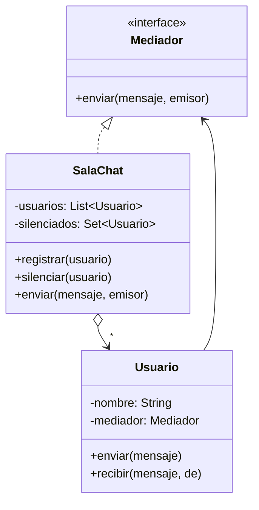

### Código para probar

```java
// Mediador.java
// INTERFAZ MEDIADORA: los componentes solo conocen esto, nunca a los otros componentes.
public interface Mediador {
    void enviar(String mensaje, Usuario emisor);
}
```

```java
// Usuario.java
// COMPONENTE: tiene logica propia pero se comunica unicamente a traves del mediador.
public class Usuario {

    private final String nombre;
    private final Mediador mediador;

    public Usuario(String nombre, Mediador mediador) {
        this.nombre = nombre;
        this.mediador = mediador;
    }

    public String getNombre() {
        return nombre;
    }

    public void enviar(String mensaje) {
        mediador.enviar(mensaje, this);   // notifica al mediador, no a otros usuarios
    }

    public void recibir(String mensaje, String de) {
        System.out.println("  [" + nombre + " recibe] " + de + ": " + mensaje);
    }
}
```

```java
// SalaChat.java
import java.util.ArrayList;
import java.util.HashSet;
import java.util.List;
import java.util.Set;

// MEDIADOR CONCRETO: concentra las relaciones y las reglas entre los componentes.
public class SalaChat implements Mediador {

    private final List<Usuario> usuarios = new ArrayList<>();
    private final Set<Usuario> silenciados = new HashSet<>();

    public void registrar(Usuario usuario) {
        usuarios.add(usuario);
    }

    public void silenciar(Usuario usuario) {
        silenciados.add(usuario);
    }

    @Override
    public void enviar(String mensaje, Usuario emisor) {
        System.out.println(emisor.getNombre() + " escribe: " + mensaje);
        if (silenciados.contains(emisor)) {
            System.out.println("  [Sala] " + emisor.getNombre() + " esta silenciado: mensaje descartado");
            return;
        }
        for (Usuario u : usuarios) {
            if (u != emisor) {
                u.recibir(mensaje, emisor.getNombre());
            }
        }
    }
}
```

```java
// App.java
public class App {
    public static void main(String[] args) {
        SalaChat sala = new SalaChat();

        Usuario ana = new Usuario("Ana", sala);
        Usuario luis = new Usuario("Luis", sala);
        Usuario marta = new Usuario("Marta", sala);
        sala.registrar(ana);
        sala.registrar(luis);
        sala.registrar(marta);

        ana.enviar("Hola a todos");

        sala.silenciar(luis);
        luis.enviar("Compren mi producto");   // la regla vive en el mediador, no en los usuarios
        marta.enviar("Luis esta silenciado, pero igual nos lee");
    }
}
```

Salida esperada:

```
Ana escribe: Hola a todos
  [Luis recibe] Ana: Hola a todos
  [Marta recibe] Ana: Hola a todos
Luis escribe: Compren mi producto
  [Sala] Luis esta silenciado: mensaje descartado
Marta escribe: Luis esta silenciado, pero igual nos lee
  [Ana recibe] Marta: Luis esta silenciado, pero igual nos lee
  [Luis recibe] Marta: Luis esta silenciado, pero igual nos lee
```

Ningún `Usuario` tiene una referencia a otro `Usuario`: toda la comunicación y la regla del silenciamiento viven en `SalaChat`.

### Cuándo usarlo y cuándo no

**Úsalo cuando** muchos objetos se comuniquen de forma compleja y las dependencias cruzadas dificulten el cambio, o cuando quieras reutilizar un componente sin arrastrar a todos los que se relacionaban con él (formularios con campos que se habilitan según otros, salas de chat, torres de control).

**Evítalo cuando** haya pocos objetos y la comunicación sea sencilla. El riesgo clásico es que el mediador crezca hasta convertirse en un **"objeto dios"** que sabe demasiado; si eso pasa, conviene dividirlo.

---

## 5. Memento

### Descripción

Permite **guardar y restaurar el estado anterior** de un objeto sin revelar los detalles de su implementación (sin romper el encapsulamiento).

### Estructura general


**Qué representa cada número de la figura (variante clásica, con clases anidadas, la que se puede usar en Java):**

1. **Originadora**: la clase que puede producir instantáneas de su propio estado y restaurarlo a partir de ellas cuando lo necesita.
2. **Memento**: objeto de valor que actúa como instantánea del estado de la originadora. Es práctica común hacerlo inmutable y entregarle los datos una sola vez, por el constructor.
3. **Cuidadora**: sabe no solo "cuándo" y "por qué" capturar el estado de la originadora, sino también cuándo debe restaurarse. Puede rastrear el historial guardando una pila de mementos: para retroceder, saca el de arriba y se lo pasa al método de restauración.
4. En esta implementación, la clase memento se **anida dentro de la originadora**. Así la originadora accede a sus campos aunque sean privados, mientras que la cuidadora tiene un acceso muy limitado: puede guardar mementos en una pila pero no alterar su contenido.

*(El libro describe además dos variantes: una con **interfaz intermedia**, para lenguajes sin clases anidadas, donde la cuidadora solo ve una interfaz con metadatos del memento; y otra con **encapsulación más estricta**, para que ninguna otra clase acceda al estado de la originadora a través del memento. En Java la de clases anidadas es la natural.)*

---

### El problema

Un editor de texto necesita **deshacer**. Para hacerlo, hay que guardar el estado anterior. Pero si el estado se guarda copiando los campos desde fuera, el editor tiene que exponerlos todos (getters públicos de cada atributo), lo que rompe el encapsulamiento: cualquiera podría leerlos o modificarlos, y cada cambio interno en el editor obliga a actualizar el código externo que hace la copia.

### La solución

Que sea el **propio editor** quien produzca la copia de su estado, dentro de un objeto `Instantanea` (el memento). Ese objeto es una **caja cerrada**: solo el editor puede mirar dentro. Quien guarda el historial (`HistorialEdiciones`, la cuidadora) puede almacenar instantáneas y devolverlas, pero no leer ni modificar su contenido. Así el estado se respalda **sin exponer** los detalles del editor.

### Estructura de la solución

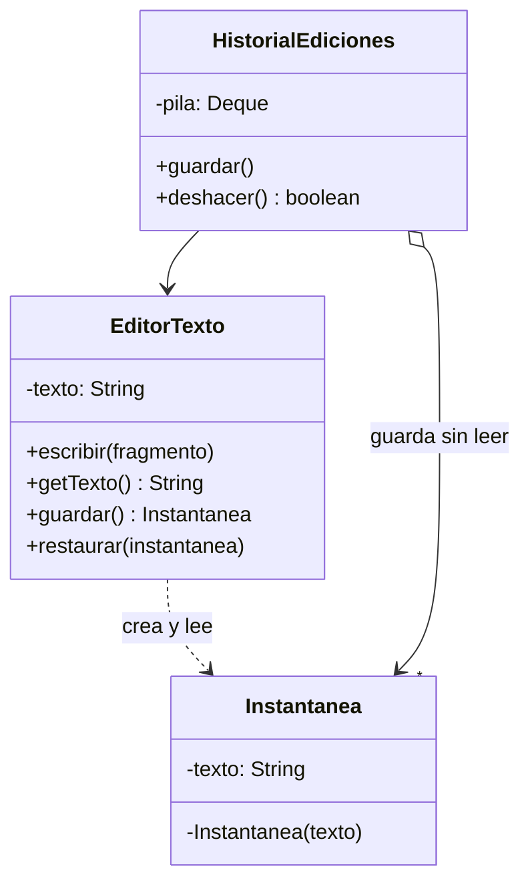

*(La clase `Instantanea` está anidada dentro de `EditorTexto`: por eso el editor puede acceder a su campo privado y las demás clases no.)*

### Código para probar

```java
// EditorTexto.java
// ORIGINADORA: produce instantaneas de su propio estado y se restaura a partir de ellas.
public class EditorTexto {

    private String texto = "";

    public void escribir(String fragmento) {
        texto += fragmento;
    }

    public String getTexto() {
        return texto;
    }

    public Instantanea guardar() {
        return new Instantanea(texto);
    }

    public void restaurar(Instantanea instantanea) {
        this.texto = instantanea.texto;     // solo la originadora puede leer el campo privado
    }

    // MEMENTO como clase anidada: la originadora accede a sus campos privados,
    // cualquier otra clase solo puede guardar y devolver el objeto, sin leerlo ni cambiarlo.
    public static class Instantanea {

        private final String texto;

        private Instantanea(String texto) {
            this.texto = texto;
        }
    }
}
```

```java
// HistorialEdiciones.java
import java.util.ArrayDeque;
import java.util.Deque;

// CUIDADORA: decide CUANDO guardar y CUANDO restaurar, pero no puede ver dentro de las instantaneas.
public class HistorialEdiciones {

    private final Deque<EditorTexto.Instantanea> pila = new ArrayDeque<>();
    private final EditorTexto editor;

    public HistorialEdiciones(EditorTexto editor) {
        this.editor = editor;
    }

    public void guardar() {
        pila.push(editor.guardar());
    }

    public boolean deshacer() {
        if (pila.isEmpty()) {
            return false;
        }
        editor.restaurar(pila.pop());
        return true;
    }
}
```

```java
// App.java
public class App {
    public static void main(String[] args) {
        EditorTexto editor = new EditorTexto();
        HistorialEdiciones historial = new HistorialEdiciones(editor);

        historial.guardar();                 // instantanea 1: texto vacio
        editor.escribir("Hola");
        historial.guardar();                 // instantanea 2: "Hola"
        editor.escribir(" mundo");
        historial.guardar();                 // instantanea 3: "Hola mundo"
        editor.escribir("!!!");
        System.out.println("Texto actual: \"" + editor.getTexto() + "\"");

        historial.deshacer();
        System.out.println("Deshacer 1: \"" + editor.getTexto() + "\"");
        historial.deshacer();
        System.out.println("Deshacer 2: \"" + editor.getTexto() + "\"");
        historial.deshacer();
        System.out.println("Deshacer 3: \"" + editor.getTexto() + "\"");
        System.out.println("Queda historial? " + historial.deshacer());
    }
}
```

Salida esperada:

```
Texto actual: "Hola mundo!!!"
Deshacer 1: "Hola mundo"
Deshacer 2: "Hola"
Deshacer 3: ""
Queda historial? false
```

Compara con Command: ambos permiten deshacer, pero **Command** deshace ejecutando la operación inversa, mientras que **Memento** deshace **volviendo a una copia** del estado. Memento es más simple cuando es difícil describir la operación inversa, pero consume más memoria si el estado es grande.

### Cuándo usarlo y cuándo no

**Úsalo cuando** necesites instantáneas del estado de un objeto para restaurarlo después (deshacer, puntos de guardado en un videojuego, transacciones que se revierten) y copiar el estado directamente rompería el encapsulamiento.

**Evítalo cuando** el estado sea enorme y se guarde con mucha frecuencia (el consumo de memoria se dispara: considera guardar solo las diferencias), o cuando los objetos cambian tan poco que una copia sencilla alcanza.

---

## 6. Observer

### Descripción

Define un mecanismo de **suscripción** para avisar a varios objetos sobre cualquier evento que le suceda al objeto que están observando.

### Estructura general


**Qué representa cada número de la figura:**

1. **Notificador (publicador)**: envía eventos de interés a otros objetos. Esos eventos ocurren cuando cambia su estado o ejecuta ciertos comportamientos. Contiene una infraestructura de suscripción que permite a los suscriptores nuevos y antiguos entrar y salir de la lista.
2. Cuando sucede un evento, el notificador **recorre la lista de suscripción** e invoca el método de notificación declarado en la interfaz suscriptora de cada suscriptor.
3. **Interfaz suscriptora**: declara la interfaz de notificación. En la mayoría de los casos consiste en un único método `actualizar`, que puede recibir parámetros con detalles del evento.
4. **Suscriptores concretos**: realizan acciones en respuesta a las notificaciones. Todos implementan la misma interfaz, de modo que el notificador no se acopla a clases concretas.
5. Normalmente los suscriptores necesitan información de contexto para manejar la actualización. Por eso el notificador suele pasar datos como argumentos de la notificación, o incluso pasarse a sí mismo para que el suscriptor extraiga lo que necesita.
6. **Cliente**: crea por separado los notificadores y los suscriptores, y luego registra a los suscriptores en el notificador.

---

### El problema

Una tienda en línea tiene un producto agotado. Muchos clientes quieren enterarse cuando vuelva a haber stock, cada uno por un canal distinto (correo, notificación en la app). Si los clientes consultan al producto una y otra vez para ver si ya hay stock, se desperdician recursos. Si el producto avisa directamente a cada cliente con código específico para cada canal, queda acoplado a todos ellos y hay que modificarlo cada vez que se agrega un canal nuevo.

### La solución

El producto (notificador) mantiene una **lista de suscriptores** que implementan una interfaz común. Cuando el stock vuelve de cero a positivo, recorre la lista y llama a `actualizar(evento)` en cada uno. Quien quiera enterarse se suscribe; quien ya no, cancela. El producto no conoce los detalles de ningún suscriptor, solo la interfaz.

### Estructura de la solución

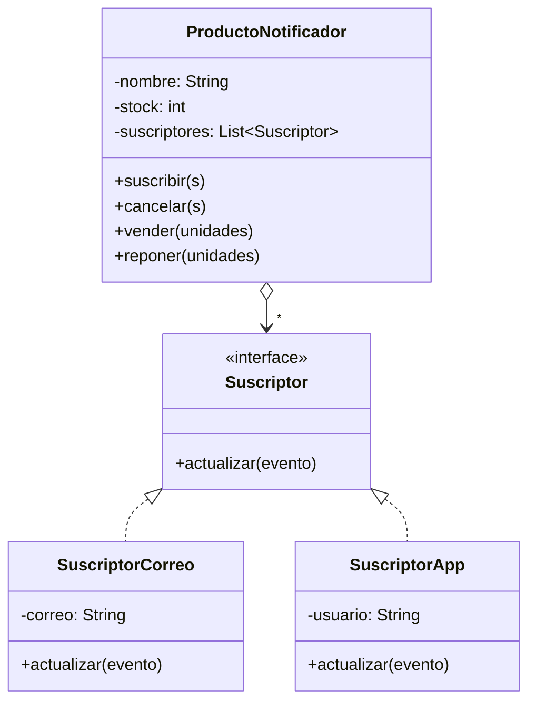

### Código para probar

```java
// Suscriptor.java
// INTERFAZ SUSCRIPTORA: lo unico que el notificador necesita saber de quien lo escucha.
public interface Suscriptor {
    void actualizar(String evento);
}
```

```java
// ProductoNotificador.java
import java.util.ArrayList;
import java.util.List;

// NOTIFICADOR: mantiene la lista de suscriptores y los avisa cuando algo de interes ocurre.
public class ProductoNotificador {

    private final String nombre;
    private int stock;
    private final List<Suscriptor> suscriptores = new ArrayList<>();

    public ProductoNotificador(String nombre, int stock) {
        this.nombre = nombre;
        this.stock = stock;
    }

    public void suscribir(Suscriptor s) {
        suscriptores.add(s);
    }

    public void cancelar(Suscriptor s) {
        suscriptores.remove(s);
    }

    public void vender(int unidades) {
        stock = Math.max(0, stock - unidades);
        System.out.println("Se vendieron " + unidades + " de " + nombre + ". Stock: " + stock);
    }

    public void reponer(int unidades) {
        boolean estabaAgotado = stock == 0;
        stock += unidades;
        System.out.println("Se repusieron " + unidades + " de " + nombre + ". Stock: " + stock);
        if (estabaAgotado) {
            notificar("Volvio a haber " + nombre);   // solo avisa si el estado cambio de verdad
        }
    }

    private void notificar(String evento) {
        for (Suscriptor s : suscriptores) {
            s.actualizar(evento);
        }
    }
}
```

```java
// SuscriptorCorreo.java
public class SuscriptorCorreo implements Suscriptor {

    private final String correo;

    public SuscriptorCorreo(String correo) {
        this.correo = correo;
    }

    @Override
    public void actualizar(String evento) {
        System.out.println("  [Correo a " + correo + "] " + evento);
    }
}
```

```java
// SuscriptorApp.java
public class SuscriptorApp implements Suscriptor {

    private final String usuario;

    public SuscriptorApp(String usuario) {
        this.usuario = usuario;
    }

    @Override
    public void actualizar(String evento) {
        System.out.println("  [Notificacion push a " + usuario + "] " + evento);
    }
}
```

```java
// App.java
public class App {
    public static void main(String[] args) {
        ProductoNotificador monitor = new ProductoNotificador("Monitor 24", 0);

        Suscriptor correo = new SuscriptorCorreo("ana@correo.com");
        Suscriptor app = new SuscriptorApp("luis");
        monitor.suscribir(correo);
        monitor.suscribir(app);

        monitor.reponer(5);        // estaba agotado: avisa a los dos
        monitor.vender(5);         // vuelve a agotarse

        monitor.cancelar(correo);  // Ana ya no quiere avisos
        monitor.reponer(3);        // avisa solo a Luis
        monitor.reponer(2);        // ya habia stock: no hay evento nuevo
    }
}
```

Salida esperada:

```
Se repusieron 5 de Monitor 24. Stock: 5
  [Correo a ana@correo.com] Volvio a haber Monitor 24
  [Notificacion push a luis] Volvio a haber Monitor 24
Se vendieron 5 de Monitor 24. Stock: 0
Se repusieron 3 de Monitor 24. Stock: 3
  [Notificacion push a luis] Volvio a haber Monitor 24
Se repusieron 2 de Monitor 24. Stock: 5
```

Observa que la última reposición (2 unidades cuando ya había 3) **no genera aviso**: el evento de interés es "dejó de estar agotado", no "llegó mercancía".

### Cuándo usarlo y cuándo no

**Úsalo cuando** el cambio de estado en un objeto deba reflejarse en otros objetos que no se conocen de antemano o que cambian dinámicamente: interfaces gráficas (eventos de botones), sistemas de notificaciones, actualización en tiempo real, modelos de datos con varias vistas.

**Evítalo cuando** solo haya un interesado fijo (una llamada directa es más simple) o cuando el orden de las notificaciones importe, porque no está garantizado. Cuidado también con las **fugas de memoria** (suscriptores que nunca se cancelan siguen vivos) y con las **cadenas de notificaciones** en las que un aviso provoca otro y es difícil seguir el flujo.

---

## 7. State

### Descripción

Permite que un objeto **cambie su comportamiento cuando cambia su estado interno**. Parece como si el objeto cambiara de clase.

### Estructura general


**Qué representa cada número de la figura:**

1. **Contexto**: guarda una referencia a uno de los objetos de estado concreto y le delega todo el trabajo que depende del estado. Se comunica con él a través de la interfaz de estado y expone un modificador (`setter`) para recibir un nuevo estado.
2. **Interfaz estado**: declara los métodos específicos del estado. Deben tener sentido para todos los estados concretos: ninguno debería tener métodos inútiles que nunca se invoquen.
3. **Estados concretos**: implementan sus propias versiones de los métodos específicos del estado. Para evitar duplicar código parecido entre estados, se pueden usar clases abstractas intermedias. Pueden guardar una referencia de vuelta al contexto, para extraer información de él o iniciar transiciones.
4. Tanto el contexto como los estados concretos pueden establecer el siguiente estado del contexto y realizar la transición, **sustituyendo el objeto de estado** vinculado al contexto.

---

### El problema

Un documento de un blog pasa por estados: borrador, en revisión, publicado. Las mismas acciones (enviar a revisión, aprobar, rechazar) significan cosas distintas, o no son válidas, según el estado actual. Con un atributo `String estado` y una cadena de `if/else` o `switch` en cada método, el código se llena de condiciones repetidas: cada acción pregunta por el estado, y agregar uno nuevo ("archivado") obliga a modificar **todos** los métodos.

### La solución

Cada estado se convierte en una **clase** que implementa la misma interfaz y sabe qué hacer con cada acción estando en él. El documento (contexto) guarda el estado actual y le **delega** las acciones. Las transiciones las hace el propio estado, sustituyendo el objeto de estado del contexto por otro. Un estado nuevo es una clase nueva; las condiciones desaparecen.

### Estructura de la solución

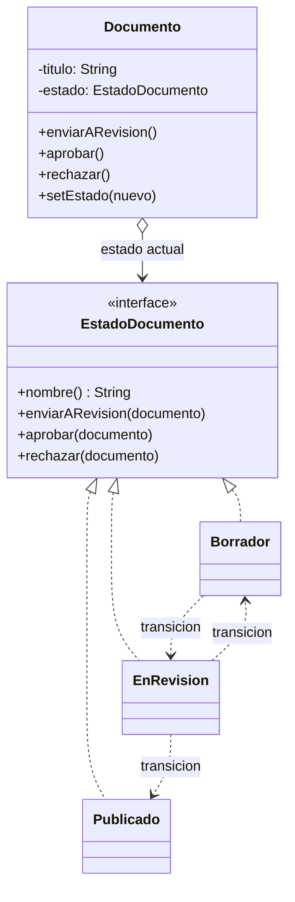

### Código para probar

```java
// EstadoDocumento.java
// INTERFAZ ESTADO: todas las acciones posibles, cada estado decide que significan.
public interface EstadoDocumento {
    String nombre();

    void enviarARevision(Documento documento);

    void aprobar(Documento documento);

    void rechazar(Documento documento);
}
```

```java
// Documento.java
// CONTEXTO: guarda el estado actual y le delega todo el trabajo que depende de el.
public class Documento {

    private final String titulo;
    private EstadoDocumento estado = new Borrador();

    public Documento(String titulo) {
        this.titulo = titulo;
    }

    // Permite que el contexto o los propios estados provoquen la transicion.
    void setEstado(EstadoDocumento nuevo) {
        System.out.println("  Transicion: " + estado.nombre() + " -> " + nuevo.nombre());
        this.estado = nuevo;
    }

    public void enviarARevision() {
        estado.enviarARevision(this);
    }

    public void aprobar() {
        estado.aprobar(this);
    }

    public void rechazar() {
        estado.rechazar(this);
    }

    public String getEstado() {
        return estado.nombre();
    }

    public String getTitulo() {
        return titulo;
    }
}
```

```java
// Borrador.java
public class Borrador implements EstadoDocumento {

    @Override
    public String nombre() {
        return "Borrador";
    }

    @Override
    public void enviarARevision(Documento d) {
        d.setEstado(new EnRevision());
    }

    @Override
    public void aprobar(Documento d) {
        System.out.println("  No se puede aprobar un borrador que no fue revisado");
    }

    @Override
    public void rechazar(Documento d) {
        System.out.println("  No hay nada que rechazar: aun es un borrador");
    }
}
```

```java
// EnRevision.java
public class EnRevision implements EstadoDocumento {

    @Override
    public String nombre() {
        return "En revision";
    }

    @Override
    public void enviarARevision(Documento d) {
        System.out.println("  Ya esta en revision");
    }

    @Override
    public void aprobar(Documento d) {
        d.setEstado(new Publicado());
    }

    @Override
    public void rechazar(Documento d) {
        d.setEstado(new Borrador());
    }
}
```

```java
// Publicado.java
public class Publicado implements EstadoDocumento {

    @Override
    public String nombre() {
        return "Publicado";
    }

    @Override
    public void enviarARevision(Documento d) {
        System.out.println("  Ya esta publicado: no necesita revision");
    }

    @Override
    public void aprobar(Documento d) {
        System.out.println("  Ya esta publicado");
    }

    @Override
    public void rechazar(Documento d) {
        System.out.println("  Un documento publicado no se puede rechazar");
    }
}
```

```java
// App.java
public class App {
    public static void main(String[] args) {
        Documento doc = new Documento("Guia de patrones");
        System.out.println("Estado inicial: " + doc.getEstado());

        System.out.println("aprobar()");
        doc.aprobar();              // invalido desde Borrador

        System.out.println("enviarARevision()");
        doc.enviarARevision();

        System.out.println("rechazar()");
        doc.rechazar();             // vuelve a Borrador

        System.out.println("enviarARevision()");
        doc.enviarARevision();

        System.out.println("aprobar()");
        doc.aprobar();

        System.out.println("rechazar()");
        doc.rechazar();             // invalido desde Publicado

        System.out.println("Estado final: " + doc.getEstado());
    }
}
```

Salida esperada:

```
Estado inicial: Borrador
aprobar()
  No se puede aprobar un borrador que no fue revisado
enviarARevision()
  Transicion: Borrador -> En revision
rechazar()
  Transicion: En revision -> Borrador
enviarARevision()
  Transicion: Borrador -> En revision
aprobar()
  Transicion: En revision -> Publicado
rechazar()
  Un documento publicado no se puede rechazar
Estado final: Publicado
```

Ninguna clase tiene un `if` que pregunte "¿en qué estado estoy?": el estado actual **es** el objeto al que se le delega.

### Cuándo usarlo y cuándo no

**Úsalo cuando** un objeto se comporte de forma muy distinta según su estado, el número de estados sea considerable y el código esté lleno de condicionales que preguntan por él (flujos de aprobación, pedidos que pasan de pendiente a enviado, reproductores de música, conexiones de red).

**Evítalo cuando** haya pocos estados o rara vez cambien: un `enum` con un `switch` es más simple. Si hay solo dos o tres estados con transiciones obvias, el patrón puede ser demasiado para el problema.

---

## 8. Strategy

### Descripción

Define una **familia de algoritmos**, coloca cada uno en una clase separada y hace que sus objetos sean **intercambiables**.

### Estructura general


**Qué representa cada número de la figura:**

1. **Contexto**: mantiene una referencia a una de las estrategias concretas y se comunica con ella únicamente a través de la interfaz estrategia.
2. **Interfaz estrategia**: común a todas las estrategias concretas. Declara un método que el contexto usa para ejecutar el algoritmo.
3. **Estrategias concretas**: implementan distintas variaciones del algoritmo que usa el contexto.
4. El contexto invoca el método de ejecución del objeto de estrategia asociado **cada vez que necesita** ejecutar el algoritmo. No sabe con qué tipo de estrategia trabaja ni cómo se ejecuta el algoritmo.
5. **Cliente**: crea un objeto de estrategia específico y se lo pasa al contexto. El contexto expone un modificador (`setter`) para que los clientes puedan sustituir la estrategia durante la ejecución.

---

### El problema

Una tienda calcula el costo de envío de dos formas: estándar y express, y pronto habrá otras (recoger en tienda, envío gratis por promoción). Si el cálculo vive dentro de la clase `Pedido` con un `switch` por tipo de envío, esa clase crece con cada algoritmo nuevo, es difícil de probar y cada modificación arriesga romper los otros cálculos.

### La solución

Cada forma de calcular se extrae a su propia clase que implementa `EstrategiaEnvio`. El `Pedido` (contexto) guarda una estrategia y se limita a invocarla. Para cambiar el algoritmo se **sustituye el objeto**, incluso con el programa corriendo. Agregar una forma de cálculo nueva es escribir una clase nueva, sin tocar el `Pedido`.

### Estructura de la solución

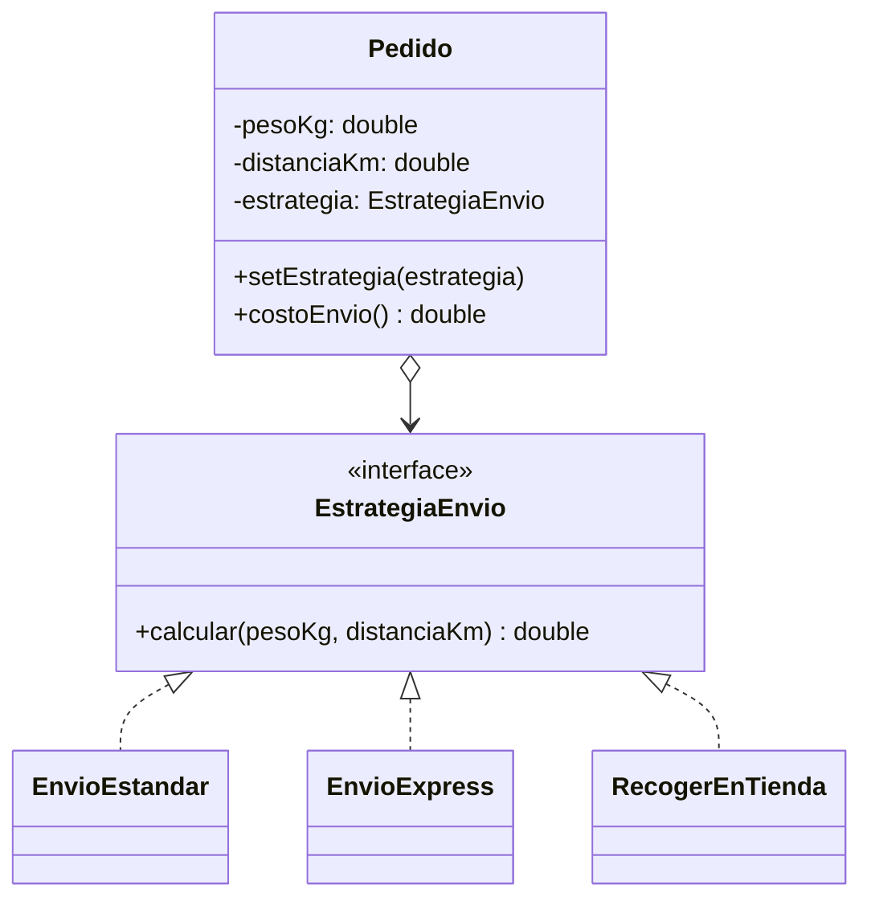

### Código para probar

```java
// EstrategiaEnvio.java
// INTERFAZ ESTRATEGIA: un unico metodo, por eso tambien se puede implementar con una lambda.
public interface EstrategiaEnvio {
    double calcular(double pesoKg, double distanciaKm);
}
```

```java
// EnvioEstandar.java
public class EnvioEstandar implements EstrategiaEnvio {
    @Override
    public double calcular(double pesoKg, double distanciaKm) {
        return 5000 + 800 * pesoKg;
    }
}
```

```java
// EnvioExpress.java
public class EnvioExpress implements EstrategiaEnvio {
    @Override
    public double calcular(double pesoKg, double distanciaKm) {
        return 12000 + 1500 * pesoKg + 50 * distanciaKm;
    }
}
```

```java
// RecogerEnTienda.java
public class RecogerEnTienda implements EstrategiaEnvio {
    @Override
    public double calcular(double pesoKg, double distanciaKm) {
        return 0;
    }
}
```

```java
// Pedido.java
// CONTEXTO: no sabe CON QUE estrategia trabaja ni como se calcula el costo.
public class Pedido {

    private final double pesoKg;
    private final double distanciaKm;
    private EstrategiaEnvio estrategia;

    public Pedido(double pesoKg, double distanciaKm, EstrategiaEnvio estrategia) {
        this.pesoKg = pesoKg;
        this.distanciaKm = distanciaKm;
        this.estrategia = estrategia;
    }

    // La estrategia se puede cambiar en tiempo de ejecucion.
    public void setEstrategia(EstrategiaEnvio estrategia) {
        this.estrategia = estrategia;
    }

    public double costoEnvio() {
        return estrategia.calcular(pesoKg, distanciaKm);
    }
}
```

```java
// App.java
public class App {
    public static void main(String[] args) {
        // El cliente elige la estrategia y se la entrega al contexto.
        Pedido pedido = new Pedido(2, 10, new EnvioEstandar());
        System.out.println("Estandar: $" + (long) pedido.costoEnvio());

        pedido.setEstrategia(new EnvioExpress());
        System.out.println("Express: $" + (long) pedido.costoEnvio());

        pedido.setEstrategia(new RecogerEnTienda());
        System.out.println("Recoger en tienda: $" + (long) pedido.costoEnvio());

        // Como la interfaz tiene un solo metodo, una estrategia nueva puede ser una lambda.
        pedido.setEstrategia((peso, distancia) -> peso >= 2 ? 0 : 5000);
        System.out.println("Promocion (envio gratis desde 2 kg): $" + (long) pedido.costoEnvio());
    }
}
```

Salida esperada:

```
Estandar: $6600
Express: $15500
Recoger en tienda: $0
Promocion (envio gratis desde 2 kg): $0
```

La interfaz tiene **un solo método**, así que una estrategia también puede escribirse como lambda (última línea). Un ejemplo conocido en Java: `Comparator` es una estrategia que se le pasa a `Collections.sort` o a `list.sort(...)`.

### Cuándo usarlo y cuándo no

**Úsalo cuando** tengas varias formas de hacer lo mismo y quieras elegir una en tiempo de ejecución, cuando una clase tenga un `switch` enorme que selecciona entre variantes de un algoritmo, o cuando quieras aislar la lógica de un algoritmo del resto del código.

**Evítalo cuando** solo haya uno o dos algoritmos que casi nunca cambian: un `if` es más simple. Además, el cliente debe **conocer las diferencias** entre las estrategias para escoger bien, lo que lo acopla un poco a ellas.

---

## 9. Template Method

### Descripción

Define el **esqueleto de un algoritmo** en una clase base y permite que las subclases redefinan **ciertos pasos** sin cambiar la estructura general.

### Estructura general


**Qué representa cada número de la figura:**

1. **Clase abstracta**: declara los métodos que actúan como pasos del algoritmo, así como el propio **método plantilla**, que invoca esos pasos en un orden específico. Los pasos pueden ser abstractos o tener una implementación por defecto.
2. **Clases concretas**: pueden sobrescribir todos los pasos, **pero no** el método plantilla.

---

### El problema

Una aplicación genera reportes en varios formatos (CSV, HTML). Los pasos son siempre los mismos: obtener los datos, escribir un encabezado, formatear cada fila, agregar un cierre y entregar el resultado. Si cada formato tiene su propia clase con el flujo completo, el **código repetido** se multiplica (obtener datos y entregar son iguales en todos), y un cambio en el orden de los pasos obliga a editar todas las clases.

### La solución

El algoritmo se escribe **una sola vez** en la clase base, en un método plantilla (`generar()`), declarado `final` para que nadie cambie el orden. Los pasos que cambian entre formatos son abstractos (`encabezado`, `formatearFila`) y cada subclase los implementa. Los pasos comunes tienen implementación por defecto (`obtenerDatos`), y los opcionales son **ganchos** (*hooks*) vacíos que las subclases pueden sobrescribir si lo necesitan (`pie`).

### Estructura de la solución

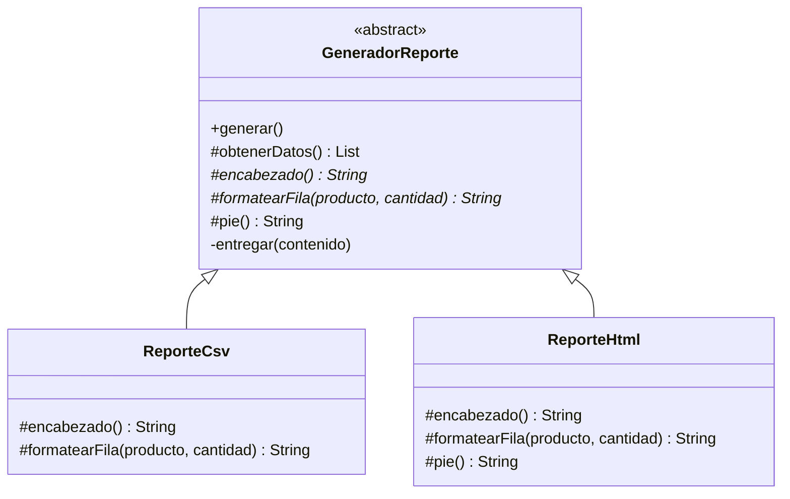

### Código para probar

```java
// GeneradorReporte.java
import java.util.List;

// CLASE ABSTRACTA: define el esqueleto del algoritmo (metodo plantilla) y deja pasos para las subclases.
public abstract class GeneradorReporte {

    // METODO PLANTILLA: final, para que las subclases no puedan cambiar el orden de los pasos.
    public final void generar() {
        List<String[]> filas = obtenerDatos();
        StringBuilder contenido = new StringBuilder();
        contenido.append(encabezado()).append("\n");
        for (String[] fila : filas) {
            contenido.append(formatearFila(fila[0], Integer.parseInt(fila[1]))).append("\n");
        }
        contenido.append(pie());
        entregar(contenido.toString());
    }

    // Paso con implementacion por defecto (comun a todos los reportes).
    protected List<String[]> obtenerDatos() {
        return List.of(
                new String[] {"Teclado", "12"},
                new String[] {"Mouse", "30"},
                new String[] {"Monitor", "5"});
    }

    // Pasos abstractos: cada subclase DEBE implementarlos.
    protected abstract String encabezado();

    protected abstract String formatearFila(String producto, int cantidad);

    // Gancho (hook): paso opcional, vacio por defecto.
    protected String pie() {
        return "";
    }

    private void entregar(String contenido) {
        System.out.println(contenido);
    }
}
```

```java
// ReporteCsv.java
public class ReporteCsv extends GeneradorReporte {

    @Override
    protected String encabezado() {
        return "producto,cantidad";
    }

    @Override
    protected String formatearFila(String producto, int cantidad) {
        return producto + "," + cantidad;
    }
}
```

```java
// ReporteHtml.java
public class ReporteHtml extends GeneradorReporte {

    @Override
    protected String encabezado() {
        return "<table><tr><th>Producto</th><th>Cantidad</th></tr>";
    }

    @Override
    protected String formatearFila(String producto, int cantidad) {
        return "<tr><td>" + producto + "</td><td>" + cantidad + "</td></tr>";
    }

    // Sobrescribe el gancho para agregar algo propio.
    @Override
    protected String pie() {
        return "</table>";
    }
}
```

```java
// App.java
public class App {
    public static void main(String[] args) {
        System.out.println("-- Reporte CSV --");
        new ReporteCsv().generar();

        System.out.println("-- Reporte HTML --");
        new ReporteHtml().generar();
    }
}
```

Salida esperada:

```
-- Reporte CSV --
producto,cantidad
Teclado,12
Mouse,30
Monitor,5

-- Reporte HTML --
<table><tr><th>Producto</th><th>Cantidad</th></tr>
<tr><td>Teclado</td><td>12</td></tr>
<tr><td>Mouse</td><td>30</td></tr>
<tr><td>Monitor</td><td>5</td></tr>
</table>
```

Fíjate en que `ReporteCsv` no define `pie()` y usa el vacío por defecto, mientras que `ReporteHtml` sí lo sobrescribe para cerrar la tabla.

### Cuándo usarlo y cuándo no

**Úsalo cuando** varias clases tengan el mismo algoritmo con diferencias en algunos pasos, o cuando quieras que los clientes extiendan solo ciertas partes de un algoritmo sin poder alterar su estructura. Es la base de muchos **frameworks**: la biblioteca define el flujo y tú rellenas los pasos (por ejemplo, `HttpServlet` decide cuándo llamar a `doGet` o `doPost`, y tú los implementas).

**Evítalo cuando** necesites cambiar el algoritmo **en tiempo de ejecución** (porque usa herencia, que es estática: ahí conviene Strategy) o cuando el esqueleto tenga tantos pasos que sea difícil de mantener. Ten presente que la herencia acopla las subclases a la clase base.

---

## 10. Visitor

### Descripción

Permite **agregar nuevas operaciones** a una familia de clases sin modificarlas, colocando la operación en un objeto aparte (el visitante).

### Estructura general


**Qué representa cada número de la figura:**

1. **Interfaz visitante**: declara un grupo de métodos de visita que reciben los elementos concretos de la estructura como argumento. Pueden llamarse igual si el lenguaje permite sobrecarga, pero los tipos de los parámetros deben ser diferentes.
2. **Visitantes concretos**: cada uno implementa versiones del mismo comportamiento, adaptadas a cada clase de elemento concreto.
3. **Interfaz elemento**: declara un método para "aceptar" visitantes, que recibe un parámetro del tipo de la interfaz visitante.
4. **Elementos concretos**: cada uno implementa el método de aceptación, cuyo propósito es **redirigir la llamada al método de visita adecuado** del visitante según la clase del elemento actual. Todas las subclases deben sobrescribirlo, aunque una clase base ya lo tenga, para invocar el método correcto.
5. **Cliente**: normalmente representa una colección u otro objeto complejo (como un árbol Composite). A menudo no conoce todas las clases concretas de elementos, porque trabaja con ellos a través de una interfaz abstracta.

---

### El problema

Un carrito de compras contiene libros, computadores y alimentos, cada uno con reglas de impuestos distintas. Hoy se necesita calcular impuestos; mañana, exportar a otro formato; pasado mañana, imprimir una descripción. Si cada operación nueva se agrega como método dentro de cada clase de producto, las clases se inflan con responsabilidades que no son suyas y hay que **modificar todas** cada vez que aparece una operación nueva. Preguntar con `instanceof` en un solo lugar tampoco es limpio: crece y se rompe al agregar clases.

### La solución

Cada operación nueva es un **visitante**: una clase con un método de visita para cada tipo de elemento. Cada producto tiene un único método `aceptar(visitante)` que se limita a llamar `visitante.visitar(this)`; como `this` ya tiene su tipo concreto, Java elige el método de visita correcto. A esto se le llama **doble despacho**. Agregar una operación es escribir un visitante nuevo, sin tocar los productos.

### Estructura de la solución

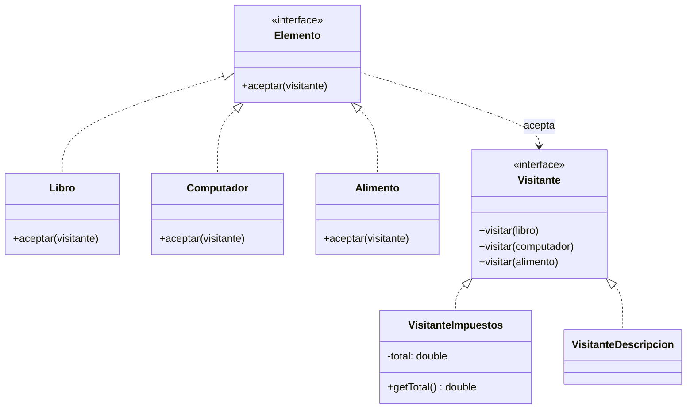

### Código para probar

```java
// Visitante.java
// INTERFAZ VISITANTE: un metodo por cada clase de elemento (sobrecarga por tipo).
public interface Visitante {
    void visitar(Libro libro);

    void visitar(Computador computador);

    void visitar(Alimento alimento);
}
```

```java
// Elemento.java
// INTERFAZ ELEMENTO: permite "aceptar" visitantes.
public interface Elemento {
    void aceptar(Visitante visitante);
}
```

```java
// Libro.java
public class Libro implements Elemento {

    private final String titulo;
    private final double precio;

    public Libro(String titulo, double precio) {
        this.titulo = titulo;
        this.precio = precio;
    }

    public String getTitulo() {
        return titulo;
    }

    public double getPrecio() {
        return precio;
    }

    // Doble despacho: el elemento le dice al visitante QUE clase es (visitar(Libro)).
    @Override
    public void aceptar(Visitante visitante) {
        visitante.visitar(this);
    }
}
```

```java
// Computador.java
public class Computador implements Elemento {

    private final String modelo;
    private final double precio;

    public Computador(String modelo, double precio) {
        this.modelo = modelo;
        this.precio = precio;
    }

    public String getModelo() {
        return modelo;
    }

    public double getPrecio() {
        return precio;
    }

    @Override
    public void aceptar(Visitante visitante) {
        visitante.visitar(this);
    }
}
```

```java
// Alimento.java
public class Alimento implements Elemento {

    private final String nombre;
    private final double precio;

    public Alimento(String nombre, double precio) {
        this.nombre = nombre;
        this.precio = precio;
    }

    public String getNombre() {
        return nombre;
    }

    public double getPrecio() {
        return precio;
    }

    @Override
    public void aceptar(Visitante visitante) {
        visitante.visitar(this);
    }
}
```

```java
// VisitanteImpuestos.java
// VISITANTE CONCRETO: una operacion nueva sobre toda la familia de elementos, sin modificarlos.
public class VisitanteImpuestos implements Visitante {

    private double total = 0;

    @Override
    public void visitar(Libro libro) {
        total += libro.getPrecio() * 0.00;      // los libros no pagan IVA
    }

    @Override
    public void visitar(Computador computador) {
        total += computador.getPrecio() * 0.19;
    }

    @Override
    public void visitar(Alimento alimento) {
        total += alimento.getPrecio() * 0.05;
    }

    public double getTotal() {
        return total;
    }
}
```

```java
// VisitanteDescripcion.java
public class VisitanteDescripcion implements Visitante {

    @Override
    public void visitar(Libro libro) {
        System.out.println("Libro: " + libro.getTitulo() + " ($" + (long) libro.getPrecio() + ")");
    }

    @Override
    public void visitar(Computador computador) {
        System.out.println("Computador: " + computador.getModelo() + " ($" + (long) computador.getPrecio() + ")");
    }

    @Override
    public void visitar(Alimento alimento) {
        System.out.println("Alimento: " + alimento.getNombre() + " ($" + (long) alimento.getPrecio() + ")");
    }
}
```

```java
// App.java
import java.util.List;

public class App {
    public static void main(String[] args) {
        // El cliente maneja los elementos solo como Elemento.
        List<Elemento> carrito = List.of(
                new Libro("Patrones de diseno", 40000),
                new Computador("Portatil 14", 2000000),
                new Alimento("Cafe", 10000));

        VisitanteDescripcion descripcion = new VisitanteDescripcion();
        for (Elemento e : carrito) {
            e.aceptar(descripcion);
        }

        VisitanteImpuestos impuestos = new VisitanteImpuestos();
        for (Elemento e : carrito) {
            e.aceptar(impuestos);
        }
        System.out.println("Impuestos totales: $" + (long) impuestos.getTotal());
    }
}
```

Salida esperada:

```
Libro: Patrones de diseno ($40000)
Computador: Portatil 14 ($2000000)
Alimento: Cafe ($10000)
Impuestos totales: $380500
```

El cálculo es 0 (libro) + 380000 (19% de 2.000.000) + 500 (5% de 10.000) = 380500.

### Cuándo usarlo y cuándo no

**Úsalo cuando** tengas una estructura de clases estable (los tipos de elemento casi no cambian) sobre la que necesitas aplicar operaciones nuevas con frecuencia, o cuando quieras separar lógica auxiliar (exportar, calcular, validar) de las clases del dominio. Es habitual en compiladores y en el recorrido de árboles de sintaxis.

**Evítalo cuando** las clases de elemento cambien con frecuencia: cada elemento nuevo obliga a modificar **todos** los visitantes. También rompe parcialmente el encapsulamiento, porque los elementos deben exponer lo que el visitante necesita. En Java moderno, el *pattern matching* con `switch` sobre interfaces selladas (`sealed`) cubre muchos casos con menos código.

---

## 11. Interpreter

### Descripción

Dada la **gramática de un lenguaje sencillo**, define una representación de sus reglas mediante clases y un intérprete que usa esa representación para evaluar oraciones del lenguaje.

### Estructura general

Este patrón **no está en el libro de Shvets**, por eso no hay figura para ubicar. La estructura clásica del catálogo GoF es:

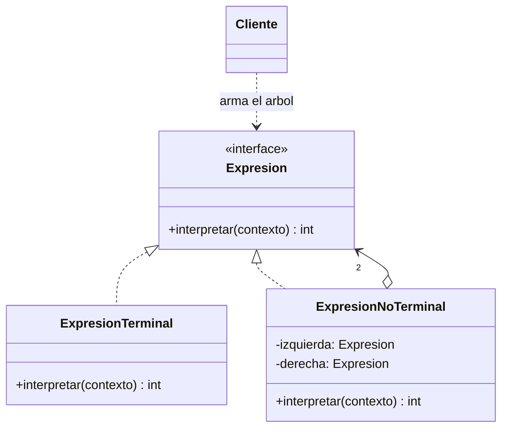

**Qué representa cada elemento (leyenda propia, no del libro):**

1. **Expresión (abstracta)**: la interfaz común, con una operación `interpretar` que recibe el contexto.
2. **Expresiones terminales**: las piezas más simples de la gramática (un número, una variable). Se interpretan directamente.
3. **Expresiones no terminales**: reglas compuestas (suma, resta). Contienen otras expresiones y combinan sus resultados.
4. **Contexto**: la información global que se necesita al interpretar (aquí, los valores de las variables).
5. **Cliente**: construye (o recibe de un analizador) el **árbol sintáctico** de la expresión y pide interpretarlo.

Observa que es un caso del patrón **Composite**: el árbol de expresiones es un árbol donde las hojas son terminales y los nodos son no terminales.

---

### El problema

Un sistema de ventas necesita que el negocio defina reglas de cálculo sencillas que cambian seguido: "precio por cantidad menos descuento", "(a + b) menos 3". Si cada regla se programa a mano en Java, cada cambio exige recompilar y desplegar. Se necesita que la regla sea **un dato** que el programa pueda evaluar con valores distintos cada vez.

### La solución

Se modela cada parte de la gramática como una clase: `Numero`, `Variable` (terminales) y `Suma`, `Resta`, `Multiplicacion` (no terminales, que contienen otras expresiones). Una regla es entonces un **árbol de objetos** que se evalúa de forma recursiva con `interpretar(contexto)`. El contexto aporta los valores de las variables, así que el mismo árbol se reutiliza con datos diferentes. Un analizador (aquí, uno sencillo de notación postfija) puede construir el árbol a partir de texto.

### Estructura de la solución

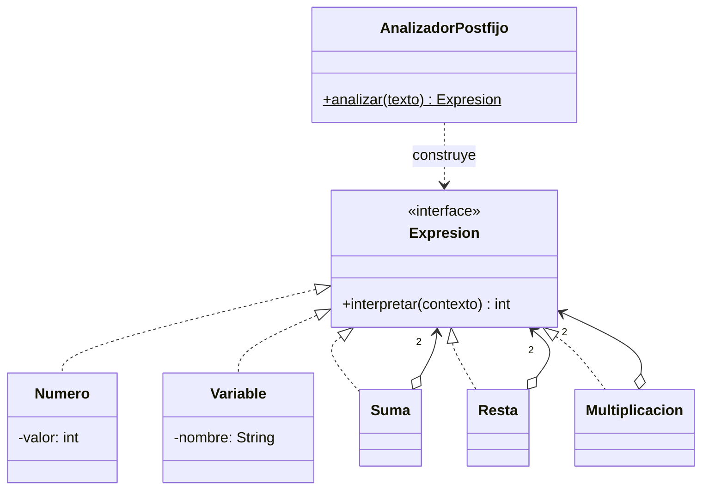

### Código para probar

```java
// Expresion.java
import java.util.Map;

// EXPRESION ABSTRACTA: toda parte de la gramatica sabe interpretarse dentro de un contexto.
public interface Expresion {
    int interpretar(Map<String, Integer> contexto);
}
```

```java
// Numero.java
import java.util.Map;

// EXPRESION TERMINAL: no contiene otras expresiones.
public class Numero implements Expresion {

    private final int valor;

    public Numero(int valor) {
        this.valor = valor;
    }

    @Override
    public int interpretar(Map<String, Integer> contexto) {
        return valor;
    }
}
```

```java
// Variable.java
import java.util.Map;

// EXPRESION TERMINAL: su valor se consulta en el contexto (por eso la misma expresion sirve con datos distintos).
public class Variable implements Expresion {

    private final String nombre;

    public Variable(String nombre) {
        this.nombre = nombre;
    }

    @Override
    public int interpretar(Map<String, Integer> contexto) {
        return contexto.get(nombre);
    }
}
```

```java
// Suma.java
import java.util.Map;

// EXPRESION NO TERMINAL: contiene otras expresiones y combina sus resultados.
public class Suma implements Expresion {

    private final Expresion izquierda;
    private final Expresion derecha;

    public Suma(Expresion izquierda, Expresion derecha) {
        this.izquierda = izquierda;
        this.derecha = derecha;
    }

    @Override
    public int interpretar(Map<String, Integer> contexto) {
        return izquierda.interpretar(contexto) + derecha.interpretar(contexto);
    }
}
```

```java
// Resta.java
import java.util.Map;

public class Resta implements Expresion {

    private final Expresion izquierda;
    private final Expresion derecha;

    public Resta(Expresion izquierda, Expresion derecha) {
        this.izquierda = izquierda;
        this.derecha = derecha;
    }

    @Override
    public int interpretar(Map<String, Integer> contexto) {
        return izquierda.interpretar(contexto) - derecha.interpretar(contexto);
    }
}
```

```java
// Multiplicacion.java
import java.util.Map;

public class Multiplicacion implements Expresion {

    private final Expresion izquierda;
    private final Expresion derecha;

    public Multiplicacion(Expresion izquierda, Expresion derecha) {
        this.izquierda = izquierda;
        this.derecha = derecha;
    }

    @Override
    public int interpretar(Map<String, Integer> contexto) {
        return izquierda.interpretar(contexto) * derecha.interpretar(contexto);
    }
}
```

```java
// AnalizadorPostfijo.java
import java.util.ArrayDeque;
import java.util.Deque;

// Construye el arbol sintactico a partir de texto en notacion postfija ("a b + 3 -").
// No es parte del patron en si: el patron define el arbol; quien lo arma es el cliente (o un analizador como este).
public class AnalizadorPostfijo {

    public static Expresion analizar(String texto) {
        Deque<Expresion> pila = new ArrayDeque<>();
        for (String token : texto.trim().split("\\s+")) {
            switch (token) {
                case "+" -> {
                    Expresion der = pila.pop();
                    pila.push(new Suma(pila.pop(), der));
                }
                case "-" -> {
                    Expresion der = pila.pop();
                    pila.push(new Resta(pila.pop(), der));
                }
                case "*" -> {
                    Expresion der = pila.pop();
                    pila.push(new Multiplicacion(pila.pop(), der));
                }
                default -> {
                    if (token.matches("\\d+")) {
                        pila.push(new Numero(Integer.parseInt(token)));
                    } else {
                        pila.push(new Variable(token));
                    }
                }
            }
        }
        return pila.pop();
    }
}
```

```java
// App.java
import java.util.HashMap;
import java.util.Map;

public class App {
    public static void main(String[] args) {

        // 1. El cliente arma el arbol a mano: (a + b) - 3
        Expresion expresion = new Resta(
                new Suma(new Variable("a"), new Variable("b")),
                new Numero(3));

        Map<String, Integer> contexto = new HashMap<>();
        contexto.put("a", 10);
        contexto.put("b", 5);
        System.out.println("(a + b) - 3 con a=10, b=5 : " + expresion.interpretar(contexto));

        // La misma expresion se interpreta con otros datos.
        contexto.put("a", 1);
        contexto.put("b", 1);
        System.out.println("(a + b) - 3 con a=1, b=1  : " + expresion.interpretar(contexto));

        // 2. Un analizador construye el arbol desde texto: reglas de negocio configurables.
        Expresion total = AnalizadorPostfijo.analizar("precio cantidad * descuento -");
        Map<String, Integer> venta = new HashMap<>();
        venta.put("precio", 2500);
        venta.put("cantidad", 4);
        venta.put("descuento", 1000);
        System.out.println("precio * cantidad - descuento : " + total.interpretar(venta));
    }
}
```

Salida esperada:

```
(a + b) - 3 con a=10, b=5 : 12
(a + b) - 3 con a=1, b=1  : -1
precio * cantidad - descuento : 9000
```

La notación postfija (`precio cantidad * descuento -`) pone el operador **después** de sus operandos, lo que hace muy fácil armar el árbol con una pila. El analizador no es parte del patrón: el patrón define el árbol y cómo se evalúa.

### Cuándo usarlo y cuándo no

**Úsalo cuando** tengas un lenguaje **pequeño y estable** (reglas de negocio configurables, filtros de búsqueda, fórmulas sencillas) y la gramática sea simple de representar como clases.

**Evítalo cuando** la gramática sea grande o compleja: el número de clases crece con cada regla y el rendimiento sufre. Para lenguajes reales se usan generadores de analizadores (como ANTLR) o bibliotecas ya hechas (expresiones regulares, motores de reglas). Es, de los once, el patrón que se usa con menos frecuencia en el día a día.

---

## Cómo distinguir Strategy, State y Template Method

Los tres cambian "cómo se hace algo" usando polimorfismo, pero responden a necesidades distintas:

| | **Strategy** | **State** | **Template Method** |
|---|---|---|---|
| **Mecanismo** | Composición (se le pasa un objeto) | Composición (el contexto guarda un objeto de estado) | Herencia (las subclases rellenan pasos) |
| **Quién decide el cambio** | El **cliente**, desde fuera | El **propio sistema**: los estados hacen las transiciones | El **programador**, al elegir qué subclase crear |
| **¿Se conocen entre sí las variantes?** | No: son independientes | Sí: los estados conocen a los estados siguientes | No aplica |
| **¿Cuándo cambia?** | En tiempo de ejecución, por elección | En tiempo de ejecución, por eventos | En tiempo de compilación |
| **Pregunta clave** | "¿Qué algoritmo uso?" | "¿En qué situación estoy?" | "¿Qué pasos varían de un flujo fijo?" |

## Otras parejas que se confunden

| Pareja | Diferencia |
|---|---|
| **Observer y Mediator** | Observer: un objeto avisa a **muchos** que no conoce, en un solo sentido. Mediator: los objetos hablan **en ambos sentidos** a través de un coordinador que conoce y aplica reglas. |
| **Command y Memento** | Ambos permiten deshacer. Command revierte con la **operación inversa**; Memento regresa a una **copia del estado**. |
| **Command y Strategy** | Ambos encapsulan código en un objeto. Command representa una **acción** (a ejecutar, guardar o deshacer); Strategy representa **una forma de hacer lo mismo**. |
| **Chain of Responsibility y Decorator** | Ambos encadenan objetos. En la cadena, cada manejador puede **detener** el flujo; un decorador siempre delega y agrega comportamiento. |

## Resumen comparativo

| Patrón | Resuelve... | Mecanismo típico en Java |
|---|---|---|
| **Chain of Responsibility** | Varios objetos pueden atender una solicitud en un orden configurable | Manejadores con referencia al siguiente |
| **Command** | Convertir acciones en objetos (deshacer, encolar, registrar) | Interfaz con `ejecutar()` y `deshacer()` |
| **Iterator** | Recorrer una colección sin exponer su estructura | Interfaz con `hayMas()` y `siguiente()` |
| **Mediator** | Maraña de comunicación entre objetos | Objeto coordinador que conoce a los componentes |
| **Memento** | Guardar y restaurar estado sin romper el encapsulamiento | Clase anidada con campos privados |
| **Observer** | Avisar a muchos cuando algo cambia | Lista de suscriptores con una interfaz común |
| **State** | Comportamiento que depende del estado interno | Una clase por estado y delegación desde el contexto |
| **Strategy** | Algoritmos intercambiables | Interfaz con implementaciones sustituibles |
| **Template Method** | Esqueleto fijo con pasos variables | Método `final` que llama a pasos abstractos |
| **Visitor** | Operaciones nuevas sobre clases estables | Doble despacho con `aceptar` y `visitar` |
| **Interpreter** | Evaluar reglas de un lenguaje pequeño | Árbol de expresiones terminales y no terminales |

## Ejemplos que ya usas sin saberlo (Java)

| Patrón | Dónde aparece |
|---|---|
| **Chain of Responsibility** | Cadena de filtros de servlets (`FilterChain`) |
| **Command** | `Runnable` y `Callable` enviados a un `ExecutorService` |
| **Iterator** | `java.util.Iterator` e `Iterable` (el `for` mejorado) |
| **Observer** | Los *listeners* de las interfaces gráficas (por ejemplo `ActionListener`) |
| **Strategy** | `Comparator` pasado a `list.sort(...)` |
| **Template Method** | `HttpServlet` (`service` llama a `doGet`, `doPost`...) |

*(Los demás patrones aparecen con más frecuencia en código de aplicación que en la biblioteca estándar.)*
