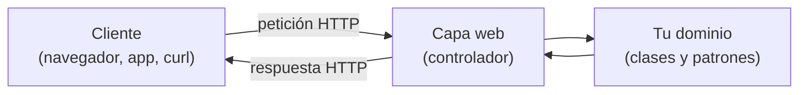
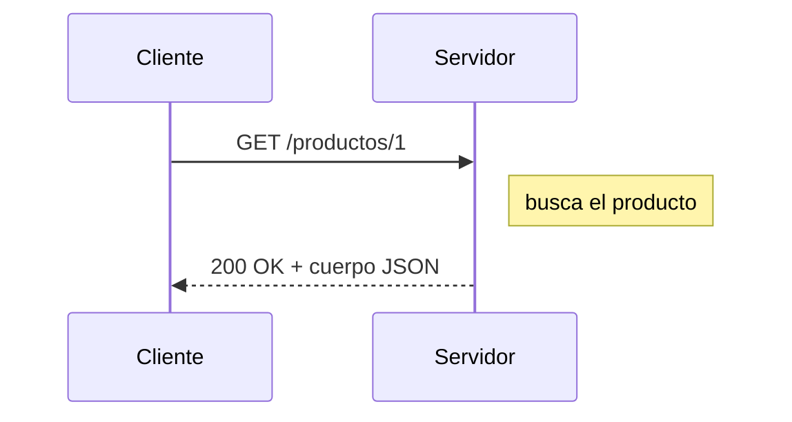
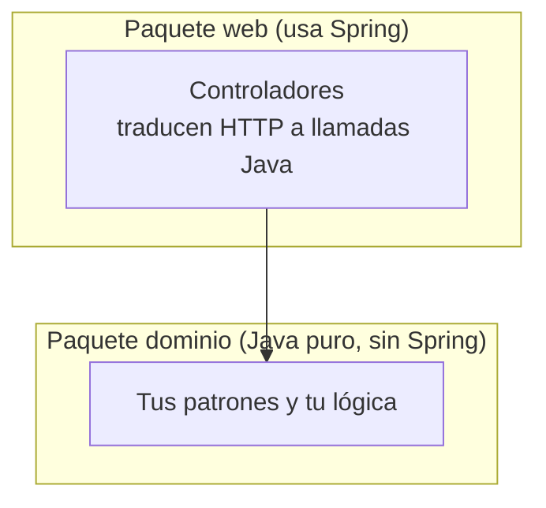

# Fundamentos web para programadores: cliente, servidor, HTTP, JSON y REST

> Guía introductoria previa al desarrollo con Spring Boot. No necesitas saber nada de desarrollo web: partimos de cero y todo se explica con ejemplos que puedes ejecutar en tu computador.

| | |
|---|---|
| **Curso** | Modelos de Programación |
| **Duración sugerida** | 1 sesión de 2 horas (lectura guiada + práctica) |
| **Requisitos** | Java 17 o superior, una terminal y un navegador |
| **Qué vas a poder hacer al final** | Leer y escribir una petición HTTP, interpretar un código de estado, leer y escribir JSON, diseñar las rutas de una API REST y probar un servidor con `curl` |

---

## 1. Por qué esta guía en un curso de patrones

Hasta ahora todos tus programas eran de consola: el usuario ejecutaba `main`, se imprimía algo y el programa terminaba. Casi ningún software real funciona así. Una tienda en línea, una aplicación de domicilios o un banco funcionan como **servicios que están siempre encendidos** y a los que otras aplicaciones les hacen peticiones.

En el proyecto final vas a construir una aplicación con varios patrones de diseño y a **exponerla como un servicio web**, de modo que cualquier cliente (un navegador, una aplicación móvil, otro programa) pueda usarla. Los patrones siguen siendo exactamente los mismos que ya conoces; lo nuevo es la "puerta de entrada" por la que llegan las peticiones.



En esta guía aprenderás el vocabulario de esa flecha del centro: cómo se hablan el cliente y el servidor.

---

## 2. Cliente y servidor

Piensa en un restaurante:

| En el restaurante | En la web |
|---|---|
| El **comensal** pide algo | El **cliente** hace una petición (*request*) |
| El **mesero** lleva el pedido y trae la respuesta | La **red** transporta los mensajes |
| La **cocina** prepara el plato | El **servidor** procesa la petición |
| El comensal no entra a la cocina | El cliente **no ve** cómo está construido el servidor |

Dos ideas importantes:

1. **El cliente siempre empieza.** El servidor no le escribe al cliente por iniciativa propia; espera a que le pregunten y responde.
2. **Cliente y servidor se pueden programar en lenguajes distintos.** Un cliente escrito en JavaScript puede hablar con un servidor escrito en Java, porque ambos acuerdan un **protocolo** (un conjunto de reglas para el formato de los mensajes). El protocolo de la web se llama **HTTP**.

Esto es lo mismo que ya viste con los patrones: el cliente depende de una **interfaz** (el contrato HTTP), no de la implementación interna del servidor.

---

## 3. Direcciones: host, puerto y URL

Para que el cliente encuentre al servidor necesita saber **dónde** está y **a qué puerta** tocar.

```
http://localhost:8080/productos/1?moneda=cop
\__/   \_______/ \__/ \_________/ \_________/
 |        |       |       |            |
 |        |       |       |            +-- parámetros de consulta (query)
 |        |       |       +--------------- ruta (path)
 |        |       +----------------------- puerto
 |        +------------------------------- host (la máquina)
 +---------------------------------------- protocolo
```

- **Host**: el nombre o la dirección de la máquina donde corre el servidor. `localhost` significa "este mismo computador". Es lo que vas a usar todo el curso: tu computador será a la vez cliente y servidor.
- **Puerto**: un número entre 1 y 65535 que identifica *qué programa* de esa máquina debe atender la petición. Una misma máquina puede tener muchos servidores a la vez, cada uno en su puerto. Por convención, las aplicaciones de desarrollo usan el **8080**.
- **Ruta (path)**: qué recurso se pide dentro del servidor (`/productos/1`).
- **Query**: datos opcionales después del `?`, en pares `clave=valor` separados por `&` (`?moneda=cop&orden=precio`).

---

## 4. HTTP: el idioma de la web

HTTP es un protocolo basado en texto. Una conversación consta siempre de **una petición** y **una respuesta**.

### 4.1 La petición (request)

Esta es una petición real. Se capturó con `curl -v` contra el servidor de ejemplo de la sección 8:

```
GET /productos/1 HTTP/1.1
Host: localhost:8080
User-Agent: curl/8.5.0
Accept: */*

```

Tiene tres partes:

1. **Línea inicial**: el **método** (`GET`), la **ruta** (`/productos/1`) y la versión del protocolo.
2. **Cabeceras (headers)**: pares `Nombre: valor` con información adicional (a quién va dirigida, qué programa la envía, qué formatos acepta).
3. **Cuerpo (body)**: datos opcionales. Un `GET` normalmente no lleva cuerpo; un `POST` sí.

### 4.2 La respuesta (response)

```
HTTP/1.1 200 OK
Date: Wed, 11 Nov 2026 16:51:53 GMT
Content-type: application/json
Content-length: 80

{"id": 1, "nombre": "Teclado mecanico", "precioCop": 103960, "disponible": true}
```

También tiene tres partes:

1. **Línea de estado**: la versión, el **código de estado** (`200`) y su texto (`OK`).
2. **Cabeceras**: entre ellas `Content-type`, que dice **en qué formato** viene el cuerpo.
3. **Cuerpo**: el contenido que pidió el cliente. Aquí es un texto en formato JSON (sección 6).



### 4.3 Los métodos (verbos)

El método dice **qué quieres hacer** con el recurso. Los cuatro básicos:

| Método | Significado | Ejemplo | ¿Lleva cuerpo? |
|---|---|---|---|
| `GET` | **Leer** un recurso. No debe cambiar nada en el servidor | `GET /productos/1` | No |
| `POST` | **Crear** un recurso nuevo | `POST /productos` | Sí (los datos del nuevo producto) |
| `PUT` | **Reemplazar** un recurso existente | `PUT /productos/1` | Sí (el producto completo) |
| `DELETE` | **Eliminar** un recurso | `DELETE /productos/1` | No |

Fíjate que la **ruta** dice *sobre qué* y el **método** dice *qué hacer*. La ruta nunca es un verbo: se escribe `DELETE /productos/1`, no `GET /borrarProducto?id=1`.

### 4.4 Los códigos de estado

El código resume en un número cómo le fue a la petición. Se agrupan por su primer dígito:

| Familia | Significado | Códigos que vas a usar |
|---|---|---|
| **2xx** | Todo salió bien | `200 OK` (respuesta normal), `201 Created` (se creó algo) |
| **4xx** | El **cliente** se equivocó | `400 Bad Request` (petición mal formada), `404 Not Found` (no existe), `405 Method Not Allowed` (método no permitido en esa ruta) |
| **5xx** | El **servidor** falló | `500 Internal Server Error` (una excepción no controlada) |

Regla práctica: si el error se arregla cambiando la petición, es 4xx; si se arregla corrigiendo el código del servidor, es 5xx.

> **Conexión con tu taller de MiniTienda:** los códigos `200`, `400` y `404` que devolvía `TiendaFachada.get(...)` eran exactamente estos. La clase `RespuestaHttp` que te dimos era una simulación de una respuesta real. En el proyecto final dejarás de simularla.

---

## 5. Cabeceras y tipos de contenido

La cabecera más importante para nosotros es `Content-type`: indica cómo interpretar el cuerpo.

| `Content-type` | El cuerpo es... |
|---|---|
| `text/plain` | Texto simple |
| `text/html` | Una página web |
| `application/json` | Datos en formato JSON |

Cuando el **cliente** envía datos (con `POST` o `PUT`), también debe decir en qué formato los manda: `Content-Type: application/json`.

---

## 6. JSON: el formato para intercambiar datos

Un objeto Java vive en la memoria de la JVM. Para enviarlo por la red hay que convertirlo en **texto**. Ese proceso se llama **serialización**; el proceso inverso (de texto a objeto) se llama **deserialización**. El formato de texto más usado hoy es **JSON** (*JavaScript Object Notation*).

### 6.1 Sintaxis

```json
{
  "id": 1,
  "nombre": "Teclado mecanico",
  "precioCop": 103960,
  "disponible": true,
  "etiquetas": ["oficina", "periferico"],
  "proveedor": { "nombre": "Proveedor Uno", "pais": "US" },
  "descuento": null
}
```

Reglas (son pocas):

- Un objeto va entre llaves `{ }` y contiene pares `"clave": valor` separados por comas.
- Las **claves siempre van entre comillas dobles**. Las comillas simples no son válidas.
- Los valores pueden ser: texto (`"..."`), número (`12`, `3.5`), booleano (`true` o `false`), `null`, una lista entre corchetes `[ ]` o **otro objeto**.
- **No se permiten comas sobrantes** al final ni comentarios.

### 6.2 De objeto Java a JSON

La correspondencia es directa: cada atributo se vuelve una clave.

```java
public record ProductoDto(int id, String nombre, long precioCop, boolean disponible) { }

ProductoDto p = new ProductoDto(1, "Teclado mecanico", 103960, true);
```

se serializa como:

```json
{"id": 1, "nombre": "Teclado mecanico", "precioCop": 103960, "disponible": true}
```

| Java | JSON |
|---|---|
| `int`, `long`, `double` | número |
| `String` | texto entre comillas |
| `boolean` | `true` / `false` |
| `List<...>` o arreglo | lista `[ ... ]` |
| Un objeto o `Map` | objeto `{ ... }` |
| `null` | `null` |

Más adelante no vas a escribir ese texto a mano: **Spring lo hace por ti** cuando tu método devuelve un objeto. Pero necesitas saber leerlo, porque es lo que verás en las pruebas.

### 6.3 Compruebas que entendiste (JSON)

¿Cuáles de estos textos son JSON válido? (Respuestas en la sección 11.)

```text
A)  {"nombre": "Mouse", "precio": 15500}
B)  {nombre: "Mouse", "precio": 15500}
C)  {"nombre": 'Mouse', "precio": 15500}
D)  {"nombre": "Mouse", "precio": 15500,}
E)  {"nombre": "Mouse", "tags": ["a", "b"], "stock": {"bodega": 3}}
```

---

## 7. REST: cómo diseñar las rutas de una API

**REST** no es una tecnología sino un **estilo de diseño** para servicios web. Su idea central: la API expone **recursos** (sustantivos: productos, pedidos, clientes), cada uno con una dirección, y los métodos HTTP son las operaciones sobre ellos.

Para el recurso `productos` de MiniTienda:

| Operación | Método y ruta | Respuesta exitosa | Respuesta de error |
|---|---|---|---|
| Consultar un producto | `GET /productos/1` | `200` + JSON del producto | `404` si no existe |
| Listar productos | `GET /productos` | `200` + lista JSON | |
| Crear un producto | `POST /productos` (cuerpo JSON) | `201` + JSON del producto creado | `400` si el cuerpo es inválido |
| Reemplazar un producto | `PUT /productos/1` (cuerpo JSON) | `200` | `404` |
| Eliminar un producto | `DELETE /productos/1` | `204` (sin cuerpo) o `200` | `404` |

Convenciones que conviene seguir:

- Rutas con **sustantivos en plural** (`/productos`), no verbos (`/obtenerProductos`).
- El identificador va **en la ruta** (`/productos/1`), los filtros opcionales en la **query** (`/productos?categoria=perifericos`).
- El **código de estado** informa el resultado; no se devuelve `200` con un texto "error" dentro.
- Los errores también se devuelven en JSON, con un formato consistente (`{"error": "Producto no encontrado: 99"}`).

Una API que sigue estas convenciones se llama *RESTful*, y es lo que construirás en el proyecto.

---

## 8. Práctica: un servidor web de verdad en 60 líneas de Java

Antes de usar un framework, conviene ver que un servidor web **no tiene nada de misterioso**. El propio JDK incluye un servidor HTTP sencillo. Crea un archivo llamado `ServidorMinimo.java`:

```java
import com.sun.net.httpserver.HttpExchange;
import com.sun.net.httpserver.HttpServer;
import java.io.IOException;
import java.io.OutputStream;
import java.net.InetSocketAddress;
import java.nio.charset.StandardCharsets;

// Un servidor web minimo usando solo el JDK (sin Spring, sin librerias).
// Ejecutar con:  java ServidorMinimo.java
public class ServidorMinimo {

    public static void main(String[] args) throws IOException {
        HttpServer servidor = HttpServer.create(new InetSocketAddress(8080), 0);
        servidor.createContext("/saludo", ServidorMinimo::saludo);
        servidor.createContext("/productos", ServidorMinimo::productos);
        servidor.start();
        System.out.println("Servidor escuchando en http://localhost:8080");
    }

    // GET /saludo  ->  texto simple
    private static void saludo(HttpExchange intercambio) throws IOException {
        responder(intercambio, 200, "text/plain", "Hola desde el servidor");
    }

    // GET /productos/1   -> 200 con JSON
    // GET /productos/99  -> 404 con JSON
    // POST /productos    -> 201, devuelve lo que llego en el cuerpo
    private static void productos(HttpExchange intercambio) throws IOException {
        String metodo = intercambio.getRequestMethod();
        String ruta = intercambio.getRequestURI().getPath();
        System.out.println("Llego una peticion: " + metodo + " " + ruta);

        if (metodo.equals("GET") && ruta.equals("/productos/1")) {
            String json = "{\"id\": 1, \"nombre\": \"Teclado mecanico\", "
                    + "\"precioCop\": 103960, \"disponible\": true}";
            responder(intercambio, 200, "application/json", json);
        } else if (metodo.equals("GET") && ruta.startsWith("/productos/")) {
            String id = ruta.substring("/productos/".length());
            responder(intercambio, 404, "application/json",
                    "{\"error\": \"Producto no encontrado: " + id + "\"}");
        } else if (metodo.equals("POST") && ruta.equals("/productos")) {
            String cuerpo = new String(intercambio.getRequestBody().readAllBytes(), StandardCharsets.UTF_8);
            System.out.println("Cuerpo recibido: " + cuerpo);
            responder(intercambio, 201, "application/json", cuerpo);
        } else {
            responder(intercambio, 405, "text/plain", "Metodo no permitido");
        }
    }

    private static void responder(HttpExchange intercambio, int codigo, String tipo, String cuerpo)
            throws IOException {
        byte[] bytes = cuerpo.getBytes(StandardCharsets.UTF_8);
        intercambio.getResponseHeaders().set("Content-Type", tipo);
        intercambio.sendResponseHeaders(codigo, bytes.length);
        try (OutputStream salida = intercambio.getResponseBody()) {
            salida.write(bytes);
        }
    }
}
```

Ejecútalo desde una terminal, en la carpeta donde guardaste el archivo:

```bash
java ServidorMinimo.java
```

Verás `Servidor escuchando en http://localhost:8080` y la terminal quedará "ocupada": **eso es lo normal**, un servidor se queda esperando peticiones. Para detenerlo, presiona `Ctrl + C`.

Observa lo que hace el código, porque es lo mismo que hará Spring por ti de forma automática:

1. Abre un puerto (`8080`).
2. Registra qué método de Java atiende cada ruta (`createContext`).
3. Para cada petición lee el **método** y la **ruta**, decide qué responder, y escribe **código de estado + cabecera + cuerpo**.

Todo el trabajo "pesado" (armar el JSON a mano, decidir con `if` cuál ruta es cuál) es lo que un framework te quita de encima.

### 8.1 Probar el servidor

Abre **otra terminal** (la primera sigue ocupada por el servidor) y usa `curl`, un programa para hacer peticiones HTTP desde la línea de comandos. La opción `-i` muestra también la cabecera de la respuesta.

> **Si usas Windows:** en PowerShell, `curl` es un alias de otro comando. Escribe `curl.exe` en su lugar. Además, para el `POST` de más abajo usa comillas dobles con escape: `-d "{\"nombre\": \"Cable USB\", \"precioCop\": 12000}"`.

**Petición 1: leer texto**

```bash
curl -i http://localhost:8080/saludo
```

```
HTTP/1.1 200 OK
Date: Wed, 11 Nov 2026 16:51:53 GMT
Content-type: text/plain
Content-length: 22

Hola desde el servidor
```

**Petición 2: un producto que existe**

```bash
curl -i http://localhost:8080/productos/1
```

```
HTTP/1.1 200 OK
Date: Wed, 11 Nov 2026 16:51:53 GMT
Content-type: application/json
Content-length: 80

{"id": 1, "nombre": "Teclado mecanico", "precioCop": 103960, "disponible": true}
```

**Petición 3: un producto que no existe**

```bash
curl -i http://localhost:8080/productos/99
```

```
HTTP/1.1 404 Not Found
Date: Wed, 11 Nov 2026 16:51:53 GMT
Content-type: application/json
Content-length: 39

{"error": "Producto no encontrado: 99"}
```

**Petición 4: crear con `POST` y un cuerpo JSON**

```bash
curl -i -X POST -H "Content-Type: application/json" \
     -d '{"nombre": "Cable USB", "precioCop": 12000}' \
     http://localhost:8080/productos
```

```
HTTP/1.1 201 Created
Date: Wed, 11 Nov 2026 16:51:53 GMT
Content-type: application/json
Content-length: 43

{"nombre": "Cable USB", "precioCop": 12000}
```

**Petición 5: un método que el servidor no soporta**

```bash
curl -i -X DELETE http://localhost:8080/productos/1
```

```
HTTP/1.1 405 Method Not Allowed
Date: Wed, 11 Nov 2026 16:51:53 GMT
Content-type: text/plain
Content-length: 19

Metodo no permitido
```

Mientras tanto, en la terminal del servidor verás (esta es la salida real del programa):

```
Servidor escuchando en http://localhost:8080
Llego una peticion: GET /productos/1
Llego una peticion: GET /productos/99
Llego una peticion: POST /productos
Cuerpo recibido: {"nombre": "Cable USB", "precioCop": 12000}
Llego una peticion: DELETE /productos/1
```

(Los números de `Content-length` y las fechas pueden variar según lo que escribas; lo que importa es la estructura.)

### 8.2 Probar con el navegador

Los `GET` también se pueden probar escribiendo la dirección en la barra del navegador: `http://localhost:8080/productos/1`. El navegador solo hace `GET` desde la barra de direcciones, así que para `POST`, `PUT` y `DELETE` necesitas `curl` o una herramienta gráfica como **Postman**, **Insomnia** o la extensión **Thunder Client** de VS Code.

Truco: en el navegador, abre las herramientas de desarrollo (tecla `F12`), pestaña **Network** (Red), recarga la página y haz clic en la petición. Verás exactamente la petición y la respuesta HTTP de las secciones 4.1 y 4.2.

---

## 9. Qué cambia (y qué no) cuando usamos un framework

El servidor de la sección 8 funciona, pero ya se nota el problema: un `if` por cada ruta, JSON armado a mano con comillas escapadas, y cada ruta nueva ensucia el mismo método. Un framework como **Spring Boot** resuelve justo eso:

| Tarea | Con `HttpServer` del JDK | Con Spring Boot |
|---|---|---|
| Decidir qué método atiende cada ruta | `if` sobre el método y la ruta | Anotaciones: `@GetMapping("/productos/{id}")` |
| Leer el `id` de la ruta | `substring` a mano | Parámetro `@PathVariable int id` |
| Producir el JSON | Concatenar texto | Se devuelve un objeto y Spring lo serializa |
| Manejar errores | `if` y códigos a mano | Un manejador central de excepciones |
| Crear los objetos y conectarlos entre sí | Lo haces tú en `main` | Spring lo hace (inyección de dependencias) |

Lo que **no** cambia: tu dominio. Las clases con tus patrones (Adapter, Proxy, Facade, Strategy...) siguen siendo Java puro. El framework es la "puerta de entrada", no el diseño.

Esta separación es la regla de oro del proyecto final:



El dominio **nunca importa nada de Spring**. Así puedes probarlo con un simple `main` (como en los talleres) y cambiar de framework sin reescribirlo.

---

## 10. Mapa de conceptos (resumen)

| Concepto | En una frase |
|---|---|
| Cliente | Quien hace la petición (navegador, app, `curl`) |
| Servidor | Programa que está siempre encendido, escucha un puerto y responde |
| Host y puerto | La máquina y la "puerta" de esa máquina (`localhost:8080`) |
| URL | Dirección completa: protocolo + host + puerto + ruta + query |
| HTTP | Reglas de texto para peticiones y respuestas |
| Método | Qué hacer: `GET` leer, `POST` crear, `PUT` reemplazar, `DELETE` eliminar |
| Código de estado | Número que resume el resultado (2xx bien, 4xx culpa del cliente, 5xx culpa del servidor) |
| Cabecera | Metadatos de la petición o respuesta (por ejemplo `Content-type`) |
| Cuerpo | Los datos que viajan (normalmente JSON) |
| JSON | Formato de texto para objetos, listas, números, texto, booleanos y `null` |
| Serialización | Convertir un objeto Java en texto (y la inversa se llama deserialización) |
| REST | Estilo de diseño: recursos con rutas en sustantivos + métodos HTTP + códigos de estado |

---

## 11. Ejercicios de comprensión

**Ejercicio 1.** Dada la URL `http://localhost:9090/pedidos/15/items?orden=precio`, identifica el protocolo, el host, el puerto, la ruta y la query.

**Ejercicio 2.** Escribe a mano (sin ejecutarla) la petición HTTP, con su línea inicial, que haría un cliente para consultar el pedido 15.

**Ejercicio 3.** ¿Qué código de estado devolverías en cada caso?
a) Piden `GET /productos/abc` y el id debe ser numérico.
b) Piden `GET /productos/5000` y no existe.
c) Se crea un producto nuevo con `POST /productos`.
d) El servidor lanza una `NullPointerException` que nadie controló.
e) Piden `DELETE /saludo`, pero esa ruta solo acepta `GET`.

**Ejercicio 4.** Escribe el JSON que representa a este objeto Java:

```java
new Pedido(7, "Ana", List.of("Teclado", "Mouse"), new Direccion("Calle 10", "Bogota"));
```

**Ejercicio 5.** Corrige estas rutas para que sigan las convenciones REST:
a) `GET /obtenerClientes`
b) `POST /crearPedido`
c) `GET /borrarProducto?id=4`

**Ejercicio 6 (práctica).** Modifica `ServidorMinimo.java` para que `GET /productos/2` responda `200` con el JSON del Mouse inalámbrico (`precioCop` 62000, `disponible` false). Reinicia el servidor y pruébalo con `curl`. Luego reflexiona: ¿qué tan incómodo se vuelve agregar el producto 3, el 4, el 5...? Eso es lo que resuelve el framework.

**Ejercicio 7 (reflexión).** Un compañero dice: "El servidor web es el programa que tiene la lógica de la tienda". Usando lo que viste en la sección 9, explica con tus palabras por qué esto no es del todo cierto y dónde debería estar la lógica.

### Respuestas

**Sección 6.3 (JSON válido):** A y E son válidos. B es inválido (la clave `nombre` no tiene comillas). C es inválido (comillas simples). D es inválido (coma sobrante antes de `}`).

**Ejercicio 1.** Protocolo `http`, host `localhost`, puerto `9090`, ruta `/pedidos/15/items`, query `orden=precio`.

**Ejercicio 2.**

```
GET /pedidos/15 HTTP/1.1
Host: localhost:8080
Accept: application/json
```

(La cabecera `Accept` es opcional; lo indispensable es la línea inicial y `Host`.)

**Ejercicio 3.** a) `400`. b) `404`. c) `201`. d) `500`. e) `405`.

**Ejercicio 4.**

```json
{
  "id": 7,
  "cliente": "Ana",
  "items": ["Teclado", "Mouse"],
  "direccion": { "calle": "Calle 10", "ciudad": "Bogota" }
}
```

Los nombres de las claves dependen de los nombres de los atributos de la clase; lo importante es que la lista va entre corchetes y el objeto anidado entre llaves.

**Ejercicio 5.** a) `GET /clientes`. b) `POST /pedidos`. c) `DELETE /productos/4`.

**Ejercicio 6.** Basta con agregar otra rama `else if` para `/productos/2` con su JSON. La reflexión esperada: cada producto o ruta nueva obliga a editar el mismo método y a escribir más texto a mano, lo cual viola el principio abierto/cerrado y mezcla enrutamiento, datos y formato.

**Ejercicio 7.** El servidor web (la capa web) solo recibe la petición, la traduce a una llamada Java y convierte el resultado en respuesta HTTP. La lógica y los patrones deben estar en el dominio, independiente del framework, para poder probarlo y reutilizarlo sin un servidor.

---

## 12. Siguiente paso

Con este vocabulario ya puedes pasar a la guía **"Hola Mundo con Spring Boot"**, donde instalarás las herramientas, crearás un proyecto y harás tu primer servicio, y luego a la guía de **MiniTienda como API REST**.

---

*Modelos de Programación*
