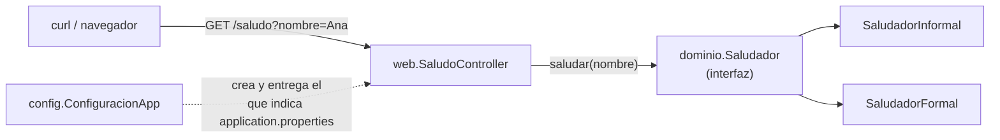

# Hola Mundo con Spring Boot: de cero a tu primer servicio web

> Guía paso a paso. No se asume experiencia previa con frameworks, Maven ni servidores. Cada paso dice **qué hacer**, **qué deberías ver** y **qué hacer si no lo ves**.

| | |
|---|---|
| **Curso** | Modelos de Programación |
| **Duración sugerida** | 1 sesión de 2 horas (instalación + práctica) |
| **Antes de empezar** | Haber leído la guía "Fundamentos web: cliente, servidor, HTTP, JSON y REST" |
| **Qué vas a lograr** | Un servicio web propio, funcionando en tu computador, que responde texto y JSON, con el código organizado en capas (web, dominio y configuración) |

---

## 1. ¿Qué es Spring Boot y por qué lo usamos?

En la guía anterior escribiste un servidor web con el `HttpServer` del JDK y viste lo incómodo que es: un `if` por cada ruta y JSON armado a mano. **Spring Boot** es un *framework* (una base de código ya hecha que tú completas con tus clases) que resuelve eso:

- **Spring** (el framework) crea y conecta los objetos de tu aplicación y sabe enrutar peticiones HTTP hacia tus métodos.
- **Boot** (la parte "arranque") configura todo automáticamente con valores razonables y trae el **servidor web incluido** (Tomcat). No tienes que instalar ni configurar ningún servidor aparte: tu programa *es* el servidor, y se inicia con un `main` como cualquier otro programa Java.

Una idea que atraviesa toda la guía: **en un framework, tú no llamas al código del framework; el framework llama al tuyo.** Tú escribes un método y le dices "atiende las peticiones `GET /hola`"; Spring lo ejecuta cuando llega una. Esa inversión del control es la que ya viste en el patrón Template Method (el "principio de Hollywood": *no nos llames, nosotros te llamamos*).

---

## 2. Preparar el computador

Necesitas tres cosas: el **JDK**, un **editor o IDE** y una **terminal**. Maven no hay que instalarlo: el proyecto que vamos a generar trae su propio "envoltorio" (`mvnw`) que lo descarga solo.

### 2.1 Java (JDK 17 o superior)

Spring Boot 4 requiere **Java 17 como mínimo**. Recomendamos la versión **21** (LTS, soporte de largo plazo).

**Paso 1.** Abre una terminal (en Windows: PowerShell o "Símbolo del sistema") y ejecuta:

```bash
java -version
javac -version
```

Debes ver un número de versión 17 o mayor en **ambos** comandos. Por ejemplo:

```
openjdk version "21.0.4" ...
javac 21.0.4
```

**Paso 2 (si no tienes Java o es más viejo que 17).** Descarga el JDK 21 desde **Adoptium (Eclipse Temurin)**: <https://adoptium.net>. Durante la instalación en Windows, marca las opciones **"Add to PATH"** y **"Set JAVA_HOME variable"**. Luego **cierra y vuelve a abrir la terminal** y repite el Paso 1.

**Si ves:** `'java' no se reconoce como un comando...` (Windows) o `command not found: java` (Linux/macOS) → Java no quedó en el PATH. Reinstala marcando la opción del PATH, o reinicia la terminal.

**Si ves:** `java` en versión 21 pero `javac` dice que no existe → tienes solo el JRE; instala el **JDK**.

### 2.2 Un editor o IDE

En el curso trabajamos con **Visual Studio Code**, porque con sus extensiones podemos **crear el proyecto Spring Boot sin salir del editor**. Si prefieres IntelliJ, también funciona (abajo está la opción B).

#### Opción A: Visual Studio Code (la que usaremos en clase)

1. Instala VS Code desde <https://code.visualstudio.com>.
2. Abre la pestaña de extensiones (`Ctrl + Shift + X`) e instala estas **dos** (busca el nombre exacto y verifica que el publicador sea Microsoft o VMware/Broadcom):
   - **Extension Pack for Java** (Microsoft): trae el soporte para compilar, ejecutar y depurar Java, y para trabajar con Maven.
   - **Spring Boot Extension Pack**: es un paquete que instala tres extensiones de una vez:
     - **Spring Initializr Java Support**: **crea proyectos Spring Boot desde la paleta de comandos** (la usaremos en la sección 3).
     - **Spring Boot Tools**: ayuda al escribir `application.properties` y el código Spring (autocompletado y avisos).
     - **Spring Boot Dashboard**: un panel para **iniciar, detener y abrir** tus aplicaciones Spring con un clic (lo usaremos en la sección 5).
   - *(Opcional)* **Thunder Client**: un cliente gráfico para probar peticiones HTTP sin salir del editor.
3. Reinicia VS Code cuando termine. Para comprobar que la extensión que crea proyectos quedó instalada, presiona `Ctrl + Shift + P`, escribe `Spring Initializr` y debe aparecer una lista con comandos como **Spring Initializr: Create a Maven Project...**.

> Si prefieres instalar una extensión desde la barra de comandos: `Ctrl + P`, pega `ext install vscjava.vscode-spring-initializr` y pulsa Enter.

#### Opción B: IntelliJ IDEA Community Edition

1. Descárgalo e instálalo desde <https://www.jetbrains.com/idea/download> (la edición **Community** es gratuita).
2. No necesitas plugins adicionales: ya trae soporte para Maven y para ejecutar aplicaciones Spring Boot. Como la edición Community no incluye un asistente para crear proyectos Spring, en esta opción generarás el proyecto con la **página web** (sección 3, opción B).

> Los nombres exactos de menús y extensiones pueden variar un poco con las versiones. Si algo no coincide, busca la opción equivalente o pregúntale a tu docente.

### 2.3 Un cliente para probar

Usaremos **`curl`** (viene en Windows 10/11, macOS y Linux) y el **navegador**. En PowerShell recuerda escribir `curl.exe` en lugar de `curl`.

---

## 3. Generar el proyecto con Spring Initializr

**Spring Initializr** es el servicio oficial de Spring que te arma el esqueleto de un proyecto con todo lo necesario ya configurado. Hay **dos formas de usarlo** y las dos producen **exactamente el mismo proyecto**, porque la extensión de VS Code le pide el esqueleto al mismo servicio de la página web (`start.spring.io`):

| Opción | Dónde | Cuándo usarla |
|---|---|---|
| **A. Extensión de VS Code** | Dentro del editor, con `Ctrl + Shift + P` | **La que usaremos en clase.** No sales del editor y no hay que descomprimir nada |
| **B. Página web** | <https://start.spring.io> | Si usas IntelliJ, si la extensión te da problemas, o para ver todo el formulario junto |

Los valores que debes usar son **los mismos en ambas opciones**:

| Dato | Valor | Para qué sirve |
|---|---|---|
| **Project** | Maven | Herramienta que descarga librerías y compila el proyecto |
| **Language** | Java | |
| **Spring Boot** | La versión estable más reciente (por ejemplo **4.1.x**). **No elijas** las que dicen `SNAPSHOT`, `M1`, `RC1` | Versión del framework |
| **Group** | `edu.modelos` | Identifica a quien crea el proyecto (como un dominio al revés) |
| **Artifact** | `holamundo` | Nombre del proyecto |
| **Package name** | `edu.modelos.holamundo` | Paquete Java raíz (se arma solo con Group + Artifact) |
| **Packaging** | Jar | Se empaqueta como un `.jar` ejecutable |
| **Java** | **21** (o 17 si ese es el JDK que instalaste) | **Nunca** más alto que tu JDK instalado |
| **Dependencies** | **Spring Web** | Da el servidor web y el soporte de rutas y JSON |

### 3.1 Opción A: con la extensión de VS Code (recomendada)

**Paso 1.** Abre VS Code (no hace falta abrir ninguna carpeta). Presiona `Ctrl + Shift + P` (en Mac, `Cmd + Shift + P`) para abrir la **paleta de comandos**.

**Paso 2.** Escribe `Spring Initializr` y elige **Spring Initializr: Create a Maven Project...**. (Si no aparece, la extensión no está instalada: vuelve a la sección 2.2.)

**Paso 3.** La extensión te hará **una pregunta a la vez**, en la parte de arriba de la ventana. Respóndelas así (el orden puede variar un poco según la versión de la extensión):

| Pregunta de la extensión | Qué respondes |
|---|---|
| **Specify Spring Boot version** | La versión estable más reciente de la lista (por ejemplo `4.1.x`). Evita las que digan `SNAPSHOT` o `M`/`RC` |
| **Specify project language** | `Java` |
| **Input Group Id** | `edu.modelos` (borra el `com.example` que aparece por defecto) y Enter |
| **Input Artifact Id** | `holamundo` (borra el `demo`) y Enter |
| **Specify packaging type** | `Jar` |
| **Specify Java version** | `21` (o `17`, según tu JDK; **nunca** mayor que el instalado) |
| **Choose dependencies** | Escribe `Spring Web`, selecciónala con Enter y, cuando arriba aparezca que hay **1 dependencia seleccionada**, vuelve a pulsar Enter para continuar |

**Paso 4.** Se abrirá un cuadro para **escoger una carpeta**. Elige la carpeta donde guardarás tus proyectos (por ejemplo `Documentos/modelos`) y pulsa **Generate into this folder**. La extensión crea dentro de ella una carpeta con el nombre del artifact: `Documentos/modelos/holamundo`. Evita rutas con tildes o espacios.

**Paso 5.** Al terminar, VS Code muestra un aviso para abrir el proyecto generado. Elige **Open** (abrir). Si te pregunta "¿Confías en los autores de esta carpeta?" (*Trust*), acepta.

> **Atención:** elige **Open** y no *Add to Workspace*. Con *Add to Workspace* el proyecto se agrega a un espacio de trabajo existente y a veces VS Code no lo reconoce como proyecto Java.

**Qué deberías ver:** en el panel Explorador de la izquierda, la carpeta `holamundo` con `pom.xml`, `mvnw` y `src`. Abajo a la derecha, VS Code mostrará un momento "Java: Importing projects" o un ícono de carga: espera a que termine.

**Un truco para más adelante.** Si necesitas agregar una librería (por ejemplo, una base de datos para el bonus del proyecto final), no hace falta volver a generar el proyecto: abre `pom.xml`, haz clic derecho dentro del archivo y elige **Edit starters**. Verás la misma lista de dependencias de Initializr y marcas las que quieras.

### 3.2 Opción B: con la página web start.spring.io

**Paso 1.** Entra a <https://start.spring.io>.

**Paso 2.** Completa el formulario con los valores de la tabla de arriba. Los campos **Name** y **Package name** se completan solos a partir de Artifact y Group.

**Paso 3.** Al lado derecho pulsa **ADD DEPENDENCIES...**, escribe **Spring Web** y selecciónala. Debe aparecer en la lista de dependencias del formulario.

**Paso 4.** Pulsa **GENERATE**. Se descargará `holamundo.zip`.

**Paso 5.** Descomprímelo (en Windows: clic derecho → *Extraer todo*) en una carpeta fácil de ubicar, por ejemplo `Documentos/modelos/holamundo`. Evita rutas con tildes o espacios. Luego, en la sección 4, abre esa carpeta en tu editor.

---

## 4. Conocer lo que se generó

Si generaste el proyecto con la extensión de VS Code (opción A), **ya está abierto**. Si lo descargaste de la página web (opción B), ábrelo así:

- **VS Code:** *File → Open Folder...* y selecciona la carpeta `holamundo` (la que contiene `pom.xml`). Acepta el aviso de confianza y espera a que termine de cargar "Java Projects".
- **IntelliJ:** *File → Open...* y selecciona la carpeta (la que contiene `pom.xml`). Si pregunta "Trust Project", acepta. Espera a que termine la barra de progreso de abajo a la derecha (está importando el proyecto Maven).

Verás esta estructura:

```
holamundo/
├── .mvn/wrapper/                      Archivos del "envoltorio" de Maven
├── mvnw                               Script para ejecutar Maven en Linux/macOS
├── mvnw.cmd                           Script para ejecutar Maven en Windows
├── pom.xml                            Descripción del proyecto y sus dependencias
└── src/
    ├── main/
    │   ├── java/edu/modelos/holamundo/
    │   │   └── HolamundoApplication.java     La clase que arranca todo
    │   └── resources/
    │       └── application.properties        Configuración de la aplicación
    └── test/java/edu/modelos/holamundo/
        └── HolamundoApplicationTests.java    Una prueba automática de ejemplo
```

| Elemento | Qué es |
|---|---|
| `pom.xml` | El "documento de identidad" del proyecto para Maven. Lista las librerías que necesita. No lo edites a mano por ahora (para agregar librerías, en VS Code usa *Edit starters*). |
| `mvnw` / `mvnw.cmd` | Permiten compilar y ejecutar **sin tener Maven instalado**. La primera vez descargan Maven y las librerías. |
| `HolamundoApplication.java` | Contiene el `main` que arranca la aplicación (lo vemos abajo). |
| `application.properties` | Archivo de configuración (puerto, textos, opciones). Está vacío (salvo el nombre). |
| `src/test/...` | Pruebas automáticas. No las tocaremos hoy; sirve para comprobar que el proyecto arranca. |

**Una nota sobre el `pom.xml`.** Si lo abres verás una sección `<dependencies>` con algo como `spring-boot-starter-webmvc`. Un *starter* es un "paquete de conveniencia": con **una** línea se traen Tomcat, el soporte de rutas y la conversión a JSON. (En versiones anteriores de Spring Boot esa dependencia se llamaba `spring-boot-starter-web`; si ves ese nombre en tu proyecto, no hay problema: lo que manda es el `pom.xml` que generó Initializr.)

Ahora abre `HolamundoApplication.java`. Es la única clase con código:

```java
package edu.modelos.holamundo;

import org.springframework.boot.SpringApplication;
import org.springframework.boot.autoconfigure.SpringBootApplication;

@SpringBootApplication
public class HolamundoApplication {

    public static void main(String[] args) {
        SpringApplication.run(HolamundoApplication.class, args);
    }
}
```

Dos líneas importantes:

- `SpringApplication.run(...)` **arranca Spring y el servidor Tomcat embebido**.
- `@SpringBootApplication` le dice a Spring "esta es la clase principal; **busca mis clases anotadas en este paquete y en todos los paquetes que cuelgan de él**". Más abajo verás por qué esto importa.

---

## 5. Primera ejecución (todavía sin código nuestro)

Antes de escribir nada, comprobemos que el entorno funciona.

**Desde la terminal** (ábrela en la carpeta `holamundo`, donde está el `pom.xml`):

| Sistema | Comando |
|---|---|
| Linux / macOS | `./mvnw spring-boot:run` |
| Windows PowerShell | `.\mvnw.cmd spring-boot:run` |
| Windows CMD | `mvnw.cmd spring-boot:run` |

(En Linux/macOS, si dice `Permission denied`, ejecuta antes `chmod +x mvnw`.)

**Desde VS Code (lo más cómodo):** tienes dos formas, y las dos hacen lo mismo que el comando de arriba:

- **Spring Boot Dashboard:** haz clic en el ícono **Spring Boot Dashboard** de la barra lateral izquierda (lo agregó el Spring Boot Extension Pack). Verás tu aplicación `holamundo` en la lista: pasa el cursor sobre ella y pulsa **Run** (el triángulo). Con **Stop** (el cuadrado) la detienes, y con **Open in Browser** abres `http://localhost:8080`.
- **Botón Run sobre `main`:** abre `HolamundoApplication.java` y pulsa el enlace **Run** que aparece justo encima del método `main`.

**Desde IntelliJ:** abre `HolamundoApplication.java` y pulsa el triángulo verde junto a `main`.

**La primera vez tarda varios minutos** y necesita internet: descarga Maven y las librerías (verás muchas líneas `Downloading from central...`). Las siguientes veces arranca en segundos.

**Qué deberías ver al final:** un banner de Spring y unas líneas de registro (*log*) parecidas a estas (los tiempos y números exactos varían):

```
  .   ____          _            __ _ _
 /\\ / ___'_ __ _ _(_)_ __  __ _ \ \ \ \
( ( )\___ | '_ | '_| | '_ \/ _` | \ \ \ \
 \\/  ___)| |_)| | | | | || (_| |  ) ) ) )
  '  |____| .__|_| |_|_| |_\__, | / / / /
 =========|_|==============|___/=/_/_/_/

 :: Spring Boot ::                (v4.1.x)

... Starting HolamundoApplication ...
... Tomcat started on port 8080 (http) ...
... Started HolamundoApplication in 1.5 seconds ...
```

La línea clave es **`Tomcat started on port 8080`**: tu servidor está escuchando en el puerto 8080. La terminal queda ocupada (igual que con el servidor de la guía anterior). **Esto es lo normal.**

Abre en el navegador <http://localhost:8080>. Verás una página de error 404 ("Whitelabel Error Page") o un texto JSON con `"status":404`. **Eso es correcto:** el servidor funciona, pero todavía no hay ninguna ruta definida. Es un 404 de verdad (recuerda la tabla de códigos de estado).

Para detener el servidor: `Ctrl + C` en la terminal, **Stop** en el Spring Boot Dashboard, o el cuadrado rojo en el IDE.

### Si algo falla

| Síntoma | Causa probable | Solución |
|---|---|---|
| `release version 21 not supported` / `invalid target release: 21` | Elegiste en Initializr una versión de Java **mayor** que tu JDK | Abre `pom.xml`, busca `<java.version>` y cámbialo por la versión de tu JDK (17 o 21) |
| `JAVA_HOME is not defined correctly` | Falta la variable de entorno `JAVA_HOME` | Reinstala el JDK marcando "Set JAVA_HOME", o defínela a mano; reinicia la terminal |
| `Port 8080 was already in use` | Otro programa (o una ejecución anterior que no cerraste) usa el puerto | Cierra el otro programa, o en `application.properties` agrega `server.port=8081` |
| Se queda en `Downloading...` o da error de conexión | Sin internet o red bloqueada | Revisa tu conexión; en una red restringida, prueba con otra red |
| Muchos imports en rojo en el IDE | El IDE no terminó de importar Maven | IntelliJ: pestaña *Maven* → botón de recargar. VS Code: `Ctrl+Shift+P` → "Java: Clean Java Language Server Workspace" |
| `./mvnw: Permission denied` | El script no tiene permiso de ejecución (Linux/macOS) | `chmod +x mvnw` |
| Al escribir `Spring Initializr` en la paleta no aparece ningún comando | La extensión no está instalada o VS Code no se reinició | Instala el **Spring Boot Extension Pack** (sección 2.2) y reinicia VS Code |
| La extensión se queda cargando la lista de versiones o falla con un error de red | No hay internet o la red bloquea `start.spring.io` (la extensión lo consulta por detrás) | Revisa tu conexión o prueba con otra red; si no se resuelve, usa la opción B desde otro equipo |
| Generé el proyecto con la extensión pero no aparece el botón **Run** sobre `main` ni el Spring Boot Dashboard lo muestra | VS Code no reconoció la carpeta como proyecto Java (por ejemplo, se agregó con *Add to Workspace*, o se abrió la carpeta de arriba y no la que tiene `pom.xml`) | Cierra la carpeta y ábrela con *File → Open Folder...* seleccionando **la carpeta que contiene `pom.xml`**; espera a que cargue "Java Projects" |
| La extensión creó el proyecto con Java 17 o 11 y quiero otra versión | Los valores por defecto de la extensión vienen de su configuración | Elige la versión en la pregunta *Specify Java version*, o corrige `<java.version>` en `pom.xml` |

---

## 6. Tu primer endpoint: Hola Mundo

Un **endpoint** es una combinación de método y ruta que tu servidor atiende (por ejemplo `GET /hola`). Un **controlador** es la clase que agrupa endpoints.

Vamos a crear los paquetes desde el inicio, porque el proyecto final los usará. Dentro de `src/main/java/edu/modelos/holamundo/` crea **tres paquetes nuevos** (clic derecho sobre el paquete `holamundo` → *New → Package*):

- `web`: lo que habla HTTP (controladores).
- `dominio`: la lógica de la aplicación (Java puro, **sin nada de Spring**).
- `config`: el ensamblaje de la aplicación.

Todos deben quedar **dentro de** `edu.modelos.holamundo` (es decir: `edu.modelos.holamundo.web`, etc.). Esto es obligatorio: recuerda que Spring solo busca clases en el paquete de la clase principal y en los que cuelgan de él.

Dentro de `web`, crea la clase `HolaController`:

```java
package edu.modelos.holamundo.web;

import org.springframework.web.bind.annotation.GetMapping;
import org.springframework.web.bind.annotation.PathVariable;
import org.springframework.web.bind.annotation.RestController;

@RestController
public class HolaController {

    @GetMapping("/hola")
    public String hola() {
        return "Hola Mundo desde Spring Boot";
    }

    @GetMapping("/hola/{nombre}")
    public String holaA(@PathVariable String nombre) {
        return "Hola, " + nombre;
    }
}
```

Qué hace cada anotación:

| Anotación | Significado |
|---|---|
| `@RestController` | "Esta clase atiende peticiones web, y lo que devuelven sus métodos es **el cuerpo de la respuesta**" |
| `@GetMapping("/hola")` | "Este método atiende `GET /hola`" |
| `{nombre}` en la ruta | Una parte **variable** de la ruta |
| `@PathVariable String nombre` | "Entrégame aquí lo que haya llegado en `{nombre}`" |

**Ejecuta de nuevo** (detén la ejecución anterior y vuelve a iniciar). Cada vez que cambies código tendrás que reiniciar.

Prueba en el navegador o con `curl`:

```bash
curl http://localhost:8080/hola
curl http://localhost:8080/hola/Ana
```

Resultados esperados:

```
Hola Mundo desde Spring Boot
Hola, Ana
```

Con `curl -i` verás además `200` como código de estado y `Content-Type: text/plain`: Spring escogió el tipo de contenido por ti.

**Si recibes 404:** (1) ¿reiniciaste el servidor?; (2) ¿la clase está en un paquete que cuelga de `edu.modelos.holamundo`?; (3) ¿escribiste `@RestController` y `@GetMapping` con sus `import`?; (4) ¿escribiste bien la ruta?

---

## 7. Devolver JSON (sin escribir JSON)

Crea en `web` un `record` (una clase de datos inmutable de una línea):

```java
package edu.modelos.holamundo.web;

public record Saludo(String mensaje, int longitud) { }
```

Y en `web` crea `SaludoController`:

```java
package edu.modelos.holamundo.web;

import org.springframework.web.bind.annotation.GetMapping;
import org.springframework.web.bind.annotation.RequestParam;
import org.springframework.web.bind.annotation.RestController;

@RestController
public class SaludoController {

    @GetMapping("/saludo")
    public Saludo saludo(@RequestParam(defaultValue = "Mundo") String nombre) {
        String mensaje = "Hola, " + nombre;
        return new Saludo(mensaje, mensaje.length());
    }
}
```

Fíjate en dos cosas nuevas:

- `@RequestParam` lee un parámetro de la **query** (`?nombre=Ana`). Con `defaultValue` se usa un valor por defecto si no llega.
- El método devuelve un **objeto**, no un texto. Spring lo convierte en JSON automáticamente (serialización) y pone `Content-Type: application/json`.

Reinicia y prueba:

```bash
curl "http://localhost:8080/saludo?nombre=Ana"
curl "http://localhost:8080/saludo"
```

```
{"mensaje":"Hola, Ana","longitud":9}
{"mensaje":"Hola, Mundo","longitud":11}
```

(Las comillas alrededor de la URL en `curl` son necesarias en muchas terminales porque `?` y `&` tienen significado especial.)

Compara con la guía anterior: no escribiste ninguna comilla escapada ni concatenaste texto JSON. Tu único trabajo fue devolver un objeto.

---

## 8. Separar en capas: dominio, configuración y web

Hasta aquí la "lógica" (armar el saludo) está dentro del controlador. En el proyecto final eso es justo lo que **no** queremos: el controlador debe limitarse a traducir HTTP, y la lógica debe vivir en el dominio, donde estarán tus patrones. Vamos a hacerlo con un ejemplo pequeño que, de paso, contiene un patrón que ya conoces.

### 8.1 Dominio: un Strategy sin Spring

En el paquete `dominio` crea la interfaz y dos implementaciones. Observa que **no hay ningún `import` de Spring**:

```java
package edu.modelos.holamundo.dominio;

public interface Saludador {

    String saludar(String nombre);
}
```

```java
package edu.modelos.holamundo.dominio;

public class SaludadorInformal implements Saludador {

    @Override
    public String saludar(String nombre) {
        return "Hola, " + nombre;
    }
}
```

```java
package edu.modelos.holamundo.dominio;

public class SaludadorFormal implements Saludador {

    @Override
    public String saludar(String nombre) {
        return "Buenos dias, estimado(a) " + nombre;
    }
}
```

Es el patrón **Strategy** de siempre: una interfaz y varias formas intercambiables de hacer lo mismo.

### 8.2 Configuración: quién crea qué

En el paquete `config` crea `ConfiguracionApp`:

```java
package edu.modelos.holamundo.config;

import edu.modelos.holamundo.dominio.Saludador;
import edu.modelos.holamundo.dominio.SaludadorFormal;
import edu.modelos.holamundo.dominio.SaludadorInformal;
import org.springframework.beans.factory.annotation.Value;
import org.springframework.context.annotation.Bean;
import org.springframework.context.annotation.Configuration;

@Configuration
public class ConfiguracionApp {

    // Spring ejecuta este metodo una sola vez y guarda el objeto que devuelve.
    // El valor de saludo.estilo se lee de application.properties (si no existe, usa "informal").
    @Bean
    public Saludador saludador(@Value("${saludo.estilo:informal}") String estilo) {
        if (estilo.equals("formal")) {
            return new SaludadorFormal();
        }
        return new SaludadorInformal();
    }
}
```

Vocabulario nuevo:

- **Bean**: un objeto que **Spring crea y administra** por ti. Un método `@Bean` es la "receta" para crearlo. Spring lo ejecuta una sola vez y guarda el resultado, así que hay **una sola instancia compartida** (¿te suena a algún patrón?).
- `@Configuration`: marca la clase que contiene recetas.
- `@Value("${saludo.estilo:informal}")`: lee la propiedad `saludo.estilo` del archivo `application.properties`; el texto después de `:` es el valor por defecto.

Esta clase es el lugar donde decides **qué implementación concreta** se usa. El dominio no sabe nada de esto.

### 8.3 Web: el controlador recibe lo que necesita

Reemplaza el contenido de `SaludoController`:

```java
package edu.modelos.holamundo.web;

import edu.modelos.holamundo.dominio.Saludador;
import org.springframework.web.bind.annotation.GetMapping;
import org.springframework.web.bind.annotation.RequestParam;
import org.springframework.web.bind.annotation.RestController;

@RestController
public class SaludoController {

    private final Saludador saludador;

    // Spring ve que el constructor necesita un Saludador y le entrega el que creo en ConfiguracionApp.
    public SaludoController(Saludador saludador) {
        this.saludador = saludador;
    }

    @GetMapping("/saludo")
    public Saludo saludo(@RequestParam(defaultValue = "Mundo") String nombre) {
        String mensaje = saludador.saludar(nombre);
        return new Saludo(mensaje, mensaje.length());
    }
}
```

Fíjate: el controlador **nunca escribe `new SaludadorInformal()`**. Declara lo que necesita en su constructor y Spring se lo entrega. A eso se le llama **inyección de dependencias**, y es la aplicación directa del principio de inversión de dependencias (la "D" de SOLID): el controlador depende de la interfaz `Saludador`, no de una clase concreta.

### 8.4 Cambiar de comportamiento solo con configuración

Reinicia y prueba (el estilo por defecto es informal):

```bash
curl "http://localhost:8080/saludo?nombre=Ana"
```

```
{"mensaje":"Hola, Ana","longitud":9}
```

Ahora abre `src/main/resources/application.properties` y agrega al final:

```properties
saludo.estilo=formal
```

Reinicia y repite la petición:

```
{"mensaje":"Buenos dias, estimado(a) Ana","longitud":28}
```

**No modificaste ninguna clase**: cambiaste una línea de configuración y la aplicación se comporta distinto. Ya tienes, en miniatura, la estructura del proyecto final.

El proyecto queda así:



---

## 9. ¿Qué pasó "detrás"? La magia explicada

Cada vez que algo funciona "mágicamente", conviene saber qué hay debajo. Este es el resumen de lo que hizo Spring:

1. **Al arrancar** (`SpringApplication.run`), Spring recorre el paquete `edu.modelos.holamundo` y todos sus subpaquetes buscando clases con anotaciones como `@RestController` y `@Configuration` (esto se llama *escaneo de componentes*). **Por eso las clases deben estar dentro de ese paquete.**
2. Ejecuta los métodos `@Bean` y crea los controladores. Cuando un constructor pide un objeto, Spring busca un *bean* de ese tipo y se lo pasa.
3. Registra cada `@GetMapping` en una **tabla de rutas**: "`GET /saludo` → método `saludo` de `SaludoController`".
4. **Cuando llega una petición**, Tomcat la recibe, Spring consulta la tabla, extrae `nombre` de la query, llama a tu método, toma el objeto que devolviste, lo convierte a JSON y escribe la respuesta con código `200`.

Observaciones para conectar con lo que has visto del curso:

- Tú no llamas a tus controladores: **Spring llama a tus métodos** (inversión del control).
- Los *beans* son, por defecto, instancias únicas compartidas (relación con **Singleton**).
- Lo que hace Spring al escoger el método según la ruta tiene la forma de un único punto de entrada que reparte el trabajo (un *Front Controller*, que es un patrón de **arquitectura**, no uno de los 23 de GoF; lo estudiarás en cursos posteriores).

---

## 10. Ejercicios

1. **Cambiar el puerto.** Haz que el servicio responda en el puerto `9090` modificando **solo** `application.properties` (pista: `server.port`). Pruébalo con `curl`. Luego devuélvelo a `8080`.
2. **Una ruta nueva.** Agrega `GET /despedida/{nombre}` que responda `Hasta luego, <nombre>`.
3. **Un tercer estilo.** Crea `SaludadorEntusiasta` (por ejemplo, que responda `¡Hola, <nombre>!!`) y haz que se seleccione con `saludo.estilo=entusiasta`. Responde: ¿qué clases tuviste que modificar y cuáles solo crear? (Pista: piensa en el principio abierto/cerrado. Hay un único archivo existente que deberás tocar y es el que decide cuál estrategia se usa.)
4. **Una petición sin parámetro.** Llama a `http://localhost:8080/saludo` sin `?nombre=`. ¿Qué responde y por qué? Quita el `defaultValue` y vuelve a probar: ¿qué código de estado devuelve ahora y por qué crees que es ese? (Pista: es de la familia 4xx.)
5. **Reflexión.** ¿Por qué el controlador recibe el `Saludador` en el constructor en lugar de crearlo con `new`? Da dos ventajas concretas.

### Respuestas

1. En `application.properties`: `server.port=9090`; la URL pasa a ser `http://localhost:9090/...`.
2. En `HolaController`:

```java
@GetMapping("/despedida/{nombre}")
public String despedida(@PathVariable String nombre) {
    return "Hasta luego, " + nombre;
}
```

3. **Se crea:** `SaludadorEntusiasta`. **Se modifica:** únicamente `ConfiguracionApp` (agregar la rama para `"entusiasta"`). No se modifican `Saludador`, `SaludadorInformal`, `SaludadorFormal` ni `SaludoController`.
4. Sin parámetro responde con el valor por defecto (`Mundo`). Sin `defaultValue`, el parámetro pasa a ser obligatorio y Spring responde `400` (petición mal formada), porque falta un dato que el cliente debía enviar.
5. Ventajas: (a) el controlador no depende de ninguna implementación concreta, así que se puede cambiar de estrategia sin tocarlo (OCP/DIP); (b) se puede probar con un `Saludador` falso; (c) Spring controla el ciclo de vida del objeto y lo comparte, en lugar de crear instancias repetidas.

---

## 11. Lista de verificación

Tu Hola Mundo está terminado si puedes marcar todo:

- [ ] `java -version` y `javac -version` muestran 17 o superior.
- [ ] El proyecto se generó con Spring Initializr (con la extensión de VS Code o con `start.spring.io`) y con la dependencia **Spring Web**.
- [ ] La aplicación arranca y la consola muestra `Tomcat started on port 8080`.
- [ ] `GET /hola` y `GET /hola/Ana` responden texto.
- [ ] `GET /saludo?nombre=Ana` responde JSON.
- [ ] El código está en tres paquetes (`web`, `dominio`, `config`) y **ninguna clase de `dominio` importa algo de Spring**.
- [ ] Puedes iniciar y detener la aplicación desde VS Code (Spring Boot Dashboard o botón **Run**) y también con `./mvnw spring-boot:run`.
- [ ] Cambiaste el estilo de saludo editando únicamente `application.properties`.
- [ ] Puedes explicar con tus palabras qué es un *bean*, qué hace `@RestController` y qué significa inyección de dependencias.

---

## 12. Siguiente paso

Con este esqueleto ya puedes exponer cualquier dominio como un servicio web. En la siguiente guía tomarás tu solución del taller **MiniTienda** (Adapter, Proxy, Facade y Decorator) y la publicarás como una API REST.

---

*Modelos de Programación*
