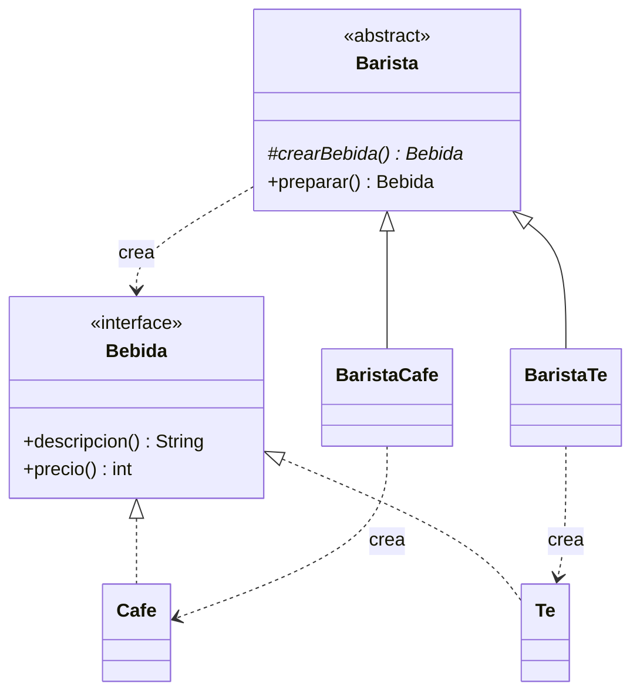
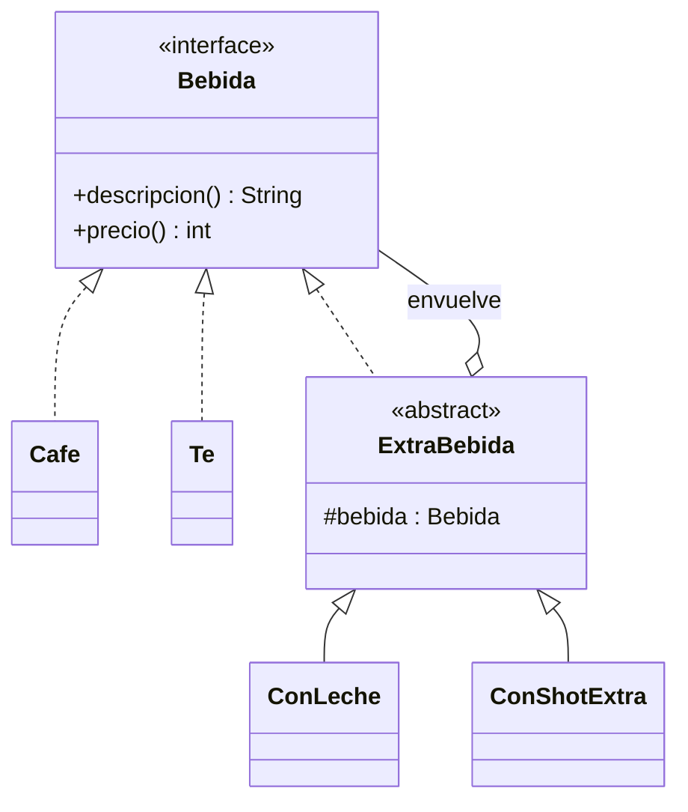
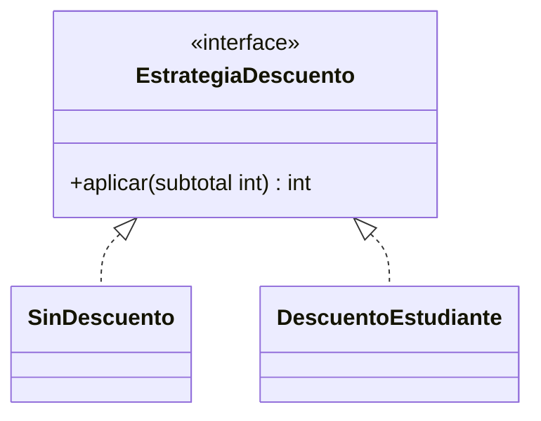
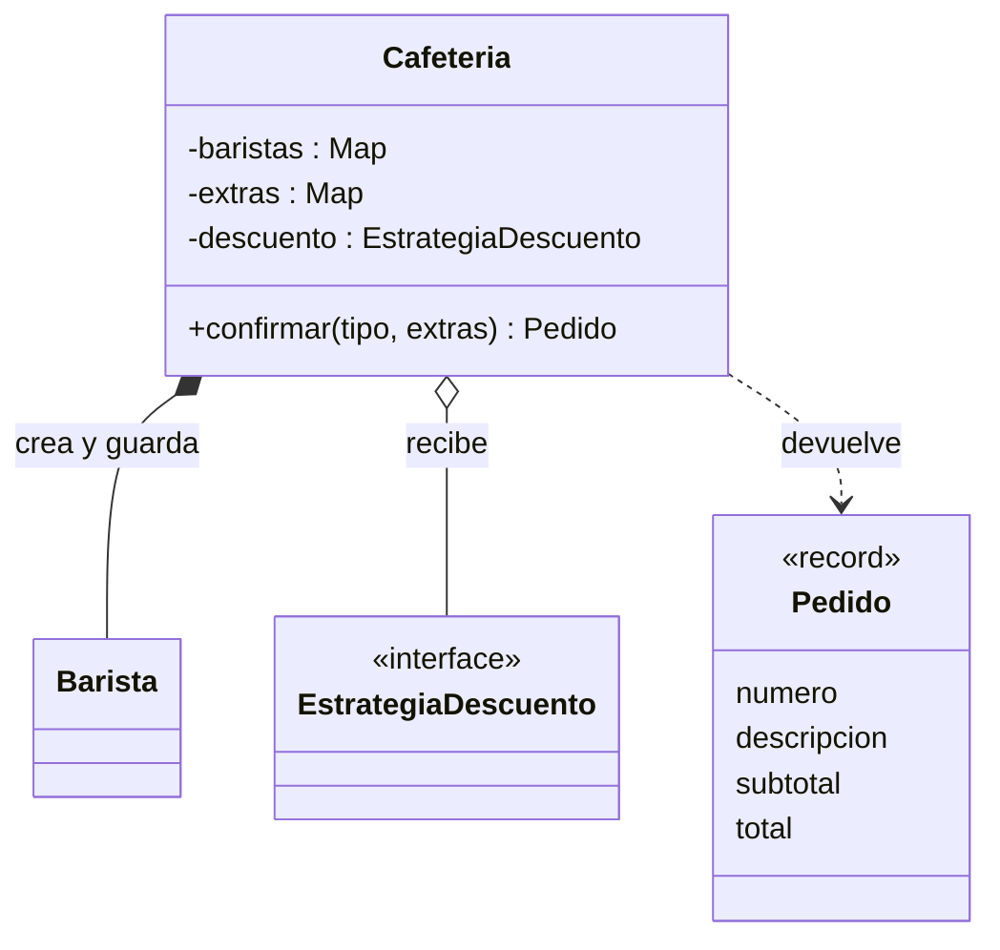
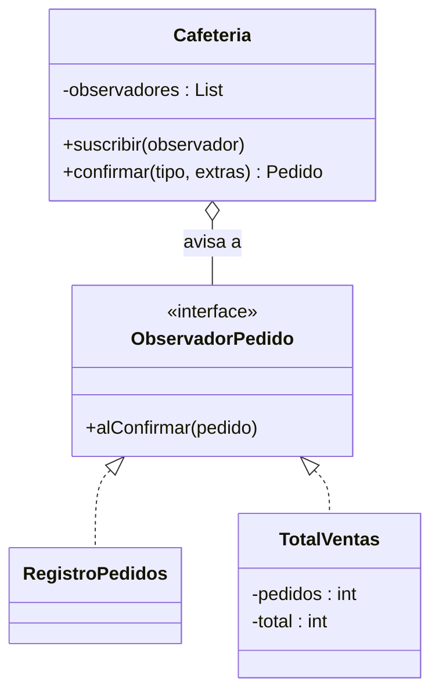
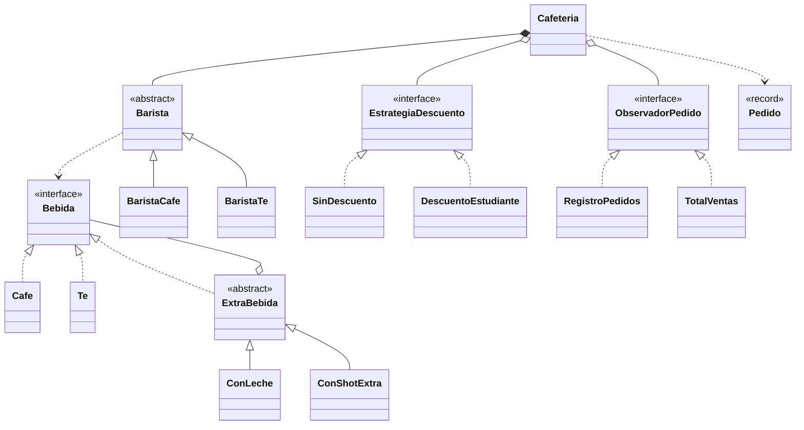

# Ejemplo guiado: una cafetería con cuatro patrones de diseño (en la terminal)

> Vamos a construir juntos un programa pequeño, paso a paso, como lo hemos hecho siempre: en Java, desde la terminal, sin frameworks. Primero escribimos la versión "ingenua" y vemos dónde duele; después aplicamos un patrón por vez para arreglar cada dolor. Al final tendrás un modelo de cómo se trabaja un problema con patrones, y esa misma forma de trabajar es la que usarás en el proyecto final.

| | |
|---|---|
| **Curso** | Modelos de Programación |
| **Duración sugerida** | 2 sesiones de 2 horas (se puede hacer en vivo o en casa) |
| **Requisitos** | JDK 17 o superior y una terminal. Haber visto Factory Method, Decorator, Strategy y Observer (o verlos mientras se hace esta guía) |
| **Patrones** | Factory Method (creacional), Decorator (estructural), Strategy y Observer (comportamiento) |
| **Qué vas a lograr** | Una cafetería que arma pedidos con bebidas, extras, descuentos y avisos, sin un solo `if` de reglas de negocio mezclado, y que cambia agregando clases en lugar de editar las existentes |

---

## 1. De qué se trata

Una cafetería recibe pedidos. Cada pedido tiene una **bebida** (café, té...), unos **extras** opcionales (leche, shot extra...) y se le aplica un **descuento** según la promoción vigente. Cuando se confirma un pedido, **otras partes del negocio** quieren enterarse: el registro de pedidos, el control de ventas...

Cada una de esas cuatro necesidades corresponde a un patrón:

| Necesidad | Patrón | Categoría | Papel en la cafetería |
|---|---|---|---|
| Crear la bebida correcta sin que el resto del programa conozca las clases concretas | **Factory Method** | Creacional | Los *baristas* crean las bebidas |
| Agregar extras a una bebida en cualquier combinación | **Decorator** | Estructural | Cada extra "envuelve" a la bebida |
| Cambiar la política de descuento sin tocar el resto | **Strategy** | Comportamiento | Cada descuento es una estrategia intercambiable |
| Avisar a varios interesados cuando se confirma un pedido | **Observer** | Comportamiento | El registro y el control de ventas se suscriben |

Es el mismo ejercicio que, más adelante, harás con **más patrones** para tu proyecto final. La idea de esta guía es que veas el *proceso*: del problema al patrón, y del patrón al código que funciona.

---

## 2. Cómo usar esta guía

Cada paso tiene siempre la misma forma:

1. **El problema**: qué dolor del paso anterior vamos a resolver.
2. **Piensen**: una pregunta para discutir antes de ver la solución (si lo hacen en clase, es el momento de hablar).
3. **La idea**: el patrón, en una o dos frases, con su diagrama.
4. **El código**: archivo por archivo, **con comentarios**. Los comentarios son parte de la lección: léelos.
5. **Ejecuten**: el comando y la salida que **debes obtener** (si es distinta, revisa antes de seguir).
6. **Observen**: qué se logró y qué quedó pendiente.

Reglas del juego:

- Todo el código va en **una sola carpeta** llamada `cafeteria` (sin paquetes, como en los talleres anteriores). Cada archivo `.java` lleva el nombre de la clase que contiene.
- Los pasos son **acumulativos**: el paso 2 usa los archivos del paso 1, y así sucesivamente. Solo `App.java` (y en un par de pasos `Cafeteria.java`) se reemplazan por una versión nueva.
- Si copias el código, **copia también los comentarios**. Cuando algo no funcione, compara con la guía línea por línea.

### Preparación

1. Crea la carpeta y entra a ella:

   ```bash
   mkdir cafeteria
   cd cafeteria
   ```

2. Comprueba tu Java (debe decir 17 o más, en los dos comandos):

   ```bash
   java -version
   javac -version
   ```

3. Cada vez que crees o cambies archivos, se compila y ejecuta así (desde dentro de la carpeta):

   ```bash
   javac *.java
   java App
   ```

   (`javac *.java` compila todos los archivos de la carpeta; `java App` ejecuta la clase `App`, que contiene el método `main`.)

---

## 3. Paso 0: el primer intento (sin patrones)

Antes de usar ningún patrón, escribamos lo que haría cualquiera que no los conoce: **todo en un solo método**. Es importante hacerlo: así sabremos exactamente qué problema resuelve cada patrón.

Crea el archivo `Ingenuo.java` (ojo: este archivo es aparte, puedes dejarlo en la misma carpeta):

```java
// Ingenuo.java
// PRIMER INTENTO, sin patrones: todo vive en un solo metodo.
// Funciona... pero mira cuantas responsabilidades mezcla.
// Ejecutar con:  java Ingenuo.java
public class Ingenuo {

    // Estadisticas "sueltas" (estado global mezclado con la logica)
    static int pedidos = 0;
    static int totalVentas = 0;

    // Calcula el total de un pedido. Recibe un booleano por cada extra y el tipo de cliente.
    static int calcular(String tipo, boolean leche, boolean shot, String cliente) {

        // 1) Elegir la bebida: un if por cada bebida del menu
        int precio;
        String descripcion;
        if (tipo.equals("cafe")) {
            precio = 5000;
            descripcion = "Cafe";
        } else if (tipo.equals("te")) {
            precio = 4000;
            descripcion = "Te";
        } else {
            throw new IllegalArgumentException("Bebida no existe: " + tipo);
        }

        // 2) Agregar extras: un if por cada extra
        if (leche) {
            precio += 1000;
            descripcion += " con leche";
        }
        if (shot) {
            precio += 2000;
            descripcion += " con shot extra";
        }

        // 3) Aplicar el descuento: un if por cada tipo de cliente
        int subtotal = precio;
        if (cliente.equals("estudiante")) {
            precio = precio * 90 / 100;
        }

        // 4) Registrar el pedido y las ventas (mezclado con todo lo anterior)
        pedidos++;
        totalVentas += precio;
        System.out.println("[Registro] Pedido #" + pedidos + ": " + descripcion
                + " | subtotal $" + subtotal + " | total $" + precio);

        return precio;
    }

    public static void main(String[] args) {
        calcular("cafe", true, true, "estudiante");
        calcular("te", false, false, "general");
        System.out.println("Ventas: " + pedidos + " pedidos, $" + totalVentas);
    }
}
```

Ejecútalo (este archivo se puede correr directamente, sin compilar antes):

```bash
java Ingenuo.java
```

Salida:

```
[Registro] Pedido #1: Cafe con leche con shot extra | subtotal $8000 | total $7200
[Registro] Pedido #2: Te | subtotal $4000 | total $4000
Ventas: 2 pedidos, $11200
```

Funciona. Los números son correctos: el café con leche y shot cuesta 8000; con descuento de estudiante, 7200.

### Piensen (antes de seguir)

Imaginen que la dueña de la cafetería les pide, uno tras otro, estos cuatro cambios. Para cada uno, ¿qué parte del código hay que editar?

| # | Cambio pedido | Qué hay que tocar en el código ingenuo |
|---|---|---|
| 1 | "Vamos a vender chocolate" | Editar el método `calcular`: otro `else if` dentro del bloque 1 |
| 2 | "Queremos extra de crema" | Editar el método: otro `if` en el bloque 2 **y** agregar un tercer `boolean` a la firma, lo que obliga a cambiar **todas las llamadas** (hoy son dos en `main`) |
| 3 | "Descuento para clientes frecuentes" | Editar el método otra vez: otro `if` en el bloque 3 |
| 4 | "Que la barra reciba un aviso de cada pedido" | Editar el método otra vez: más código en el bloque 4 |

### Observen: los cuatro dolores

1. **Todo cambio obliga a modificar el mismo método.** Cada vez que lo editas puedes romper algo que ya funcionaba (esto es lo que el principio *abierto/cerrado* quiere evitar).
2. **El método tiene demasiadas responsabilidades**: elige la bebida, suma extras, calcula el descuento y registra ventas. Son cuatro razones distintas para cambiarlo (el principio de *responsabilidad única* dice que debería haber una sola).
3. **No se puede probar una parte sin las demás**: para comprobar el descuento tienes que pasar por todo lo demás y, de paso, se imprime un registro.
4. **La firma crece sin control**: un `boolean` por cada extra, y el orden de los parámetros se confunde fácilmente (`calcular("cafe", true, false, "general")`, ¿qué era cada uno?).

Con tu pareja o con el grupo, anoten **otro problema** que vean. Lo usaremos al final.

Ahora arreglemos cada dolor con un patrón. Empezamos por el primero: elegir y crear la bebida.

---

## 4. Paso 1: Factory Method (crear la bebida correcta)

### El problema

En el bloque 1 del código ingenuo hay un `if` por cada bebida, y cada `if` repite lo mismo (precio, descripción). Agregar chocolate significa editar ese bloque. Además, **quien necesita una bebida está obligado a conocer todas las bebidas posibles**.

### Piensen

¿Y si cada tipo de bebida tuviera su propia clase y alguien se encargara de crear la correcta, de modo que el resto del programa nunca escribiera `new Cafe()`?

### La idea

El **Factory Method** define un método "fábrica" (abstracto) en una clase creadora, y deja que **cada subclase decida qué objeto concreto crea**. El código que usa la fábrica trabaja con la abstracción (`Bebida`) y no sabe qué clase concreta salió.



Se lee así: `Barista` es el **creador** (clase abstracta); `crearBebida()` es el **factory method** (abstracto, con `#` porque es `protected`); `BaristaCafe` y `BaristaTe` son **creadores concretos**; `Cafe` y `Te` son los **productos concretos**; y `Bebida` es el **producto** (la interfaz común). Las flechas punteadas indican que un barista *crea* bebidas (una dependencia: no guarda la bebida como atributo).

### El código

Crea estos seis archivos.

**1. `Bebida.java`**, el producto (la interfaz común):

```java
// Bebida.java
// Esta interfaz cumple DOS papeles a la vez:
//   - Es el PRODUCTO del Factory Method (lo que las fabricas crean).
//   - Es el COMPONENTE del Decorator (lo que los extras envuelven).
// Todo lo que se pueda servir en la cafeteria sabe responder estas dos preguntas.
public interface Bebida {

    // Texto que describe la bebida, por ejemplo "Cafe con leche".
    String descripcion();

    // Precio en pesos colombianos. Usamos int (pesos enteros) para evitar errores de redondeo.
    int precio();
}
```

**2. `Cafe.java`** y **3. `Te.java`**, los productos concretos:

```java
// Cafe.java
// PRODUCTO CONCRETO: una bebida base. No sabe nada de extras, descuentos ni pedidos.
public class Cafe implements Bebida {

    @Override
    public String descripcion() {
        return "Cafe";
    }

    @Override
    public int precio() {
        return 5000;
    }
}
```

```java
// Te.java
// OTRO PRODUCTO CONCRETO: misma interfaz que Cafe, distinto comportamiento.
public class Te implements Bebida {

    @Override
    public String descripcion() {
        return "Te";
    }

    @Override
    public int precio() {
        return 4000;
    }
}
```

**4. `Barista.java`**, el creador, donde vive el factory method:

```java
// Barista.java
// CREADOR del patron Factory Method.
//
// Idea: esta clase define el FLUJO comun (preparar una bebida), pero deja que cada
// subclase decida QUE bebida concreta se crea. Quien usa un Barista nunca escribe "new Cafe()".
public abstract class Barista {

    // FACTORY METHOD: es el metodo "fabrica". Es abstracto: cada subclase lo implementa
    // y devuelve la bebida que le corresponde. (protected: solo lo usan esta clase y sus hijas.)
    protected abstract Bebida crearBebida();

    // Operacion comun a todos los baristas. Fijate que llama a crearBebida() SIN saber
    // cual bebida va a salir: eso lo decide la subclase en tiempo de ejecucion.
    public Bebida preparar() {
        Bebida bebida = crearBebida();
        System.out.println("[Barista] Prepara la base: " + bebida.descripcion());
        return bebida;
    }
}
```

**5. `BaristaCafe.java`** y **6. `BaristaTe.java`**, los creadores concretos:

```java
// BaristaCafe.java
// CREADOR CONCRETO: la unica diferencia con los demas baristas es QUE bebida crea.
public class BaristaCafe extends Barista {

    @Override
    protected Bebida crearBebida() {
        return new Cafe();
    }
}
```

```java
// BaristaTe.java
// CREADOR CONCRETO: agregar una bebida nueva significa agregar una pareja de clases
// (el producto y su barista) sin modificar ninguna de las que ya existen.
public class BaristaTe extends Barista {

    @Override
    protected Bebida crearBebida() {
        return new Te();
    }
}
```

Y ahora el programa que los usa. Crea `App.java`:

```java
// App.java (paso 1: Factory Method)
public class App {

    public static void main(String[] args) {

        // Un arreglo de baristas. El tipo declarado es Barista (la clase abstracta):
        // el codigo de abajo no sabe, ni necesita saber, cual bebida produce cada uno.
        Barista[] baristas = { new BaristaCafe(), new BaristaTe() };

        for (Barista barista : baristas) {
            Bebida bebida = barista.preparar();   // aqui actua el factory method
            System.out.println("  -> " + bebida.descripcion() + " cuesta $" + bebida.precio());
        }
    }
}
```

### Ejecuten

```bash
javac *.java
java App
```

Salida esperada:

```
[Barista] Prepara la base: Cafe
  -> Cafe cuesta $5000
[Barista] Prepara la base: Te
  -> Te cuesta $4000
```

### Observen

- En `App` nunca aparece `new Cafe()` ni `new Te()`: solo `new BaristaCafe()` y `new BaristaTe()`, y el ciclo trata a todos como `Barista`. El método `preparar()` llama a `crearBebida()` **sin saber** cuál será.
- **Agregar una bebida nueva = agregar dos clases** (el producto y su barista). No se edita ni una línea de lo que ya existe. Esto lo comprobaremos en los ejercicios con el chocolate.
- Lo que quedó pendiente: por ahora no hay extras ni descuentos.

---

## 5. Paso 2: Decorator (agregar extras en cualquier combinación)

### El problema

En el bloque 2 del código ingenuo hay un `boolean` en la firma y un `if` por cada extra. Y hay algo peor: si quisiéramos resolverlo con herencia, necesitaríamos una clase por cada combinación (`CafeConLeche`, `CafeConLecheYShot`, `TeConLeche`, `TeConShot`...). Con 2 bebidas y 2 extras ya serían 8 clases; con 3 extras, 16. Es la explosión de subclases.

### Piensen

¿Y si cada extra fuera un objeto que "envuelve" a la bebida, la convierte en otra bebida (con un precio y una descripción distintos) y se pudieran apilar en cualquier orden?

### La idea

El **Decorator** agrega responsabilidades a un objeto **envolviéndolo** en otro que tiene **su misma interfaz**. Como el envoltorio también es una `Bebida`, se puede envolver otra vez, y otra, formando capas como una cebolla.



Fíjate en la forma: `ExtraBebida` **es** una `Bebida` (flecha de herencia) y **tiene** una `Bebida` (el rombo vacío indica agregación: la bebida envuelta llega desde afuera, por el constructor).

### El código

Crea estos tres archivos (la interfaz `Bebida` y los demás ya los tienes del paso 1).

**1. `ExtraBebida.java`**, la base de todos los extras:

```java
// ExtraBebida.java
// DECORATOR BASE: una Bebida que "envuelve" a otra Bebida.
//
// Dos cosas a notar:
//   1) Es una Bebida (implements Bebida): por eso el resto del programa no nota la diferencia
//      entre una bebida simple y una con extras.
//   2) TIENE una Bebida (el atributo "bebida"): la que envuelve. Por defecto le delega todo.
// Los extras concretos heredan de aqui y solo cambian lo que les interesa.
public abstract class ExtraBebida implements Bebida {

    // La bebida envuelta. "protected final": los extras hijos la pueden usar, pero nadie la cambia.
    protected final Bebida bebida;

    // La bebida llega desde afuera, por el constructor (por eso la relacion es de agregacion).
    protected ExtraBebida(Bebida bebida) {
        this.bebida = bebida;
    }

    @Override
    public String descripcion() {
        return bebida.descripcion();   // por defecto: lo mismo que la bebida envuelta
    }

    @Override
    public int precio() {
        return bebida.precio();        // por defecto: el mismo precio
    }
}
```

**2. `ConLeche.java`** y **3. `ConShotExtra.java`**, los extras concretos:

```java
// ConLeche.java
// DECORATOR CONCRETO: agrega leche. Suma texto a la descripcion y plata al precio.
public class ConLeche extends ExtraBebida {

    public ConLeche(Bebida bebida) {
        super(bebida);   // guarda la bebida envuelta en la clase padre
    }

    @Override
    public String descripcion() {
        return super.descripcion() + " con leche";   // lo que ya tenia + el extra
    }

    @Override
    public int precio() {
        return super.precio() + 1000;                // lo que ya costaba + el extra
    }
}
```

```java
// ConShotExtra.java
// DECORATOR CONCRETO: agrega un shot extra de espresso.
public class ConShotExtra extends ExtraBebida {

    public ConShotExtra(Bebida bebida) {
        super(bebida);
    }

    @Override
    public String descripcion() {
        return super.descripcion() + " con shot extra";
    }

    @Override
    public int precio() {
        return super.precio() + 2000;
    }
}
```

Reemplaza `App.java` por esta versión:

```java
// App.java (paso 2: Decorator)
public class App {

    public static void main(String[] args) {

        // Un cafe "a secas"
        Bebida simple = new BaristaCafe().preparar();
        mostrar(simple);

        // Un cafe con leche: el ConLeche envuelve al cafe
        Bebida conLeche = new ConLeche(new BaristaCafe().preparar());
        mostrar(conLeche);

        // Un cafe con leche y shot extra: dos capas, una dentro de la otra
        //   ConShotExtra( ConLeche( Cafe ) )
        Bebida completo = new ConShotExtra(new ConLeche(new BaristaCafe().preparar()));
        mostrar(completo);

        // Los extras funcionan con CUALQUIER bebida, no solo con el cafe
        Bebida teConLeche = new ConLeche(new BaristaTe().preparar());
        mostrar(teConLeche);
    }

    // Este metodo recibe una Bebida cualquiera (simple o decorada): no sabe cuantas capas tiene.
    private static void mostrar(Bebida bebida) {
        System.out.println("  -> " + bebida.descripcion() + " cuesta $" + bebida.precio());
    }
}
```

### Ejecuten

```bash
javac *.java
java App
```

Salida esperada:

```
[Barista] Prepara la base: Cafe
  -> Cafe cuesta $5000
[Barista] Prepara la base: Cafe
  -> Cafe con leche cuesta $6000
[Barista] Prepara la base: Cafe
  -> Cafe con leche con shot extra cuesta $8000
[Barista] Prepara la base: Te
  -> Te con leche cuesta $5000
```

### Observen

- La tercera línea de resultado es el momento clave: `new ConShotExtra(new ConLeche(new BaristaCafe().preparar()))` son **tres objetos anidados**. Al pedir `precio()`, cada capa le pide el precio a la de adentro y le suma el suyo: `5000 + 1000 + 2000 = 8000`.
- El método `mostrar` recibe una `Bebida` y **no sabe cuántas capas tiene**. Para él, una bebida decorada y una simple son lo mismo.
- Los extras funcionan con **cualquier bebida**: el `ConLeche` de la última línea envuelve a un té sin que hayamos escrito nada especial.
- **Agregar un extra nuevo = una clase nueva.** Sin booleanos en la firma, sin editar nada de lo anterior.
- Pendiente: todavía no sabemos cómo aplicar descuentos.

---

## 6. Paso 3: Strategy (cambiar la política de descuento)

### El problema

En el bloque 3 del código ingenuo hay un `if` por cada tipo de cliente. Si mañana hay descuento para clientes frecuentes, otro `if`. Y si el descuento de estudiantes cambia de 10 % a 12 %, hay que entrar a editar el método grande.

### Piensen

¿Y si "calcular el descuento" fuera un objeto con un único método, y pudiéramos **cambiar de objeto** (de política) sin cambiar el código que lo usa?

### La idea

El **Strategy** define una **familia de algoritmos** (aquí, formas de calcular el descuento), encapsula cada uno en una clase y los hace **intercambiables**. El código que los usa depende de la interfaz, no de ninguna política en particular.



### El código

Crea tres archivos:

**1. `EstrategiaDescuento.java`**, la interfaz:

```java
// EstrategiaDescuento.java
// STRATEGY: la interfaz que representa "una forma de calcular el descuento".
// Cada politica de descuento es una implementacion distinta e intercambiable.
public interface EstrategiaDescuento {

    // Recibe el subtotal y devuelve lo que realmente se debe pagar.
    int aplicar(int subtotal);
}
```

**2. `SinDescuento.java`** y **3. `DescuentoEstudiante.java`**, las estrategias concretas:

```java
// SinDescuento.java
// ESTRATEGIA CONCRETA: no aplica ningun descuento (el total es igual al subtotal).
public class SinDescuento implements EstrategiaDescuento {

    @Override
    public int aplicar(int subtotal) {
        return subtotal;
    }
}
```

```java
// DescuentoEstudiante.java
// ESTRATEGIA CONCRETA: 10% de descuento.
public class DescuentoEstudiante implements EstrategiaDescuento {

    @Override
    public int aplicar(int subtotal) {
        // Se paga el 90%. Se multiplica primero y se divide al final (enteros, sin decimales).
        return subtotal * 90 / 100;
    }
}
```

Reemplaza `App.java`:

```java
// App.java (paso 3: Strategy)
public class App {

    public static void main(String[] args) {

        // Una bebida con extras, como en el paso anterior (subtotal esperado: $8000)
        Bebida bebida = new ConShotExtra(new ConLeche(new BaristaCafe().preparar()));
        int subtotal = bebida.precio();
        System.out.println("Subtotal: $" + subtotal);

        // Una VARIABLE del tipo de la interfaz: puede apuntar a cualquier estrategia.
        EstrategiaDescuento politica = new SinDescuento();
        System.out.println("Sin descuento: $" + politica.aplicar(subtotal));

        // Cambiamos de estrategia: el codigo que calcula NO cambia, solo el objeto asignado.
        politica = new DescuentoEstudiante();
        System.out.println("Descuento estudiante: $" + politica.aplicar(subtotal));
    }
}
```

### Ejecuten

```bash
javac *.java
java App
```

Salida esperada:

```
[Barista] Prepara la base: Cafe
Subtotal: $8000
Sin descuento: $8000
Descuento estudiante: $7200
```

### Observen

- Hay una **única variable** (`politica`) que primero apunta a un objeto y luego a otro. Las dos líneas que calculan el resultado son idénticas; lo único distinto es **qué objeto** hay en la variable. Eso es polimorfismo trabajando.
- Las reglas de descuento ya no están mezcladas con las demás: cada una vive en **su propia clase**, que se puede probar sola.
- **Agregar una política nueva = una clase nueva** (por ejemplo, `DescuentoFidelidad`). El 10 % del estudiante cambia en **un solo lugar**.

---

## 7. Paso 4: Integrar las tres piezas (Pedido y Cafeteria)

Ya tenemos tres piezas independientes. Ahora falta la clase que las **conecta**: recibe lo que pide el cliente (una bebida y una lista de extras) y devuelve un pedido ya calculado.

### El problema

Tenemos que traducir **texto** (`"cafe"`, `"leche"`) a **objetos** (`BaristaCafe`, `ConLeche`). Alguien tiene que hacer esa traducción, porque en la vida real el cliente no escribe `new ConLeche(...)`: escribe "leche".

### La idea

La clase `Cafeteria` guarda **dos "menús"** (tablas que relacionan el nombre con el objeto que sabe crearlo) y una estrategia de descuento. Su método `confirmar` sigue siempre los mismos cinco pasos, sin ningún `if` que decida *cómo se calcula* algo. (Los `if` que quedan solo **validan** que lo pedido exista.)



Fíjate en las **dos relaciones distintas** (esto es lo mismo que discutimos en la guía de estructurales): la cafetería **crea** los baristas dentro de su constructor y los guarda, así que es **composición** (rombo lleno); en cambio la estrategia de descuento **le llega desde afuera**, por el constructor, así que es **agregación** (rombo vacío).

### El código

**1. `Pedido.java`**, el resultado (un *record*, que es una clase de datos inmutable):

```java
// Pedido.java
// Resultado de confirmar un pedido. Es un "record": una clase de datos inmutable.
// Java genera automaticamente el constructor, los metodos de acceso (numero(), total()...)
// y el toString. Es lo mismo que escribir una clase con atributos final y sus getters.
public record Pedido(int numero, String descripcion, int subtotal, int total) { }
```

**2. `Cafeteria.java`**, la clase que integra todo:

```java
import java.util.ArrayList;
import java.util.HashMap;
import java.util.List;
import java.util.Map;
import java.util.function.Function;

// Cafeteria.java (version del paso 4: integra Factory Method, Decorator y Strategy)
//
// Esta clase es el "punto de entrada" de la logica: recibe lo que el cliente pide
// (una bebida y una lista de extras) y devuelve un Pedido. Ella conecta las piezas,
// pero no contiene ningun if por bebida, por extra ni por tipo de descuento.
public class Cafeteria {

    // Registro de baristas: nombre de la bebida -> el barista que sabe crearla.
    private final Map<String, Barista> baristas = new HashMap<>();

    // Registro de extras: nombre del extra -> una "funcion" que recibe una Bebida y devuelve
    // la misma Bebida envuelta con el extra. (Function<Bebida, Bebida> es eso: una funcion
    // que entra con una Bebida y sale con otra. "ConLeche::new" significa "usa el
    // constructor de ConLeche".)
    private final Map<String, Function<Bebida, Bebida>> extras = new HashMap<>();

    // La estrategia de descuento llega desde afuera (por eso es agregacion, no composicion).
    private final EstrategiaDescuento descuento;

    private int ultimoNumero = 0;

    public Cafeteria(EstrategiaDescuento descuento) {
        this.descuento = descuento;

        // Menu de la cafeteria. Para agregar una bebida o un extra nuevo, se agrega UNA linea aqui
        // (y la clase nueva correspondiente); el resto del metodo confirmar() no cambia.
        baristas.put("cafe", new BaristaCafe());
        baristas.put("te", new BaristaTe());
        extras.put("leche", ConLeche::new);
        extras.put("shot", ConShotExtra::new);
    }

    public Pedido confirmar(String tipo, List<String> pedidoExtras) {

        // 1) Validar y buscar el barista (Factory Method)
        if (tipo == null) {
            throw new IllegalArgumentException("Debe indicar la bebida");
        }
        Barista barista = baristas.get(tipo.toLowerCase());
        if (barista == null) {
            throw new IllegalArgumentException("Bebida no existe: " + tipo);
        }

        // 2) Validar TODOS los extras antes de preparar nada
        List<Function<Bebida, Bebida>> decoradores = new ArrayList<>();
        for (String nombre : pedidoExtras) {
            Function<Bebida, Bebida> decorador = extras.get(nombre.toLowerCase());
            if (decorador == null) {
                throw new IllegalArgumentException("Extra no existe: " + nombre);
            }
            decoradores.add(decorador);
        }

        // 3) Preparar la bebida base y envolverla con cada extra (Decorator)
        Bebida bebida = barista.preparar();
        for (Function<Bebida, Bebida> decorador : decoradores) {
            bebida = decorador.apply(bebida);
        }

        // 4) Calcular el total con la politica de descuento (Strategy)
        int subtotal = bebida.precio();
        int total = descuento.aplicar(subtotal);

        // 5) Armar el pedido con el siguiente numero
        ultimoNumero++;
        return new Pedido(ultimoNumero, bebida.descripcion(), subtotal, total);
    }
}
```

Reemplaza `App.java`:

```java
import java.util.List;

// App.java (paso 4: integracion)
public class App {

    public static void main(String[] args) {

        // La estrategia se elige UNA vez, al crear la cafeteria.
        Cafeteria cafeteria = new Cafeteria(new DescuentoEstudiante());

        System.out.println("=== Pedidos ===");
        mostrar(cafeteria.confirmar("cafe", List.of("leche", "shot")));
        mostrar(cafeteria.confirmar("te", List.of()));

        System.out.println();
        System.out.println("=== Errores ===");
        intentar(cafeteria, "pizza", List.of());
        intentar(cafeteria, "cafe", List.of("chocolate"));

        System.out.println();
        System.out.println("=== Mismo pedido con otra estrategia ===");
        Cafeteria sinPromo = new Cafeteria(new SinDescuento());
        mostrar(sinPromo.confirmar("cafe", List.of("leche", "shot")));
    }

    private static void mostrar(Pedido pedido) {
        System.out.println("Pedido #" + pedido.numero() + ": " + pedido.descripcion()
                + " | subtotal $" + pedido.subtotal() + " | total $" + pedido.total());
    }

    // Intenta confirmar un pedido que tiene un error y muestra el mensaje de la excepcion.
    private static void intentar(Cafeteria cafeteria, String tipo, List<String> extras) {
        try {
            cafeteria.confirmar(tipo, extras);
        } catch (IllegalArgumentException e) {
            System.out.println("Error: " + e.getMessage());
        }
    }
}
```

### Ejecuten

```bash
javac *.java
java App
```

Salida esperada:

```
=== Pedidos ===
[Barista] Prepara la base: Cafe
Pedido #1: Cafe con leche con shot extra | subtotal $8000 | total $7200
[Barista] Prepara la base: Te
Pedido #2: Te | subtotal $4000 | total $3600

=== Errores ===
Error: Bebida no existe: pizza
Error: Extra no existe: chocolate

=== Mismo pedido con otra estrategia ===
[Barista] Prepara la base: Cafe
Pedido #1: Cafe con leche con shot extra | subtotal $8000 | total $8000
```

### Observen

- Compara con el código ingenuo: **ya no hay un `if` por bebida, por extra ni por tipo de cliente**. La tabla `baristas`, la tabla `extras` y la estrategia reemplazan a esos tres bloques.
- Los errores se detectan **antes de preparar nada**: por eso, en la sección de errores, no aparece ninguna línea `[Barista]`.
- La última sección repite el mismo pedido con otra estrategia: el total pasa de 7200 a 8000 **sin tocar `Cafeteria`**. Solo cambió el objeto que se le entregó al constructor.
- Una **limitación honesta**: para agregar una bebida o un extra hay que añadir una línea en el constructor de `Cafeteria` (donde se llenan las tablas). Es una línea, no una reescritura, y más adelante veremos cómo mover esa decisión a un lugar de configuración.

---

## 8. Paso 5: Observer (avisar a los interesados)

### El problema

Cuando se confirma un pedido, otras partes del negocio quieren enterarse: el registro lo quiere imprimir; el control de ventas lo quiere sumar. En el código ingenuo eso estaba **metido dentro del método** (bloque 4). Si mañana además queremos mandar un correo, tendríamos que editar `Cafeteria` otra vez. Y la cafetería **no debería conocer** a todos los que se interesan en sus pedidos.

### Piensen

¿Y si la cafetería mantuviera una **lista de suscriptores** y, al confirmar un pedido, simplemente los recorriera avisándoles, sin saber quiénes son ni qué hacen con el aviso?

### La idea

El **Observer** define una dependencia de uno a muchos: cuando el **sujeto** (la cafetería) cambia de estado, **notifica automáticamente** a todos sus **observadores**. El sujeto solo conoce la interfaz del observador.



### El código

Crea tres archivos nuevos:

**1. `ObservadorPedido.java`**, la interfaz de los observadores:

```java
// ObservadorPedido.java
// OBSERVER: la interfaz de quien quiere enterarse cuando se confirma un pedido.
// La cafeteria llamara a este metodo en todos los observadores suscritos.
public interface ObservadorPedido {

    void alConfirmar(Pedido pedido);
}
```

**2. `RegistroPedidos.java`** y **3. `TotalVentas.java`**, dos observadores con comportamientos distintos:

```java
// RegistroPedidos.java
// OBSERVADOR CONCRETO: deja constancia en consola de cada pedido confirmado.
public class RegistroPedidos implements ObservadorPedido {

    @Override
    public void alConfirmar(Pedido pedido) {
        System.out.println("[Registro] Pedido #" + pedido.numero() + ": " + pedido.descripcion()
                + " | subtotal $" + pedido.subtotal() + " | total $" + pedido.total());
    }
}
```

```java
// TotalVentas.java
// OTRO OBSERVADOR CONCRETO: va acumulando cuantos pedidos se han confirmado y cuanto se vendio.
// Observa que la Cafeteria no sabe que este objeto existe: solo conoce la interfaz ObservadorPedido.
public class TotalVentas implements ObservadorPedido {

    private int pedidos = 0;
    private int total = 0;

    @Override
    public void alConfirmar(Pedido pedido) {
        pedidos++;
        total += pedido.total();
    }

    public int getPedidos() {
        return pedidos;
    }

    public int getTotal() {
        return total;
    }
}
```

**Reemplaza** `Cafeteria.java` por esta versión final (tiene tres añadidos respecto a la del paso 4: la lista de observadores, el método `suscribir` y el aviso al final de `confirmar`; están marcados con `OBSERVER` o `6)` en los comentarios):

```java
import java.util.ArrayList;
import java.util.HashMap;
import java.util.List;
import java.util.Map;
import java.util.function.Function;

// Cafeteria.java (version final del paso 5: agrega el Observer)
//
// Esta clase es el "punto de entrada" de la logica: recibe lo que el cliente pide
// (una bebida y una lista de extras) y devuelve un Pedido. Ella conecta las piezas,
// pero no contiene ningun if por bebida, por extra ni por tipo de descuento.
public class Cafeteria {

    // Registro de baristas: nombre de la bebida -> el barista que sabe crearla.
    private final Map<String, Barista> baristas = new HashMap<>();

    // Registro de extras: nombre del extra -> una "funcion" que recibe una Bebida y devuelve
    // la misma Bebida envuelta con el extra. (Function<Bebida, Bebida> es eso: una funcion
    // que entra con una Bebida y sale con otra. "ConLeche::new" significa "usa el
    // constructor de ConLeche".)
    private final Map<String, Function<Bebida, Bebida>> extras = new HashMap<>();

    // La estrategia de descuento llega desde afuera (por eso es agregacion, no composicion).
    private final EstrategiaDescuento descuento;

    // OBSERVER: la lista de interesados en enterarse de cada pedido confirmado.
    // La cafeteria solo conoce la interfaz ObservadorPedido, nunca las clases concretas.
    private final List<ObservadorPedido> observadores = new ArrayList<>();

    private int ultimoNumero = 0;

    public Cafeteria(EstrategiaDescuento descuento) {
        this.descuento = descuento;

        // Menu de la cafeteria. Para agregar una bebida o un extra nuevo, se agrega UNA linea aqui
        // (y la clase nueva correspondiente); el resto del metodo confirmar() no cambia.
        baristas.put("cafe", new BaristaCafe());
        baristas.put("te", new BaristaTe());
        extras.put("leche", ConLeche::new);
        extras.put("shot", ConShotExtra::new);
    }

    // Permite que alguien se "suscriba" para recibir avisos de cada pedido confirmado.
    public void suscribir(ObservadorPedido observador) {
        observadores.add(observador);
    }

    public Pedido confirmar(String tipo, List<String> pedidoExtras) {

        // 1) Validar y buscar el barista (Factory Method)
        if (tipo == null) {
            throw new IllegalArgumentException("Debe indicar la bebida");
        }
        Barista barista = baristas.get(tipo.toLowerCase());
        if (barista == null) {
            throw new IllegalArgumentException("Bebida no existe: " + tipo);
        }

        // 2) Validar TODOS los extras antes de preparar nada
        List<Function<Bebida, Bebida>> decoradores = new ArrayList<>();
        for (String nombre : pedidoExtras) {
            Function<Bebida, Bebida> decorador = extras.get(nombre.toLowerCase());
            if (decorador == null) {
                throw new IllegalArgumentException("Extra no existe: " + nombre);
            }
            decoradores.add(decorador);
        }

        // 3) Preparar la bebida base y envolverla con cada extra (Decorator)
        Bebida bebida = barista.preparar();
        for (Function<Bebida, Bebida> decorador : decoradores) {
            bebida = decorador.apply(bebida);
        }

        // 4) Calcular el total con la politica de descuento (Strategy)
        int subtotal = bebida.precio();
        int total = descuento.aplicar(subtotal);

        // 5) Armar el pedido con el siguiente numero
        ultimoNumero++;
        Pedido pedido = new Pedido(ultimoNumero, bebida.descripcion(), subtotal, total);

        // 6) Avisar a todos los observadores suscritos (Observer)
        for (ObservadorPedido observador : observadores) {
            observador.alConfirmar(pedido);
        }

        return pedido;
    }
}
```

Y reemplaza `App.java` por la versión final, donde por fin aparecen **juntos los cuatro patrones**:

```java
import java.util.List;

// App.java (paso 5: version final con los cuatro patrones)
public class App {

    public static void main(String[] args) {

        // --- ENSAMBLAJE: aqui se deciden las piezas concretas que usara el programa ---
        Cafeteria cafeteria = new Cafeteria(new DescuentoEstudiante());   // Strategy
        TotalVentas ventas = new TotalVentas();
        cafeteria.suscribir(new RegistroPedidos());                       // Observer 1
        cafeteria.suscribir(ventas);                                      // Observer 2

        // --- USO ---
        System.out.println("=== Pedidos ===");
        cafeteria.confirmar("cafe", List.of("leche", "shot"));
        cafeteria.confirmar("te", List.of());
        cafeteria.confirmar("cafe", List.of());

        System.out.println();
        System.out.println("=== Errores (no generan pedido ni aviso) ===");
        intentar(cafeteria, "pizza", List.of());
        intentar(cafeteria, "cafe", List.of("chocolate"));

        System.out.println();
        System.out.println("=== Ventas acumuladas ===");
        System.out.println(ventas.getPedidos() + " pedidos, total $" + ventas.getTotal());
    }

    private static void intentar(Cafeteria cafeteria, String tipo, List<String> extras) {
        try {
            cafeteria.confirmar(tipo, extras);
        } catch (IllegalArgumentException e) {
            System.out.println("Error: " + e.getMessage());
        }
    }
}
```

### Ejecuten

```bash
javac *.java
java App
```

Salida esperada:

```
=== Pedidos ===
[Barista] Prepara la base: Cafe
[Registro] Pedido #1: Cafe con leche con shot extra | subtotal $8000 | total $7200
[Barista] Prepara la base: Te
[Registro] Pedido #2: Te | subtotal $4000 | total $3600
[Barista] Prepara la base: Cafe
[Registro] Pedido #3: Cafe | subtotal $5000 | total $4500

=== Errores (no generan pedido ni aviso) ===
Error: Bebida no existe: pizza
Error: Extra no existe: chocolate

=== Ventas acumuladas ===
3 pedidos, total $15300
```

### Observen

- Cada pedido produce **dos efectos** (la línea `[Registro]` y la suma en `TotalVentas`) y la cafetería no sabe que existen: solo recorre una lista de `ObservadorPedido`.
- Los pedidos con error **no generan avisos**, porque la excepción ocurre antes de llegar al paso 6.
- Las ventas acumuladas coinciden con la suma de los totales: `7200 + 3600 + 4500 = 15300`.
- **Agregar un observador nuevo** (un correo, una notificación a la barra) = una clase nueva y una línea de `suscribir` en `App`. `Cafeteria` no cambia.

---

## 9. ¿Qué logramos? Comparación con el paso 0

Volvamos a los cuatro cambios que pidió la dueña. Antes había que editar el método gigante; ahora:

| Cambio pedido | Qué se hace ahora |
|---|---|
| Vender chocolate | Crear `Chocolate` y `BaristaChocolate` (clases nuevas) y agregar **una línea** en la tabla de baristas |
| Extra de crema | Crear `ConCrema` (clase nueva) y agregar **una línea** en la tabla de extras |
| Descuento para clientes frecuentes | Crear `DescuentoFidelidad` (clase nueva) y entregarla al crear la cafetería |
| Aviso a la barra | Crear una clase observadora (clase nueva) y suscribirla en `App` |

En ningún caso se reescribe lógica que ya funcionaba. Y cada responsabilidad (elegir bebida, extras, descuento, avisos) vive en su propia clase.

### Los archivos del proyecto

```
cafeteria/
|-- App.java                   El "cliente": arma las piezas y las usa (ensamblaje + uso)
|-- Cafeteria.java             Integra todo; es el punto de entrada de la logica
|-- Pedido.java                Resultado de confirmar un pedido
|-- Bebida.java                Producto (Factory Method) y componente (Decorator)
|   |-- Cafe.java, Te.java
|   `-- ExtraBebida.java       Base del Decorator
|       |-- ConLeche.java, ConShotExtra.java
|-- Barista.java               Creador (Factory Method)
|   `-- BaristaCafe.java, BaristaTe.java
|-- EstrategiaDescuento.java   Strategy
|   `-- SinDescuento.java, DescuentoEstudiante.java
`-- ObservadorPedido.java      Observer
    `-- RegistroPedidos.java, TotalVentas.java
```

Son 18 archivos, pero casi todos tienen entre 5 y 15 líneas: ese es el costo (y el beneficio) de tener **una responsabilidad por clase**.

### El diagrama de clases completo



---

## 10. Ejercicios

Cada ejercicio comprueba justamente la promesa de la sección anterior: **agregar sin editar**. Resuélvelos sobre tu carpeta `cafeteria` y verifica con `javac *.java` y `java App`.

1. **Chocolate.** Agrega la bebida "chocolate" (precio 6000). *Pista: dos clases nuevas y una línea en `Cafeteria`.*
2. **Crema.** Agrega el extra "crema" (+1500). *Pista: una clase nueva y una línea en `Cafeteria`.*
3. **Fidelidad.** Agrega un descuento del 15 % para clientes frecuentes y úsalo en `App`. *Pista: una clase nueva y cambiar una línea de `App`.*
4. **Un tercer observador.** Crea `AvisoBarra`, que imprima `[Barra] Preparar: <descripción>` cada vez que se confirme un pedido, y suscríbelo en `App`. *Pista: ninguna clase existente debe modificarse, salvo `App`.*

Cuando termines el 1, 2 y 3, cambia en `App` el primer pedido por `cafeteria.confirmar("chocolate", List.of("crema"))` y usa `new DescuentoFidelidad()`. El resultado debe ser:

```
=== Pedidos ===
[Barista] Prepara la base: Chocolate
[Registro] Pedido #1: Chocolate con crema | subtotal $7500 | total $6375
[Barista] Prepara la base: Te
[Registro] Pedido #2: Te | subtotal $4000 | total $3400
[Barista] Prepara la base: Cafe
[Registro] Pedido #3: Cafe | subtotal $5000 | total $4250

=== Errores (no generan pedido ni aviso) ===
Error: Bebida no existe: pizza
Error: Extra no existe: chocolate

=== Ventas acumuladas ===
3 pedidos, total $14025
```

### Preguntas para discutir

5. En el paso 1, `Barista` es una **clase abstracta** y no una interfaz. ¿Por qué? (Pista: ¿dónde está el método `preparar()`?)
6. `ConLeche` envuelve a una bebida y `SinDescuento` también "envuelve" algo... ¿qué diferencia hay entre un **Decorator** y un **Strategy**? ¿Cuál de los dos devuelve algo del mismo tipo que recibe?
7. `TotalVentas` y `RegistroPedidos` están suscritos a la cafetería. ¿Qué pasa si se suscribe **dos veces** el mismo observador? ¿Y si un observador lanza una excepción? ¿Qué le faltaría al patrón tal como lo escribimos?
8. En el paso 4 dijimos que agregar una bebida exige una línea en el constructor de `Cafeteria`. ¿Eso viola el principio abierto/cerrado? ¿Cómo se podría mejorar?

### Respuestas

**1, 2 y 3.** Las clases nuevas son las mismas de la tabla de la sección 9. Código de referencia (verificado):

```java
// Chocolate.java
// PRODUCTO CONCRETO nuevo: no se modifica ninguna clase existente para crearlo.
public class Chocolate implements Bebida {

    @Override
    public String descripcion() {
        return "Chocolate";
    }

    @Override
    public int precio() {
        return 6000;
    }
}
```

```java
// BaristaChocolate.java
// CREADOR CONCRETO nuevo: la pareja de Chocolate.
public class BaristaChocolate extends Barista {

    @Override
    protected Bebida crearBebida() {
        return new Chocolate();
    }
}
```

```java
// ConCrema.java
// DECORATOR CONCRETO nuevo.
public class ConCrema extends ExtraBebida {

    public ConCrema(Bebida bebida) {
        super(bebida);
    }

    @Override
    public String descripcion() {
        return super.descripcion() + " con crema";
    }

    @Override
    public int precio() {
        return super.precio() + 1500;
    }
}
```

```java
// DescuentoFidelidad.java
// ESTRATEGIA CONCRETA nueva: 15% de descuento para clientes frecuentes.
public class DescuentoFidelidad implements EstrategiaDescuento {

    @Override
    public int aplicar(int subtotal) {
        return subtotal * 85 / 100;
    }
}
```

Y en el constructor de `Cafeteria` se agregan estas dos líneas junto a las que ya existen:

```java
baristas.put("chocolate", new BaristaChocolate());
extras.put("crema", ConCrema::new);
```

**4.** Una clase nueva:

```java
// AvisoBarra.java
// OBSERVADOR CONCRETO nuevo: avisa a la barra de que hay algo por preparar.
public class AvisoBarra implements ObservadorPedido {

    @Override
    public void alConfirmar(Pedido pedido) {
        System.out.println("[Barra] Preparar: " + pedido.descripcion());
    }
}
```

y una línea en `App`: `cafeteria.suscribir(new AvisoBarra());`.

**5.** Porque `Barista` no solo declara el factory method: también tiene **código ya hecho** (`preparar()`), que es el flujo común a todos los baristas. Una clase abstracta permite combinar un método abstracto con métodos concretos compartidos; una interfaz clásica solo declararía lo que hay que hacer.

**6.** El **Decorator** envuelve a un objeto **del mismo tipo** que él (`ExtraBebida` es una `Bebida` y tiene una `Bebida`) y cambia o añade comportamiento a ese objeto; se pueden apilar varias capas. El **Strategy** es un algoritmo **intercambiable** que otro objeto usa (la `Cafeteria` *usa* una `EstrategiaDescuento`, no *es* una) y recibe un dato (el subtotal) y devuelve otro. La diferencia es de **intención**: el Decorator agrega funcionalidad a un objeto; el Strategy cambia *cómo* se hace una tarea.

**7.** Si se suscribe dos veces, recibirá cada aviso dos veces (con la lista que usamos, que permite repetidos). Si un observador lanza una excepción, **los que siguen en la lista no reciben el aviso** y el pedido ya está confirmado, pero el cliente recibe un error. Al patrón de esta guía le faltaría: evitar duplicados, un método `desuscribir` y proteger cada notificación con su propio `try/catch`. (Para un curso introductorio lo dejamos simple, pero conviene saberlo.)

**8.** Sí, en un sentido estricto: hay que **editar** una clase existente (una línea). Es un compromiso aceptable y localizado, y se puede mejorar sacando el "menú" de `Cafeteria` hacia afuera (que alguien se lo entregue ya armado). Eso es justo lo que hace un **framework** con la inyección de dependencias, y lo veremos en la siguiente guía.

---

## 11. Lo que sigue: del programa de consola a un servicio web

Esta cafetería vive en tu terminal: `App.java` crea las piezas, hace los pedidos con datos escritos en el código y muestra los resultados con `System.out.println`. En la siguiente guía vamos a **convertir exactamente este mismo ejemplo en un servicio web con Spring Boot**. Anticipa estas tres respuestas (las verás confirmadas allá):

- ¿Qué clases **no cambian**? Todas las de los patrones: `Bebida`, `Barista`, `ExtraBebida`, `EstrategiaDescuento`, `ObservadorPedido`, `Cafeteria`... (el *dominio*).
- ¿Qué desaparece? El `main` de `App.java`.
- ¿Quién hace ahora lo que hacía `App`: crear los objetos, escoger la estrategia, suscribir los observadores? Una clase de **configuración**.

Y la idea más importante para tu proyecto final: **un programa con patrones bien hechos se puede exponer como API sin reescribirlo.** Lo que hace falta es lo que acabas de practicar: pensar primero en el problema, escoger el patrón que lo resuelve y construir cada pieza con una sola responsabilidad.

---

*Modelos de Programación*
