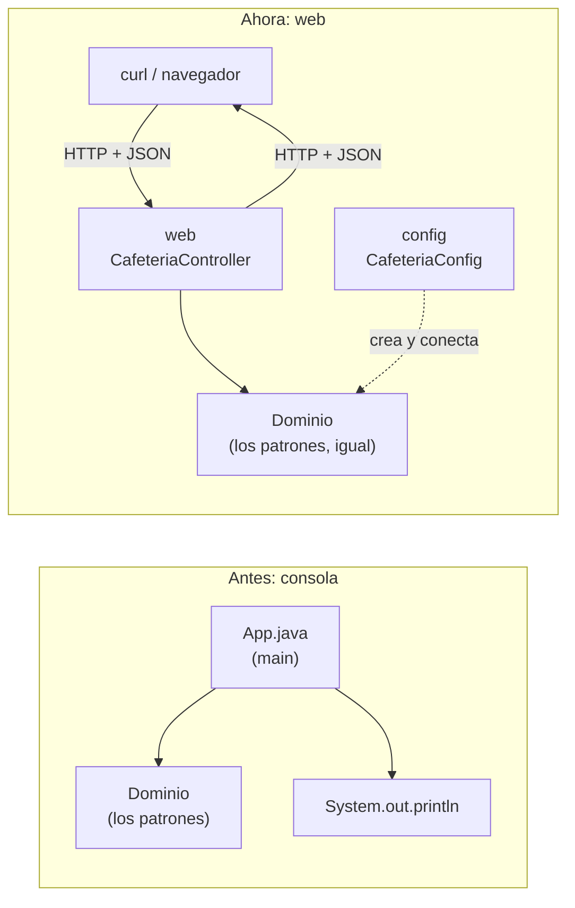
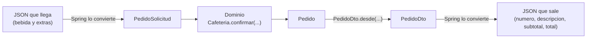
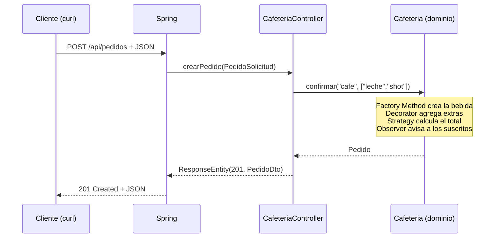

# De la consola a Spring Boot: la misma cafetería, ahora como API web

> En la guía anterior construimos una cafetería con cuatro patrones, en la terminal. Aquí la convertimos en un servicio web con Spring Boot **sin cambiar ni una línea de los patrones**. Es el modelo exacto de lo que harás con tu proyecto final: primero el dominio bien hecho, después la "puerta de entrada" web. **No necesitas saber nada de Spring**: todo el código viene comentado y cada concepto se explica cuando aparece.

| | |
|---|---|
| **Curso** | Modelos de Programación |
| **Duración sugerida** | 1 sesión de 2 horas |
| **Antes de empezar** | Haber hecho la guía "Ejemplo guiado: una cafetería con cuatro patrones" (tener esa carpeta a la mano) y las guías "Fundamentos web" y "Hola Mundo con Spring Boot" |
| **Qué vas a lograr** | Una API con dos rutas (`POST /api/pedidos` y `GET /api/ventas`) que usa Factory Method, Decorator, Strategy y Observer, y cuya política de descuento se cambia desde un archivo de configuración |

---

## 1. La idea central

Mira qué cambia al pasar de la consola a la web:

| | En la consola | En la web con Spring Boot |
|---|---|---|
| **Quién arranca el programa** | El `main` de `App.java` | Spring Boot (clase `CafeteriaApplication`) |
| **Quién crea los objetos y los conecta** | `App.java`, con `new` | Una clase de **configuración** (`CafeteriaConfig`) que Spring ejecuta |
| **De dónde vienen los datos del pedido** | Escritos en el código (`confirmar("cafe", List.of("leche"))`) | Llegan en una **petición HTTP** con un cuerpo JSON |
| **Cómo se muestra el resultado** | `System.out.println` | Una **respuesta HTTP** con código de estado y JSON |
| **Cómo se manejan los errores** | `try/catch` en `App.java` | Un **manejador de errores** que los traduce a códigos HTTP |
| **Los patrones (el dominio)** | 17 clases | **Las mismas 17 clases, idénticas** |

La última fila es la importante. Lo que construimos con tanto cuidado (Factory Method, Decorator, Strategy, Observer) no se toca. Solo cambia lo que hay **alrededor**:



El proyecto quedará organizado en **tres paquetes** (la regla que aplicaremos siempre):

| Paquete | Qué contiene | ¿Usa Spring? |
|---|---|---|
| `dominio` | Los patrones y la lógica (las 17 clases de la guía anterior) | **No. Nunca.** |
| `config` | El ensamblaje: qué objetos se crean y cómo se conectan | Sí |
| `web` | Controlador, objetos JSON y manejador de errores | Sí |

---

## 2. Spring Boot en cinco minutos (solo lo que necesitas)

Antes de escribir código, estas son las ideas que verás. Vuelve a esta sección cuando algo te confunda.

**Framework.** Una base de código que ya hace la parte repetitiva (recibir peticiones, convertir a JSON...) y a la que tú le agregas tus clases. La diferencia con una librería: en una librería **tú llamas** al código; en un framework, **el framework llama al tuyo**. Tú dices "cuando llegue una petición `POST /api/pedidos`, ejecuta este método" y Spring lo hace.

**Anotación.** Es una etiqueta que empieza por `@` y se escribe antes de una clase o de un método (por ejemplo `@RestController`). No ejecuta nada por sí sola: es una **instrucción para Spring**, que lee las etiquetas al arrancar y actúa según lo que dicen. Las verás todas explicadas en el código y en la tabla de la sección 13.

**Bean.** Un objeto que **Spring crea y guarda por ti**. Cuando un bean se pide en varios lugares, Spring entrega **siempre el mismo objeto** (una instancia compartida). Así, el `TotalVentas` que se suscribe a la cafetería es el mismo que luego lee el controlador.

**Inyección de dependencias.** En vez de que una clase escriba `new` para crear lo que necesita, **lo declara en su constructor** y Spring se lo entrega. Es lo que hemos llamado "inversión de dependencias" en SOLID, hecho automático.

**Controlador.** La clase que atiende las peticiones web. Cada método suyo atiende un método HTTP y una ruta.

**Starter.** Un "paquete de conveniencia" que trae todas las librerías necesarias para algo. Con la dependencia *Spring Web* de Initializr (la que marcas al crear el proyecto) viene el servidor web (Tomcat), el enrutamiento y la conversión a JSON.

---

## 3. Paso 1: crear el proyecto

Tienes dos formas de generar el esqueleto con **Spring Initializr** y las dos dan el mismo proyecto. **En clase usaremos la extensión de VS Code (opción A)**; la página web (opción B) es la alternativa. Si algo no te queda claro, la guía de Hola Mundo (secciones 2 y 3) lo explica con más detalle.

Estos son los valores, iguales en ambas opciones:

| Dato | Valor |
|---|---|
| Project | Maven |
| Language | Java |
| Spring Boot | La versión estable más reciente (4.1.x). Nada de `SNAPSHOT`, `M` ni `RC` |
| Group | `edu.modelos` |
| Artifact | `cafeteria` |
| Package name | `edu.modelos.cafeteria` (se arma solo con Group + Artifact) |
| Packaging | Jar |
| Java | 21 (o 17, según tu JDK; nunca mayor que el instalado) |
| Dependencies | **Spring Web** |

### Opción A: extensión de VS Code (recomendada)

Necesitas tener instalado el **Spring Boot Extension Pack** (incluye *Spring Initializr Java Support*; ver la guía de Hola Mundo, sección 2.2).

1. Presiona `Ctrl + Shift + P`, escribe `Spring Initializr` y elige **Spring Initializr: Create a Maven Project...**.
2. Responde las preguntas, una por una:

   | Pregunta | Respuesta |
   |---|---|
   | Specify Spring Boot version | La estable más reciente (`4.1.x`) |
   | Specify project language | `Java` |
   | Input Group Id | `edu.modelos` |
   | Input Artifact Id | `cafeteria` |
   | Specify packaging type | `Jar` |
   | Specify Java version | `21` (o `17`) |
   | Choose dependencies | `Spring Web` (selecciónala con Enter y vuelve a pulsar Enter para continuar) |

3. Elige la carpeta donde guardas tus proyectos y pulsa **Generate into this folder**. Se crea la carpeta `cafeteria` dentro de ella.
4. Cuando VS Code ofrezca abrir el proyecto, elige **Open** (no *Add to Workspace*) y acepta el aviso de confianza.

### Opción B: página web

Entra a <https://start.spring.io>, completa el formulario con los valores de la tabla (agrega **Spring Web** con *ADD DEPENDENCIES...*), pulsa **GENERATE**, descomprime el `.zip` y abre la carpeta `cafeteria` en tu editor.

### Comprobar que arranca

Antes de escribir código, verifica que el esqueleto funciona. En VS Code puedes usar el **Spring Boot Dashboard** (ícono en la barra lateral: pasa el cursor sobre `cafeteria` y pulsa **Run**) o el enlace **Run** sobre `main`. O, desde la terminal, dentro de la carpeta:

```bash
./mvnw spring-boot:run          # Windows PowerShell:  .\mvnw.cmd spring-boot:run
```

Debes ver `Tomcat started on port 8080`. Deténlo con **Stop** en el Dashboard o con `Ctrl + C` en la terminal. (Más adelante, cada vez que cambies código tendrás que detenerlo y volver a iniciarlo.)

La clase principal que Initializr generó se llama `CafeteriaApplication`. Esta es la versión comentada (no hay que modificarla):

```java
package edu.modelos.cafeteria;

import org.springframework.boot.SpringApplication;
import org.springframework.boot.autoconfigure.SpringBootApplication;

// Esta clase REEMPLAZA al antiguo App.java de la version de consola.
// Initializr la genera sola (con la extension de VS Code o con la pagina web); no hay que modificarla.
//
// @SpringBootApplication le dice a Spring:
//   "esta es la clase principal. Busca mis clases con anotaciones (@Configuration,
//    @RestController...) en ESTE paquete y en todos los que cuelgan de el".
// Por eso todo nuestro codigo va dentro de edu.modelos.cafeteria (dominio, web y config).
@SpringBootApplication
public class CafeteriaApplication {

    public static void main(String[] args) {
        // Arranca Spring y el servidor web (Tomcat) incluido. Desde aqui, Spring "se hace cargo":
        // crea los objetos de la configuracion, registra las rutas y se queda esperando peticiones.
        SpringApplication.run(CafeteriaApplication.class, args);
    }
}
```

---

## 4. Paso 2: traer el dominio (sin cambiar nada)

Dentro de `src/main/java/edu/modelos/cafeteria/` crea tres paquetes: `dominio`, `config` y `web`. Deben colgar de `edu.modelos.cafeteria` (el paquete de la clase principal), porque Spring solo busca clases en ese paquete y en los que cuelgan de él.

Copia dentro de `dominio` **estos 17 archivos** de tu carpeta de consola:

```
Bebida, Cafe, Te,
Barista, BaristaCafe, BaristaTe,
ExtraBebida, ConLeche, ConShotExtra,
EstrategiaDescuento, SinDescuento, DescuentoEstudiante,
Pedido,
ObservadorPedido, RegistroPedidos, TotalVentas,
Cafeteria
```

**No copies** `App.java` (su trabajo lo harán la configuración y el controlador) ni `Ingenuo.java`.

La **única** modificación permitida: como ahora los archivos están dentro de un paquete, cada uno debe llevar como **primera línea**:

```java
package edu.modelos.cafeteria.dominio;
```

Así queda el principio de `Bebida.java` (lo demás es exactamente igual):

```java
package edu.modelos.cafeteria.dominio;

// Bebida.java
// Esta interfaz cumple DOS papeles a la vez:
// ...
public interface Bebida {
    ...
}
```

### Comprobaciones

1. **Debe compilar:**

   ```bash
   ./mvnw compile        # Windows PowerShell:  .\mvnw.cmd compile
   ```

   Debe terminar con `BUILD SUCCESS`. Si ves `cannot find symbol`, casi siempre falta la línea `package` en algún archivo.

2. **El dominio no debe usar Spring.** Esta búsqueda **no debe encontrar nada**:

   ```bash
   grep -ri springframework src/main/java/edu/modelos/cafeteria/dominio
   ```

   (En PowerShell: `Select-String -Path "src\main\java\edu\modelos\cafeteria\dominio\*" -Pattern "springframework"`.)

Con esto el dominio ya está en el proyecto, intacto. Lo que sigue es construir **lo que lo rodea**.

---

## 5. Paso 3: la configuración (reemplaza al `main` de `App.java`)

Esta es la pieza más importante para entender cómo trabaja Spring. En la consola, el `main` hacía esto:

```java
Cafeteria cafeteria = new Cafeteria(new DescuentoEstudiante());   // elegir la estrategia
TotalVentas ventas = new TotalVentas();
cafeteria.suscribir(new RegistroPedidos());                        // suscribir observadores
cafeteria.suscribir(ventas);
```

Ahora lo hace una clase de configuración. Crea `CafeteriaConfig` en el paquete `config` y lee **los comentarios**, que explican cada anotación:

```java
package edu.modelos.cafeteria.config;

import edu.modelos.cafeteria.dominio.Cafeteria;
import edu.modelos.cafeteria.dominio.DescuentoEstudiante;
import edu.modelos.cafeteria.dominio.EstrategiaDescuento;
import edu.modelos.cafeteria.dominio.RegistroPedidos;
import edu.modelos.cafeteria.dominio.SinDescuento;
import edu.modelos.cafeteria.dominio.TotalVentas;
import org.springframework.beans.factory.annotation.Value;
import org.springframework.context.annotation.Bean;
import org.springframework.context.annotation.Configuration;

// ESTA CLASE ES EL NUEVO "ENSAMBLAJE".
// En la version de consola, el main de App.java hacia esto:
//     Cafeteria cafeteria = new Cafeteria(new DescuentoEstudiante());
//     TotalVentas ventas = new TotalVentas();
//     cafeteria.suscribir(new RegistroPedidos());
//     cafeteria.suscribir(ventas);
// Ahora lo hace esta clase, con la misma logica, pero Spring ejecuta estos metodos por nosotros.
//
// @Configuration: marca la clase como "libro de recetas" de Spring. Spring la lee al arrancar.
@Configuration
public class CafeteriaConfig {

    // @Bean: "este metodo es una receta. Ejecutalo UNA vez, guarda el objeto que devuelve
    // y entregaselo a quien lo pida". A cada objeto que Spring guarda asi se le llama BEAN.
    //
    // @Value("${cafeteria.descuento:ninguno}"): lee la propiedad "cafeteria.descuento" del archivo
    // application.properties. Lo que va despues de ":" es el valor por defecto si la propiedad
    // no existe. Asi se puede cambiar de estrategia editando un archivo de texto, sin recompilar.
    @Bean
    public EstrategiaDescuento estrategiaDescuento(@Value("${cafeteria.descuento:ninguno}") String politica) {
        // Este es el mismo "elegir la estrategia" que antes estaba escrito a mano en App.java.
        if (politica.equals("estudiante")) {
            return new DescuentoEstudiante();
        }
        return new SinDescuento();
    }

    // Los observadores tambien son beans, para que PUEDAN COMPARTIRSE: el mismo TotalVentas
    // que se suscribe a la cafeteria sera el que lea el controlador web mas adelante.
    @Bean
    public RegistroPedidos registroPedidos() {
        return new RegistroPedidos();
    }

    @Bean
    public TotalVentas totalVentas() {
        return new TotalVentas();
    }

    // Los PARAMETROS de un metodo @Bean los entrega Spring: ve que este metodo necesita una
    // EstrategiaDescuento, un RegistroPedidos y un TotalVentas, busca los beans de esos tipos
    // (los de arriba) y los pasa. A esto se le llama INYECCION DE DEPENDENCIAS.
    @Bean
    public Cafeteria cafeteria(EstrategiaDescuento descuento, RegistroPedidos registro, TotalVentas ventas) {
        Cafeteria cafeteria = new Cafeteria(descuento);   // Strategy
        cafeteria.suscribir(registro);                    // Observer 1
        cafeteria.suscribir(ventas);                      // Observer 2
        return cafeteria;
    }
}
```

Para entenderla, compara línea por línea:

| En `App.java` (consola) | En `CafeteriaConfig` (Spring) |
|---|---|
| `new DescuentoEstudiante()` escrito a mano | El método `estrategiaDescuento` lee la propiedad `cafeteria.descuento` y decide |
| `new TotalVentas()` | El método `totalVentas()` (queda guardado como bean y se comparte) |
| `new Cafeteria(...)` + los `suscribir` | El método `cafeteria(...)`, que recibe las piezas ya creadas |
| Las piezas se pasan "a mano" | Spring las entrega por los **parámetros** del método |

Fíjate en algo: **el código dentro de cada método es el mismo** que escribías en el `main`. Solo cambió quién lo ejecuta y cómo se entregan las piezas.

---

## 6. Paso 4: los objetos que viajan por la red (DTO)

En la consola, los datos del pedido estaban escritos en el código. En la web **llegan como JSON** y hay que convertirlos en objetos Java; y al responder, hay que convertir objetos Java en JSON. Spring hace esa conversión automáticamente, pero necesita clases que describan la **forma** del JSON.



Crea estas tres clases en el paquete `web`:

**`PedidoSolicitud`**, para lo que **llega**:

```java
package edu.modelos.cafeteria.web;

import java.util.List;

// LO QUE LLEGA: el cuerpo JSON de la peticion POST /api/pedidos. Por ejemplo:
//     {"bebida": "cafe", "extras": ["leche", "shot"]}
// Spring (con su libreria de JSON) convierte ese texto en un objeto de esta clase
// automaticamente. A ese proceso se le llama DESERIALIZACION.
// Los nombres de los campos del record deben coincidir con las claves del JSON.
public record PedidoSolicitud(String bebida, List<String> extras) {

    // Constructor compacto: se ejecuta siempre al crear el record.
    // Si el cliente no envia la clave "extras", llegaria null; aqui lo convertimos en una
    // lista vacia para que el dominio nunca tenga que preocuparse por ese caso.
    public PedidoSolicitud {
        if (extras == null) {
            extras = List.of();
        }
    }
}
```

**`PedidoDto`**, para lo que **sale**:

```java
package edu.modelos.cafeteria.web;

import edu.modelos.cafeteria.dominio.Pedido;

// LO QUE SALE: el JSON que se devuelve al cliente. DTO = "Data Transfer Object"
// (objeto de transferencia de datos): una clase hecha SOLO para viajar por la red.
//
// Es casi identica al Pedido del dominio, y aun asi la separamos a proposito: el Pedido es
// una decision interna nuestra; el DTO es un CONTRATO PUBLICO con los clientes de la API.
// Si manana cambia el Pedido, el DTO puede seguir igual y nadie se entera.
public record PedidoDto(int numero, String descripcion, int subtotal, int total) {

    // Convierte el objeto del dominio en el objeto que viaja por la red.
    public static PedidoDto desde(Pedido pedido) {
        return new PedidoDto(pedido.numero(), pedido.descripcion(), pedido.subtotal(), pedido.total());
    }
}
```

**`VentasDto`**, para el resumen de ventas:

```java
package edu.modelos.cafeteria.web;

// JSON de respuesta para GET /api/ventas, por ejemplo: {"pedidos":3,"total":15300}
public record VentasDto(int pedidos, int total) { }
```

(Un `record` es una clase de datos inmutable; Spring sabe convertirlos desde y hacia JSON usando los nombres de sus campos.)

---

## 7. Paso 5: el controlador (reemplaza al "uso" de `App.java`)

El controlador recibe la petición, llama al dominio **exactamente como lo hacía `App.java`** y devuelve la respuesta. No tiene ninguna regla de negocio.

Crea `CafeteriaController` en el paquete `web`:

```java
package edu.modelos.cafeteria.web;

import edu.modelos.cafeteria.dominio.Cafeteria;
import edu.modelos.cafeteria.dominio.Pedido;
import edu.modelos.cafeteria.dominio.TotalVentas;
import org.springframework.http.HttpStatus;
import org.springframework.http.ResponseEntity;
import org.springframework.web.bind.annotation.GetMapping;
import org.springframework.web.bind.annotation.PostMapping;
import org.springframework.web.bind.annotation.RequestBody;
import org.springframework.web.bind.annotation.RestController;

// EL CONTROLADOR: la "puerta de entrada" web. Su unico trabajo es TRADUCIR:
//     HTTP (peticion JSON)  ->  llamada Java al dominio  ->  HTTP (respuesta JSON)
// No contiene ninguna regla de negocio: eso ya esta en el dominio (los patrones).
//
// @RestController: "esta clase atiende peticiones web, y lo que devuelven sus metodos se
// convierte en el cuerpo de la respuesta (en JSON si es un objeto)".
@RestController
public class CafeteriaController {

    private final Cafeteria cafeteria;
    private final TotalVentas ventas;

    // El constructor pide los dos objetos que necesita. SPRING SE LOS ENTREGA: son los beans
    // creados en CafeteriaConfig. (No escribimos "new" en ningun lado: eso es inyeccion de
    // dependencias. Como hay un solo constructor, no hace falta ninguna anotacion mas.)
    public CafeteriaController(Cafeteria cafeteria, TotalVentas ventas) {
        this.cafeteria = cafeteria;
        this.ventas = ventas;
    }

    // @PostMapping("/api/pedidos"): "este metodo atiende las peticiones POST a /api/pedidos".
    // POST se usa para CREAR algo, y aqui creamos (confirmamos) un pedido.
    //
    // @RequestBody: "toma el cuerpo JSON de la peticion y conviertelo en un PedidoSolicitud".
    //
    // ResponseEntity: representa la respuesta completa (codigo de estado + cuerpo). Lo usamos
    // porque queremos responder 201 (Created) en lugar del 200 por defecto.
    @PostMapping("/api/pedidos")
    public ResponseEntity<PedidoDto> crearPedido(@RequestBody PedidoSolicitud solicitud) {
        // Esta es LA UNICA linea que usa el dominio: la misma llamada que hacia App.java.
        // Si el pedido es invalido, confirmar() lanza IllegalArgumentException y la atiende
        // ManejadorErrores (ver esa clase).
        Pedido pedido = cafeteria.confirmar(solicitud.bebida(), solicitud.extras());
        return ResponseEntity.status(HttpStatus.CREATED).body(PedidoDto.desde(pedido));
    }

    // @GetMapping("/api/ventas"): "este metodo atiende las peticiones GET a /api/ventas".
    // GET se usa para LEER. Devuelve lo que acumulo el Observer TotalVentas.
    // Como devolvemos un objeto (no un texto), Spring lo convierte en JSON automaticamente.
    @GetMapping("/api/ventas")
    public VentasDto resumenVentas() {
        return new VentasDto(ventas.getPedidos(), ventas.getTotal());
    }
}
```

El recorrido completo de una petición:



Observa: **los cuatro patrones trabajan dentro de `confirmar`**, igual que antes. El controlador no sabe que existen.

---

## 8. Paso 6: el manejador de errores (reemplaza al `try/catch` de `App.java`)

En la consola, `App` atrapaba `IllegalArgumentException` y mostraba el mensaje. Aquí no hay consola: el cliente necesita un **código de estado** y un JSON. Creamos un lugar único que hace esa traducción. En el paquete `web`, crea `ManejadorErrores`:

```java
package edu.modelos.cafeteria.web;

import java.util.Map;
import org.springframework.http.HttpStatus;
import org.springframework.http.ResponseEntity;
import org.springframework.web.bind.annotation.ExceptionHandler;
import org.springframework.web.bind.annotation.RestControllerAdvice;

// EL TRADUCTOR DE ERRORES. En la version de consola, App.java atrapaba la excepcion con
// try/catch y mostraba el mensaje con System.out.println. En la web no hay consola: el cliente
// espera un CODIGO DE ESTADO y un JSON. Esta clase hace esa traduccion en UN solo lugar.
//
// @RestControllerAdvice: "esta clase vigila a TODOS los controladores. Si alguno deja escapar
// una excepcion, mira aqui si hay un metodo que sepa responderla".
@RestControllerAdvice
public class ManejadorErrores {

    // @ExceptionHandler(IllegalArgumentException.class): "este metodo atiende esa excepcion".
    // El dominio lanza IllegalArgumentException("Bebida no existe: pizza") cuando el cliente pide
    // algo que no existe; eso es culpa del CLIENTE, asi que respondemos 400 (Bad Request).
    // El dominio no sabe nada de codigos HTTP: solo lanza la excepcion.
    @ExceptionHandler(IllegalArgumentException.class)
    public ResponseEntity<Map<String, String>> peticionInvalida(IllegalArgumentException e) {
        return ResponseEntity.status(HttpStatus.BAD_REQUEST).body(Map.of("error", e.getMessage()));
    }
}
```

Gracias a esto, el dominio sigue lanzando `IllegalArgumentException("Bebida no existe: pizza")` **sin saber nada de HTTP**, y el cliente recibe un `400` con `{"error":"Bebida no existe: pizza"}`.

---

## 9. Paso 7: la configuración como texto

Abre `src/main/resources/application.properties` y déjalo así:

```properties
spring.application.name=cafeteria

# Politica de descuento: ninguno (por defecto) | estudiante
# Cambiar esta linea y REINICIAR el servidor cambia la estrategia, sin tocar ningun .java
cafeteria.descuento=estudiante
```

Ese archivo es donde cambiamos el comportamiento sin tocar código: `cafeteria.descuento` es la propiedad que lee `CafeteriaConfig`.

---

## 10. Paso 8: ejecutar y probar

Este es el proyecto completo:

```
cafeteria/
|-- pom.xml
`-- src/main/
    |-- java/edu/modelos/cafeteria/
    |   |-- CafeteriaApplication.java          (arranque; lo generó Initializr)
    |   |-- config/
    |   |   `-- CafeteriaConfig.java           (ensamblaje)
    |   |-- web/
    |   |   |-- CafeteriaController.java       (puerta de entrada)
    |   |   |-- PedidoSolicitud.java           (JSON que llega)
    |   |   |-- PedidoDto.java                 (JSON que sale)
    |   |   |-- VentasDto.java                 (JSON del resumen)
    |   |   `-- ManejadorErrores.java          (errores a codigos HTTP)
    |   `-- dominio/                           (las 17 clases, SIN Spring)
    `-- resources/
        `-- application.properties
```

Arranca la aplicación (desde el **Spring Boot Dashboard** de VS Code, o con `./mvnw spring-boot:run`) y abre **otra terminal** para las peticiones.

### 10.1 Preparar los cuerpos JSON

Escribir JSON en la línea de comandos es incómodo (las comillas se complican según la terminal). Es más fácil y funciona igual en cualquier sistema guardarlos en archivos. Crea estos dos archivos de texto en la carpeta desde donde vas a ejecutar `curl`:

`pedido1.json`:

```json
{"bebida": "cafe", "extras": ["leche", "shot"]}
```

`pedido2.json` (sin extras: la clave puede omitirse):

```json
{"bebida": "te"}
```

### 10.2 Hacer los pedidos

```bash
curl -i -X POST -H "Content-Type: application/json" -d @pedido1.json http://localhost:8080/api/pedidos
```

(La `@` antes del nombre significa "toma el cuerpo de este archivo". En PowerShell usa `curl.exe` en lugar de `curl`.)

Respuesta esperada (con `-i` ves primero la cabecera; el texto exacto de sus líneas puede variar un poco):

```
HTTP/1.1 201
Content-Type: application/json
...

{"numero":1,"descripcion":"Cafe con leche con shot extra","subtotal":8000,"total":7200}
```

Hazlo ahora con el segundo y mira el resumen de ventas:

```bash
curl -X POST -H "Content-Type: application/json" -d @pedido2.json http://localhost:8080/api/pedidos
curl http://localhost:8080/api/ventas
```

```
{"numero":2,"descripcion":"Te","subtotal":4000,"total":3600}
{"pedidos":2,"total":10800}
```

Ahora mira la **terminal del servidor** (donde corre Spring). Entre las líneas de registro de Spring verás las de **tu dominio**, las mismas de la guía anterior:

```
[Barista] Prepara la base: Cafe
[Registro] Pedido #1: Cafe con leche con shot extra | subtotal $8000 | total $7200
[Barista] Prepara la base: Te
[Registro] Pedido #2: Te | subtotal $4000 | total $3600
```

Esa es la prueba de que los patrones trabajaron: el `Barista` preparó, el `Decorator` sumó los extras, el `Strategy` aplicó el 10 % (`7200`), y los dos `Observer` se enteraron (`[Registro]` imprimió y `TotalVentas` sumó, por eso `/api/ventas` dice 2 pedidos).

### 10.3 Probar los errores

```bash
curl -i -X POST -H "Content-Type: application/json" -d '{"bebida": "pizza"}' http://localhost:8080/api/pedidos
```

```
HTTP/1.1 400
...
{"error":"Bebida no existe: pizza"}
```

(Si tu terminal no acepta las comillas simples, guarda el JSON en un archivo como en 10.1.) Prueba también un extra que no existe (`{"bebida":"cafe","extras":["chocolate"]}` → `{"error":"Extra no existe: chocolate"}`) y comprueba en la terminal del servidor que **no** aparece ninguna línea `[Barista]`: el dominio validó antes de preparar nada, y `/api/ventas` no cambió.

También puedes probar un JSON mal escrito (por ejemplo `{"bebida": }`): Spring responde `400` por su cuenta, antes de llegar a tu código.

---

## 11. Paso 9: cambiar la estrategia sin tocar código

Detén el servidor, abre `application.properties` y cambia:

```properties
cafeteria.descuento=ninguno
```

Reinicia y repite el primer pedido. El total ahora es `8000` (sin descuento). **No se modificó ninguna clase Java**: la clase `CafeteriaConfig` leyó otro valor y creó otra estrategia.

Compara con la consola: allí tenías que editar `App.java` (`new DescuentoEstudiante()` por `new SinDescuento()`) y volver a compilar. Aquí basta editar un archivo de texto. Esa es la ventaja práctica de que el ensamblaje esté separado del dominio.

---

## 12. El método (lo que harás en tu proyecto final)

Lo que acabas de hacer es una receta. Para tu proyecto, sigue **siempre este orden**:

1. **Primero el dominio, en consola.** Diseña y prueba con un `App.java` simple, igual que en la guía anterior. Si no funciona en consola, no funcionará en la web.
2. **Dominio sin Spring.** Ninguna clase de `dominio` importa algo de `org.springframework`. Compruébalo con la búsqueda del Paso 2.
3. **Lista las entradas y las salidas.** ¿Qué operaciones va a pedir el cliente? Cada una será una ruta. (En la cafetería: confirmar un pedido y consultar ventas.)
4. **Escribe la configuración.** Mueve a una clase `@Configuration` todo lo que hacía el `main` para crear y conectar objetos.
5. **Crea los DTO.** Uno para lo que llega y otro para lo que sale, por cada operación.
6. **Crea el controlador.** Un método por operación; cada uno traduce y llama al dominio. Si el método tiene más de unas pocas líneas, probablemente hay lógica que debería estar en el dominio.
7. **Traduce los errores.** Cada excepción del dominio debe terminar en un código de estado apropiado (400 si el cliente pidió algo inválido, 404 si no existe, etc.).
8. **Prueba con `curl`** cada ruta, incluyendo los casos de error, y guarda las capturas.

### Tabla de equivalencias (cópiala para tu proyecto)

| Lo que había en consola | Lo que hay en Spring |
|---|---|
| `main` de `App.java` | `CafeteriaApplication` (generada) + Spring |
| `new Cafeteria(new DescuentoEstudiante())` | Método `@Bean` en `CafeteriaConfig` + propiedad en `application.properties` |
| `cafeteria.suscribir(...)` | Dentro del método `@Bean` que crea la cafetería |
| Datos escritos en el código | Cuerpo JSON → `PedidoSolicitud` |
| `System.out.println(resultado)` | `return` de un DTO → JSON |
| `try/catch` en `App.java` | `ManejadorErrores` (`@RestControllerAdvice`) |
| Imprimir `ventas.getTotal()` | Ruta `GET /api/ventas` |
| Las 17 clases del dominio | **Idénticas** |

---

## 13. Glosario de anotaciones usadas

| Anotación | Dónde se escribe | Qué le dice a Spring |
|---|---|---|
| `@SpringBootApplication` | Clase principal | "Arranca todo y busca mis clases en este paquete y sus subpaquetes" |
| `@Configuration` | Clase de configuración | "Esta clase contiene recetas para crear beans" |
| `@Bean` | Método de una `@Configuration` | "Ejecuta este método una vez y guarda el objeto que devuelve" |
| `@Value("${propiedad:defecto}")` | Parámetro de un método `@Bean` | "Pon aquí el valor de esta propiedad de `application.properties` (o el valor por defecto)" |
| `@RestController` | Clase | "Esta clase atiende peticiones web; lo que devuelve es el cuerpo de la respuesta" |
| `@PostMapping("/ruta")` | Método de un controlador | "Atiende peticiones POST a esta ruta" |
| `@GetMapping("/ruta")` | Método de un controlador | "Atiende peticiones GET a esta ruta" |
| `@RequestBody` | Parámetro de un método de controlador | "Convierte el JSON del cuerpo de la petición en este objeto" |
| `@RestControllerAdvice` | Clase | "Esta clase vigila a todos los controladores y maneja sus errores" |
| `@ExceptionHandler(X.class)` | Método de una `@RestControllerAdvice` | "Si alguien lanza la excepción X, respóndela con este método" |

---

## 14. Problemas frecuentes

| Síntoma | Causa probable | Solución |
|---|---|---|
| `Parameter 0 of constructor in CafeteriaController required a bean of type ... that could not be found` | Spring no encontró `CafeteriaConfig` | Verifica que `config` cuelgue de `edu.modelos.cafeteria` y que la clase tenga `@Configuration` |
| `cannot find symbol` al compilar | Falta la línea `package edu.modelos.cafeteria.dominio;` en algún archivo del dominio | Revisa la primera línea de cada archivo copiado |
| `404` en `/api/pedidos` | Usaste `GET` en una ruta `POST` (o escribiste mal la ruta) | Usa `-X POST` y revisa la ruta |
| `415 Unsupported Media Type` | Falta la cabecera del tipo de contenido | Agrega `-H "Content-Type: application/json"` |
| `400` con un mensaje sobre el cuerpo | El JSON está mal escrito | Revisa comillas, comas y llaves |
| `/api/ventas` siempre en cero | Se creó otro `TotalVentas` en lugar de compartir el bean | No uses `new TotalVentas()` fuera de `CafeteriaConfig` |
| Cambié `application.properties` y no pasa nada | El servidor sigue con la configuración anterior | Reinícialo |
| `Port 8080 was already in use` | Quedó otra ejecución abierta | Detén la anterior (**Stop** en el Spring Boot Dashboard o `Ctrl + C`) o usa `server.port=8081` |
| La extensión no ofrece el comando *Spring Initializr* | Falta instalar el Spring Boot Extension Pack | Instálalo (guía de Hola Mundo, sección 2.2) y reinicia VS Code; mientras tanto usa la opción B |
| Los números de pedido vuelven a empezar en 1 | Reiniciaste el servidor (todo vive en memoria) | Es lo esperado: no hay base de datos |

---

## 15. Ejercicios

1. **Agrega la bebida y el extra.** Crea en `dominio` las clases `Chocolate` y `BaristaChocolate` y `ConCrema` (están en la guía de consola, ejercicios 1 y 2) y las dos líneas en el constructor de `Cafeteria`. Reinicia y haz un pedido `{"bebida":"chocolate","extras":["crema"]}`. **No toques ninguna clase de `web` ni de `config`.** Explica por qué no hizo falta.
2. **Una estrategia más.** Crea `DescuentoFidelidad` (15 %, ejercicio 3 de la guía de consola) y haz que la propiedad `cafeteria.descuento=fidelidad` la active. ¿Qué archivo existente tuviste que modificar? ¿Cuál es la ventaja frente a editar `App.java`?
3. **Un observador más.** Crea `AvisoBarra` (ejercicio 4 de la guía de consola), declárala como bean en `CafeteriaConfig` y suscríbela en el método que crea la cafetería. Comprueba el aviso en la terminal del servidor.
4. **Una pregunta de diseño.** El `PedidoDto` es casi idéntico al `Pedido`. ¿Por qué no devolver directamente el `Pedido` del dominio?
5. **Una pregunta difícil.** Spring atiende varias peticiones **al mismo tiempo**, y la `Cafeteria` hace `ultimoNumero++`. ¿Qué podría salir mal si llegan dos pedidos simultáneos? ¿Cómo lo arreglarías? (Esto no lo resolvimos a propósito: es una simplificación del curso, pero conviene reconocerla.)

### Respuestas

1. Las tres clases nuevas y las dos líneas son las de la guía de consola. No hizo falta tocar `web` ni `config` porque el controlador solo conoce a `Cafeteria` y esta resuelve las bebidas y extras por sus tablas: la web **no sabe qué bebidas existen**. (Esto también muestra que el dominio puede crecer sin que la capa web se entere.)
2. Se modifica `CafeteriaConfig` (se agrega una rama `if` para `"fidelidad"` en el método `estrategiaDescuento`). La ventaja es que el dominio (`Cafeteria`) no cambia y la decisión de cuál estrategia usar se toma con una **propiedad**, sin recompilar para alternar entre las que ya existen.
3. En `CafeteriaConfig`: un método `@Bean` que devuelve `new AvisoBarra()`, ese bean como parámetro del método `cafeteria(...)`, y una línea `cafeteria.suscribir(avisoBarra);`. El dominio no cambia.
4. Porque el `Pedido` es una decisión **interna**, y el DTO es un **contrato público**. Si mañana el `Pedido` gana un atributo (por ejemplo, el nombre del barista), no queremos que cambie automáticamente el JSON que ya usan los clientes. El DTO deja que ambos lados evolucionen por separado.
5. Dos hilos podrían leer el mismo valor de `ultimoNumero` antes de que alguno lo incremente y entregar el **mismo número de pedido a dos clientes** (una condición de carrera). Se arregla sincronizando el método (`synchronized` en `confirmar`) o usando un `AtomicInteger` para el contador. Lo mismo vale para las sumas de `TotalVentas`. En una aplicación real esto es importante.

---

## 16. Para tu proyecto final

Cuando recibas el enunciado verás que es **este mismo ejercicio con más patrones mezclados** y un dominio distinto. Tu tarea será repetir el método de la sección 12: dominio con patrones en consola, luego configuración, DTO, controlador y errores. Quien entienda esta guía tiene resuelta la mitad del proyecto.

---

*Modelos de Programación*
