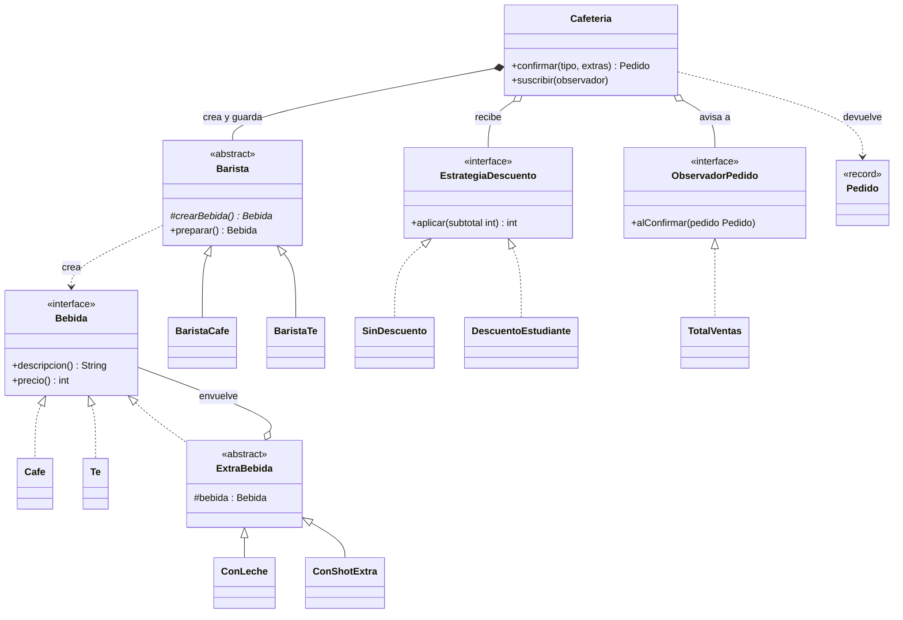
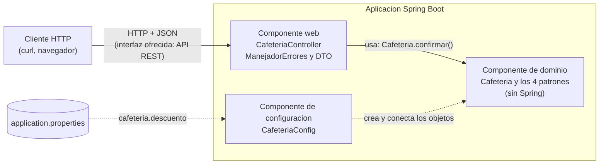

# Proyecto final (Caso A): reservas de espacios de coworking con patrones de diseño y Spring Boot

> **Caso A del curso.**

| | |
|---|---|
| **Curso** | Modelos de Programación |
| **Modalidad** | Grupos de 3 integrantes (máximo 4) |
| **Duración** | 2 semanas |
| **Lenguaje y herramientas** | Java 17 o superior, Maven, Spring Boot (Spring Web), `curl` o Postman |
| **Evaluación** | Nota de 0.0 a 5.0, con la rúbrica de la sección 6 |

---

## 1. De qué se trata

Hasta ahora practicaron los patrones de diseño por separado: creacionales, estructurales y de comportamiento. Ahora el reto es **integrarlos** en un mismo sistema que funcione, como pasa en un equipo de software real: varios patrones colaborando para resolver los casos de uso de un producto, y ese producto expuesto como un **servicio web** para que cualquier cliente (un navegador, una aplicación, `curl`) pueda usarlo.

Seguirán el método de las guías de la cafetería: **primero el dominio, probado en consola; después la capa web con Spring Boot**. La información se guarda **en memoria** (listas y mapas); no hace falta base de datos.

El **tiempo estimado es de 2 semanas**. Pueden y deben usar IA para programar, pero cada integrante tiene que poder explicar y modificar en vivo lo que entregó. La sustentación individual está en la rúbrica.

### El caso: NodoCowork

**NodoCowork** es una empresa (ficticia) que alquila espacios de trabajo por horas o por días: escritorios compartidos, salas de reuniones y un auditorio. Quiere un servicio web para gestionar las reservas: consultar espacios, reservar con servicios adicionales, aplicar la tarifa que corresponda, confirmar o cancelar, cobrar con una pasarela de pago externa y avisar a quien deba enterarse.

> El caso lo asigna el docente y no se cambia. Si tu grupo prefiere **otro caso propio** (una clínica con citas, una biblioteca con préstamos, un gimnasio con clases...), puede proponerlo por escrito al docente antes de empezar. El caso alternativo debe permitir resolver, con problemas reales y no forzados, los mismos requisitos de patrones de la sección 3.

| Término | Significado |
|---|---|
| **Espacio** | Algo que se puede reservar: escritorio, sala de reuniones, auditorio (cada tipo tiene capacidad y reglas propias) |
| **Reserva** | Un espacio, en una fecha y franja horaria, para una persona o equipo, con servicios adicionales opcionales |
| **Servicios adicionales** | Proyector, café, grabación, técnico de apoyo... (cada uno suma al precio y se puede combinar) |
| **Tarifa** | La forma de cobrar: por hora, por día, membresía mensual, promoción... |
| **Miembro** | Cliente con membresía (tiene condiciones distintas al cliente ocasional) |

---

## 2. Qué debe hacer el sistema

### 2.1 Funcionalidades mínimas (todas obligatorias)

Estas seis son **lo que el sistema debe hacer**. Las seis son **obligatorias**: al final, todas deben funcionar.

| # | Funcionalidad | Ruta sugerida |
|---|---|---|
| F1 | Listar los espacios y consultar si uno está disponible en una franja | `GET /api/espacios` |
| F2 | Crear una reserva (con espacio, franja, servicios adicionales y tipo de cliente), calculando el precio con la tarifa que aplique | `POST /api/reservas` |
| F3 | Consultar una reserva | `GET /api/reservas/{id}` |
| F4 | Confirmar y cancelar una reserva (solo se permiten ciertas transiciones de estado) | `POST /api/reservas/{id}/confirmar`, `POST /api/reservas/{id}/cancelar` |
| F5 | Pagar una reserva usando una pasarela de pago externa (simulada) | `POST /api/reservas/{id}/pago` |
| F6 | Consultar un resumen (cantidad de reservas, ingresos...) alimentado por los avisos del sistema | `GET /api/resumen` |

Las rutas son **sugeridas**: pueden mejorarlas si lo justifican, siempre que sigan las convenciones REST de la guía de fundamentos web.

### 2.2 Reglas de negocio que debes respetar

- Una reserva no puede superar la **capacidad** del espacio ni solaparse con otra del mismo espacio.
- Solo se reserva dentro del **horario** de atención (defínelo tú y documéntalo).
- Una reserva **cancelada** o **finalizada** no puede confirmarse ni pagarse.
- Los errores del cliente se devuelven con el código HTTP correcto (400, 404, 409...) y un JSON `{"error": "..."}`.
- Al cargar la aplicación debe haber **datos de ejemplo** (al menos 4 espacios de 3 tipos distintos), creados en la clase de configuración, no dentro del dominio.

---

## 3. Los patrones: el corazón del proyecto

### 3.1 Qué se exige

Debes aplicar **al menos 6 patrones distintos**, con **al menos 2 creacionales, 2 estructurales y 2 de comportamiento**, resolviendo problemas reales del sistema. **Un patrón sin un problema que lo justifique no suma puntos** (y puede restar).

Las reglas del juego, que ya conoces:

1. Los patrones se **implementan a mano** en el paquete `dominio`. Spring no los reemplaza: usar `@Service` o `@Autowired` no cuenta como un patrón.
2. El paquete `dominio` **no importa nada de Spring**.
3. Para cada patrón debes poder decir **qué problema del sistema resuelve y qué pasaría sin él**.

### 3.2 Banco de problemas

Las funcionalidades de la sección 2 son **lo que el sistema hace**. Los problemas de este banco son **las dificultades de diseño que aparecen al construirlas**, y cada patrón es la forma de resolver una de ellas. **No son funcionalidades nuevas**: son decisiones de diseño dentro de las funcionalidades que ya tienes que hacer.

**¿Qué es obligatorio y qué no?**

| Qué | ¿Es obligatorio? |
|---|---|
| Las seis funcionalidades F1 a F6 (sección 2.1) | **Sí, todas** |
| Resolver con patrones **al menos 6** problemas del banco, con el reparto 2 creacionales + 2 estructurales + 2 de comportamiento | **Sí, es el mínimo** |
| Los demás problemas del banco | **No.** Eligen los que quieran; pueden resolver más de 6 si cada patrón está bien justificado |
| Los problemas marcados con **(extra)** | **No.** Solo si los eligen: implican agregar una pequeña funcionalidad que el grupo define (por ejemplo, un endpoint de reportes) |
| Un patrón que no esté en el banco | Permitido, si justifican el problema que resuelve |
| La persistencia en base de datos | Bonus (sección 6) |

Cada fila indica **en qué funcionalidad aparece** el problema. **Los patrones candidatos son una pista, no una orden.**

| # | Problema del sistema | Aparece en | Patrón(es) candidato(s) | Categoría |
|---|---|---|---|---|
| P1 | Una reserva tiene muchos datos y varios son opcionales (espacio, franja, asistentes, servicios, notas) | F2 | Builder | Creacional |
| P2 | Cada tipo de espacio (escritorio, sala, auditorio) tiene reglas y tarifa base propias, y se agregarán más tipos | F1, F2 | Factory Method / Abstract Factory | Creacional |
| P3 | Hay parámetros de toda la aplicación (consecutivo de reservas, horario) que deben ser únicos | F2 | Singleton (cuidado: justifica por qué es necesario) | Creacional |
| P4 | Los servicios adicionales se combinan libremente y cada uno cambia precio y descripción | F2 | Decorator | Estructural |
| P5 | El cobro lo hace una pasarela externa cuyo formato de datos no coincide con el nuestro | F5 | Adapter | Estructural |
| P6 | El cliente de la API no debe conocer disponibilidad, tarifa, validación, pago ni avisos | F2 a F5 | Facade | Estructural |
| P7 | Consultar la disponibilidad a un calendario externo es lento y se repite | F1 | Proxy (caché) | Estructural |
| P8 (extra) | Existen paquetes ("piso completo" = sala + 10 escritorios) que pueden contener otros paquetes | Reservar un paquete | Composite | Estructural |
| P9 | La tarifa se cobra distinto según el caso (por hora, por día, membresía, promoción) y debe poder cambiarse | F2 | Strategy | Comportamiento |
| P10 | Antes de crear una reserva hay varias validaciones (horario, aforo, disponibilidad, membresía) que pueden variar | F2 | Chain of Responsibility | Comportamiento |
| P11 | La reserva pasa por estados (pendiente, confirmada, cancelada, finalizada) con transiciones permitidas distintas | F4, F5 | State | Comportamiento |
| P12 | Varias partes deben enterarse cuando una reserva cambia (resumen, administrador, correo simulado) | F4, F5, F6 | Observer | Comportamiento |
| P13 (extra) | Los reportes comparten estructura (encabezado, filas, totales) pero cambian el contenido | Un endpoint de reportes | Template Method | Comportamiento |
| P14 (extra) | Se quiere poder deshacer la última cancelación | Un endpoint para deshacer | Command / Memento | Comportamiento |

Como ves, sin salirte de F1 a F6 ya tienes **once problemas** (P1 a P7, P9 a P12) con patrones candidatos de las tres categorías: más que suficiente para el mínimo de 6.

### 3.3 Qué es "bien hecho"

- Cada patrón **colabora** con los demás en un caso de uso real (por ejemplo, F2 pasa por la fábrica, el builder, los decoradores, la estrategia y la cadena de validación).
- No hay `if` que decidan *cómo se calcula o se crea algo* repartidos por el código: esa variación vive en las clases del patrón.
- Los diagramas de clases **coinciden con el código**: si una clase crea a otra con `new` y la guarda, es composición; si la recibe por el constructor, es agregación.

---

## 4. Cómo trabajar: el método de las guías

Sigan el mismo orden de la guía "De la consola a Spring Boot":

1. **Diseñar** el dominio: elegir problemas del banco, asignar patrones, dibujar el diagrama de clases.
2. **Construir el dominio y probarlo en consola** con un `App.java` que reproduzca los escenarios (reserva exitosa, error de validación, transiciones de estado...).
3. **Revisar el código buscando antipatrones** (God Object, código duplicado, acoplamiento) y violaciones de SOLID, y corregir.
4. **Pasar a Spring Boot**: configuración, DTO, controlador, manejador de errores. **El dominio no se reescribe.**
5. **Probar cada ruta** con `curl` o Postman, incluidos los casos de error.
6. **Documentar** y preparar la sustentación.

### Estructura del proyecto (obligatoria)

```
nodocowork/
|-- README.md
|-- pruebas.http  (o una carpeta pruebas/ con los curl)
`-- src/main/java/.../
    |-- NodocoworkApplication.java
    |-- dominio/      Java puro, SIN Spring: patrones y reglas de negocio
    |-- config/       Ensamblaje y datos de ejemplo (@Configuration)
    `-- web/          Controladores, DTO y manejador de errores
```

---

## 5. Entrega

**Todo se entrega al final de la semana 2**, como un **repositorio del grupo** (GitHub, GitLab u otro) cuyo enlace se envía al profesor. El repositorio debe contener:

- El **proyecto completo** (código y pruebas), sin `target/` ni `.idea/` (usen un `.gitignore`).
- El **`README.md`** en la raíz, con el contenido descrito abajo.
- Los **diagramas** (de clases y de componentes), dentro del README o en una carpeta `docs/`. Un diagrama que no coincide con el código cuenta como error.

Todos los integrantes deben tener commits propios en el repositorio. Después de la entrega viene la **sustentación** (ver sección 7), que es individual.

### Contenido del README

1. Descripción del caso y cómo ejecutar el proyecto (versión de Java, comando).
2. **Tabla de patrones**: problema, patrón, clases que lo implementan, archivo(s) donde está.
3. **Tabla de rutas**: método, ruta, códigos de respuesta posibles.
4. **Diagrama de clases del dominio** (Mermaid), con las relaciones coherentes con el código (ver el ejemplo en el Anexo).
5. **Diagrama de componentes** (Mermaid; ver el ejemplo en el Anexo): identifiquen los componentes del sistema (por ejemplo, dominio, configuración, web y la pasarela externa), qué interfaz ofrece cada uno y cuál necesita de los demás.
6. Reglas de negocio y decisiones de diseño (horario, capacidad...).
7. Una tabla con lo que aportó cada integrante.
8. Reflexión (máximo una página): ¿qué patrón fue el más útil y cuál el más difícil?, ¿qué harían distinto?

---

## 6. Evaluación

Cada criterio se califica de 0.0 a 5.0 y se multiplica por su peso. La nota final es la suma.

| Criterio | Peso | Excelente (4.5 a 5.0) | Bueno (3.5 a 4.4) | Aceptable (3.0 a 3.4) | Insuficiente (0.0 a 2.9) |
| --- | --- | --- | --- | --- | --- |
| Patrones en el dominio | 40% | Al menos 6 patrones con el reparto exigido (2 creacionales, 2 estructurales, 2 de comportamiento); implementación correcta; cada uno resuelve un problema real y justificado; los patrones colaboran en los casos de uso | Reparto cumplido, pero con algún patrón forzado, justificación débil o poca colaboración entre ellos | Reparto incompleto (por ejemplo, falta una categoría) o patrones que funcionan pero cada uno por su lado | Menos de 4 patrones, patrones mal aplicados, o reemplazados por anotaciones de Spring |
| Arquitectura y Spring | 15% | Dominio sin ningún `import` de Spring; configuración separada; controladores delgados; DTO; manejador de errores; código comentado | Estructura correcta con alguna fuga (por ejemplo, lógica de negocio en un controlador) | Capas mezcladas, pero la aplicación funciona | El dominio depende de Spring o todo está en un solo controlador |
| Funcionamiento de la API | 15% | Las seis funcionalidades, códigos HTTP correctos, reglas de negocio respetadas y casos de error probados con evidencia | Cinco funcionalidades, o las seis con fallas menores | Tres o cuatro funcionalidades, o códigos HTTP incorrectos | Menos de tres funcionalidades o la aplicación no arranca |
| Diagramas y documentación | 10% | Diagrama de clases coherente con el código (composición y agregación bien usadas), diagrama de componentes, tablas de patrones y rutas, README claro | Todo presente, con detalles menores pendientes | Diagramas incompletos o desactualizados respecto al código | Diagramas o README ausentes, o que no corresponden al proyecto |
| Sustentación individual | 20% | Cada integrante explica y modifica en vivo lo que entregó (el cambio en vivo se resuelve agregando una clase y una línea de configuración) y responde con seguridad incluso fuera de lo preparado | La mayoría explica con seguridad; respuestas correctas pero básicas; el cambio en vivo sale con ayuda | Participación desigual; dependen de una sola persona | No pueden explicar lo que entregaron |

### Bonus y ajustes

- **Persistencia (bonus):** conectar una base de datos (por ejemplo, H2 o PostgreSQL) **sin que el dominio importe Spring ni JPA**: el dominio define una interfaz de repositorio y la implementación con base de datos vive fuera de él. Suma hasta 0.5 sobre la nota final, sin pasar de 5.0.
- **Ajuste individual:** si un integrante no participó o no puede explicar lo que entregó, su nota individual puede ajustarse según la sustentación y el historial de commits del repositorio.
- **Uso de IA:** está permitido y esperado, pero cada integrante responde por cada línea de lo que entrega.

---

## 7. La sustentación

**Duración:** 15 minutos por grupo.

1. **Demostración (4 min).** Arrancan el servicio y ejecutan en vivo 4 o 5 peticiones: una reserva exitosa con servicios adicionales, un error de validación, una transición de estado, el pago y el resumen.
2. **Preguntas individuales (6 min).** El docente elige a quién preguntar y qué clase abrir. Ejemplos: "¿Por qué este patrón y no otro?", "¿Qué pasaría si quitamos esta clase?", "¿Esta relación del diagrama es composición o agregación? ¿Por qué?"
3. **Cambio en vivo (5 min).** El docente pide una modificación pequeña (por ejemplo, "agreguen una tarifa con descuento del 20 % para estudiantes" o "agreguen el servicio adicional 'impresión'"). Un buen diseño con patrones debe permitirlo **agregando una clase y una línea de configuración**, sin editar la lógica existente.

---

## 8. Consejos

- **Empiecen por los patrones, no por Spring.** La web es la última capa, y la más fácil si el dominio está bien.
- **Un patrón por problema.** Es preferible 6 patrones bien justificados que 10 puestos de adorno.
- **Prueben todo en consola antes de pasar a la web.** Si falla en consola, no habrá `curl` que lo arregle.
- **Repartan el trabajo, pero todos entiendan todo.** El día de la sustentación puede tocarle a cualquiera explicar cualquier parte.

---

## Anexo. Ejemplo de diagramas

Este ejemplo usa la **cafetería** de las guías 21 y 22, que no es ninguno de los dos casos del curso, para que sirva de modelo sin darles la solución. Ustedes deben hacer lo mismo con las clases de su proyecto. Mermaid se dibuja directamente en GitHub y GitLab: basta con escribir el bloque de código con la etiqueta `mermaid` dentro del README. También se aceptan diagramas hechos en draw.io o similares, exportados como imagen y subidos al repositorio.

### A. Diagrama de clases



**Cómo leerlo (y cómo decidir la flecha):**

| Símbolo | Nombre | Se usa cuando... | Ejemplo del diagrama |
|---|---|---|---|
| `<\|--` | Herencia | una clase extiende a otra | `ConLeche` extiende `ExtraBebida` |
| `<\|..` | Realización | una clase implementa una interfaz | `Cafe` implementa `Bebida` |
| `*--` | Composición | la clase **crea** el objeto y lo guarda | `Cafeteria` crea sus `Barista` |
| `o--` | Agregación | la clase **recibe** el objeto por el constructor | `Cafeteria` recibe la `EstrategiaDescuento` |
| `..>` | Dependencia | la clase solo lo usa o lo devuelve | `Barista` crea `Bebida` en un método |

Fíjense que cada patrón se reconoce en el dibujo: Factory Method (`Barista` y sus hijos), Decorator (`ExtraBebida` que envuelve una `Bebida`), Strategy (`EstrategiaDescuento`) y Observer (`ObservadorPedido`).

### B. Diagrama de componentes



Aquí se ve la regla de arquitectura del proyecto: el **dominio no depende de Spring**; la configuración lo ensambla y la capa web solo lo usa. Cada flecha dice qué interfaz se ofrece o se necesita.

### Lista de chequeo de sus diagramas

- Cada clase del diagrama existe en el código, con el mismo nombre.
- Cada patrón de su tabla del README se reconoce en el diagrama de clases.
- Las flechas de composición y agregación corresponden a quién crea el objeto.
- El diagrama de componentes muestra al menos web, dominio, configuración y la pasarela externa.

---

*Modelos de Programación*
